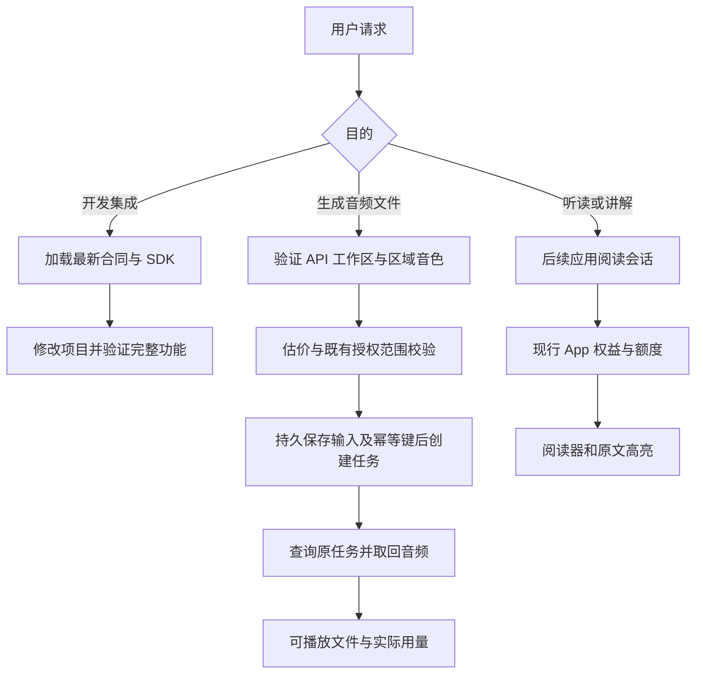

# CastReader Codex 插件：API 与应用服务接入方案

日期：2026-09-15。状态：可实施的产品与技术方案；本轮未创建、安装或发布插件，未修改 API、会员、计费或客户端。

## 1. 产品决定

建议使用一个稳定的插件身份 `castreader`，按用户目的提供三个工作流：

| 用户目的 | 示例 | 插件交付 | 服务与权益 |
| --- | --- | --- | --- |
| 开发语音应用 | 给学习卡片应用接入 CastReader TTS | 可运行的后端调用、播放界面、恢复与成本处理 | Voice API；实测生成使用 API 工作区 |
| 生成音频作品 | 把这段介绍生成 MP3，保存在项目里 | 音频文件、生成参数和实际用量 | Voice API 钱包/试用 |
| 听读与理解内容 | 读这份报告；讲解并标记原文 | 阅读会话、播放器、可继续打开的入口 | 应用服务；现行 App 权益与额度 |

公开展示名称首期可用 **CastReader — Voice API**。应用工具交付后扩展描述为 **CastReader — Voice & Reading**，保持底层插件 ID 不变。前两个场景先交付；未实现的第三类能力暂不放进可调用工具和商店功能承诺。

理由：ElevenLabs 已验证“开发接入说明 + 直接生成工具”的组织方式，Speechify 提供听读入口，Readwise 提供个人阅读资料连接。CastReader 有两条服务线，可以共用品牌、安装和意图识别，同时保持具体权限和账本清楚。

这会调整上一轮建议的顺序：基于 Voice API 的现状，先做开发者与创作者入口，应用听读单独补齐服务合同后接入。

## 2. 本轮确认了什么

### 2.1 Voice API 已具备的资产

已通过公开 HTTPS 读取首页、机器事实、OpenAPI、AI 编程接入页，并检查对应源码。

| 资产 | 当前用途 |
| --- | --- |
| [AI 编程接入页](https://voice.castreader.com/integrations/ai-coding) | 需求适配、可复制提示词、接入与验收指引 |
| [integration-manifest.json](https://voice.castreader.com/integration-manifest.json) | 当前部署的能力、价格、开通和资源链接 |
| [OpenAPI](https://voice.castreader.com/openapi.json) | 参数、返回结构和错误合同 |
| [llms-full.txt](https://voice.castreader.com/llms-full.txt) | 完整开发上下文 |
| [connection-check.mjs](https://voice.castreader.com/examples/connection-check.mjs) | 连接、区域、音色和费用检查 |
| [运行示例](https://voice.castreader.com/examples/flashcards/starter.zip) | 已有卡片音频生成和恢复实现 |
| [公开验收报告](https://voice.castreader.com/reports/api-verification) | 有日期的实际输出与限制说明 |

因此，首版插件不必先建设一套新的开发文档系统。应把这些资产变成自动加载、可执行、可验证的工作流。

### 2.2 影响插件实现的当前约束

以下为 2026-09-15 在线 manifest 快照，运行时应重新读取，不能长期写死：

- 开通为 self-service；验证账号可激活现有试用，无人工审批。
- 试用为 3,000 字符、30 天，有每日限制；公开价为 $8 / 百万规范化 Unicode 码点。
- 队列 `POST /v1/jobs` 单次最多 500 字符；即时短请求为 120 字符。
- 工作区生成并发为 1，队列任务期限 600 秒。
- 输出 MP3/WAV；当前 streaming=false、realtime=false。
- 普通语音配置支持十种语言；时间戳仅英语，可能返回不可用。
- 结果保留 24 小时；下载返回二进制音频，并非永久公开 URL。
- API key、钱包、使用量、工作区音色与阅读应用权益分开；App Pro 不包含 API 用量。
- Node/Python SDK 为官网直接下载，目前未发布到 npm/PyPI。
- Voice API 不是 OpenAI TTS 的无修改兼容替代品。

来源：[机器事实](https://voice.castreader.com/integration-manifest.json)、[完整开发上下文](https://voice.castreader.com/llms-full.txt)、[OpenAPI](https://voice.castreader.com/openapi.json)。OpenAPI 中出现的端点不代表当前生产开关已经启用，流式与实时能力就是例子。

### 2.3 应用服务与插件之间的实际缺口

现有客户端与后端有朗读、QuickRead、会员和文档相关模块，可复用业务能力。但本轮未找到已交付的通用插件阅读会话合同、公开插件 OAuth 连接或完整的远程文库/进度同步证明。

[本地统一进度方案](/Users/xuxuheng/Documents/CastReader/docs/Unified-Listening-Progress-System-2026-09-09.md)明确把本机续播与后续跨设备同步分开。因此“保存到手机并从同一句继续”需要单独实现和验收，不能因 App 已有本机恢复就直接宣传。

当前账号的插件目录查询 `CastReader` 未返回条目。发现相邻旧代码有 `/mcp` 营销页，但线上 `https://castreader.com/mcp` 本次返回 404，其链接的公开仓库也未构成新版 Voice API 插件实现证据。不能照搬旧页面中的免费、无密钥和旧模型承诺。

## 3. 首版如何做

### 第一步：Skill + 可执行客户端，先完成 Codex 本地交付

首版可以不依赖新建托管 MCP。Codex 已能执行脚本，使用现有 API key；两项 skill 加一个小型客户端即可覆盖开发接入与短音频生成。发布安装包与示例时，所有依赖必须使用已存在的下载地址和已验证版本。

建议首版 skill：

#### `build-voice-app`

触发：用户要求把 CastReader Voice API 接入自己的项目，或在选型中明确选中 CastReader。

流程：读取最新公开合同 → 判断语言、长度、实时性是否适合 → 集成服务端凭据和持久任务 → 完成播放、恢复及用量展示 → 用真实状态区分静态验证和线上合成。

未配置 API key 时仍可完成代码和本地样本验证。实际生成使用当前用户配置的凭据和已授权用量；不读取或借用产品 Owner 的凭据。

#### `generate-audio`

触发：用户明确要生成配音、学习卡片音频、短提示音频或导出 MP3/WAV。

流程：确认输入与输出语言 → 列出可用音色 → 估价 → 按已授权范围创建任务 → 保存任务 → 取回音频 → 返回可播放、可下载的文件。

“重放已有音频”只读取保存的结果。较长输入需要明确采用多任务切分与合并；单项预算和完整批次预算都必须可核对。首版可先限制为单任务，后续基于既有卡片示例扩展批次，不必第一天支持整本书。

### 第二步：同一核心客户端接托管 MCP

当上述流程稳定，把同一套调用和恢复逻辑包装为 MCP 工具，并补充 OAuth。这样 Codex 和 ChatGPT 可以通过账号连接使用，用户不必手工配置 API key。

CLI 和 MCP 应共用逻辑，避免出现两套音色解析、重试策略或计费理解。读公开文档的 skill 无需等待 OAuth 完成才能验证。

### 第三步：加入应用听读

后端正式提供应用阅读会话和对外授权后，再增加 `read-and-explain` skill、阅读 UI 与应用入口。消费者请求使用应用权益，不暗中转成开发者钱包付费任务。

阶段之间以用户流程通过验收为条件，不以 manifest 文件存在或网页发布为完成。

## 4. 建议的代码与工具组织

以下目录为设计，尚未创建：

```text
castreader/
├── plugin.json
├── .codex-plugin/plugin.json       # 需要兼容时保留
├── skills/
│   ├── build-voice-app/SKILL.md
│   ├── generate-audio/SKILL.md
│   └── read-and-explain/SKILL.md    # 应用能力完成后加入发布包
├── client/                        # API 访问、幂等、状态、音频文件
├── scripts/                       # CLI 入口与连接检查
├── references/                    # 精简稳定说明与官方资源地址
└── assets/
```

远程服务接通后加入实际 MCP 配置，不能先放一个不存在的 MCP 地址。SDK 不在公共包仓库时，也不能给出猜测的 `npm install` / `pip install` 命令。

### API 方向的 MCP 工具

下列工具名为建议；底层 HTTP 路径来自现有合同。

| 建议工具 | 复用能力 | 交付要点 |
| --- | --- | --- |
| `voice_get_capabilities` | 公开 manifest、区域 `/v1/models` | 区分已配置能力与当前可用/已授权能力 |
| `voice_list_voices` | `/v1/voices`，可辅以公共目录浏览 | 返回真实、已授权、区域正确的音色 ID |
| `voice_estimate_audio` | `POST /v1/usage/estimate` | 字符、试用、预估金额；估算不是余额预留 |
| `voice_create_audio` | `POST /v1/jobs` | 持久化幂等键、输入和任务 ID；返回任务状态 |
| `voice_get_audio_job` | `GET /v1/jobs/{id}` | 查询原任务，不再创建生成 |
| `voice_get_audio_result` | `/v1/jobs/{id}/audio` 与请求时间戳 | 音频文件、保留时间、实际用量；可重放 |

只有用户要创建私人音色时，才加入创建声音工作流，并按现有声音授权合同收集所需信息。首版优先使用已有 ready 声音，避免普通听读请求被带进声音创建流程。

公共 `catalog_id`、界面名称和 REST `voice_id` 是不同身份。当前目录选择/准备流程主要在 Console 业务中，公开 OpenAPI 未列出完整的 catalog select 合同。若要支持“从全库任选一个后自动生成”，需把该流程正式封装为授权工具并验证；首版可使用已经准备好的工作区音色。

工具 annotations 必须按实际副作用设置。例如现有连接检查明确说明，音色列表可能初始化工作区默认引用；不能仅因请求是 GET 就将包装工具标成绝对只读。

### 应用方向的后续工具

| 建议工具 | 新增合同/适配目标 |
| --- | --- |
| `reader_create_session` | 指定文本、受支持文件或 URL → 账号下可打开的阅读会话 |
| `reader_get_session` | 阅读状态、来源、能力与可继续打开的入口 |
| `reader_explain_passage` | 讲解音频 + 原文范围/标注；明确讲解与原文的关系 |
| `reader_save_item` | 用户主动保存到自己的文库 |

第三方书库登录态、某台设备上的本地 EPUB、扫描件、普通 URL 和 AI 生成文本不能按同一种输入处理。首批应用接入从用户指定文本和受支持文件开始，书库与跨设备续播另做验证。

## 5. 生成流程必须保持的行为



- `GET /v1/route` 返回的区域和已有资源区域保持一致；远程 MCP 的机房 IP 不等于最终用户的位置。不能在每个调用时任意重选区域。
- 必须从 API 得到有效 ready `voice_id`，不能把 Rowan 或公共目录 ID 直接放进去。
- 显式发送实际文本语言；界面语言和音色参考录音语言不决定合成语言。
- 创建之前保存输入、幂等键和任务记录；网络超时重试保持原 key 与 body。
- 退避查询原任务；failed/expired/cancelled 进入明确结束状态，新生成需符合用户的新请求或既有授权范围。
- 下载校验 HTTP 状态与 Content-Type；JSON 错误不能保存为 MP3。
- SDK 将保留期内的结果下载为用户工作区文件；托管模式提供受控播放/下载访问。不能把需要 Bearer 的音频端点直接交给 HTML audio 标签，不能把密钥拼进 URL。
- API 结果 24 小时保留不等于长期云文库。若要长期托管音频，需增加存储、访问和删除合同。
- 英语对齐不可用时保留可用音频并说明高亮状态；其他语言不伪造词时间戳。App 自己的对齐能力另走应用服务并独立核验。
- 播放暂停、调速、当前时间和高亮刷新由播放器处理，无需 Agent 每个词调用一次工具。

## 6. 账号连接：统一登录，明确两类授权

### 本地首版

开发者在自己的环境配置 `CASTREADER_API_KEY`，脚本只报告连接结果，不在对话或项目源码中输出密钥。可复用现有 connection check 和错误指引。

### 面向公开目录的托管版

实现 MCP OAuth 2.1：资源元数据、授权服务器元数据、PKCE、正确 audience/resource、scope、刷新与撤销。CastReader 当前支持 Google 登录，不等于已经能作为 OAuth 服务向 Codex 发放代理访问令牌。[OpenAI MCP 鉴权文档](https://developers.openai.com/plugins/build/auth)

用户可沿用既有 CastReader 登录，但连接应保存明确的身份、API workspace/project 和区域。应用服务按对应线路的账号边界解析，不能把消费者账号/区域直接等同于 Voice API 的全球控制面。

API 方向可映射现有 `speech:generate`、`voices:read`、`usage:read`，声音创建另需 `voices:write`。应用方向定义自己的 reader scopes，并使用现有会员权威服务判定。

授权页和结果中应能看清：

- 创建音频作品：使用哪个 API 工作区及其试用/钱包。
- 应用听读：使用哪个应用账号及现行权益。
- App Pro 不自动开放 API 调用，API 充值也不自动开放 Pro。

已经明确授权的操作和预算继续执行，不需要每个分段重复询问。未指定目的而两条路径会产生不同费用时，再作一次必要澄清。

## 7. 如何发布和被发现

### 开发者路径先接现有 AI 编程页

在当前 `/integrations/ai-coding` 上增加已验证的 Codex 插件安装入口和三个具体示例：给卡片应用加发音、生成一段配音、恢复未完成的音频任务。安装入口发布前继续保留现有真实状态说明。

先用本地/自有 Git marketplace 验证；发布到公共目录时按 OpenAI 的插件审核流程提交。公共目录同时服务支持的 ChatGPT 与 Codex 界面，自有 marketplace 并不自动带来公共目录曝光。[打包与分发](https://developers.openai.com/plugins/build/plugins)、[提交插件](https://developers.openai.com/plugins/deploy/submission)

### 工具与 skill 描述按任务写

首期描述示例：

> Build with CastReader Voice API and generate short multilingual voiceovers with reusable voices, cost estimates, and recoverable audio jobs.

`build-voice-app` 只在开发语音功能时考虑；`generate-audio` 只在用户要音频产物时考虑。应用版完成后再增加“朗读回答、文档跟读、讲解原文”等消费场景。

名称、说明和参数会影响工具选择，应用正向和负向提示词测试验证，不要求模型在无关任务中强行推荐 CastReader。[元数据指南](https://developers.openai.com/plugins/guides/optimize-metadata)

### 商业观察分开统计

- API：安装/连接 → 首次成功音频 → 同项目复用 → 工作区实际付费使用。
- 应用：创建阅读会话 → 成功播放 → 持续听读/再次打开 → 后续应用使用。
- 同时记录误触发、接错权益、过期结果和重复生成率。

这些是拟验证指标，尚无本次实验数据；不能把插件可搜索等同于推荐或转化成功。

## 8. 首版验收与实施顺序

### 最小验收集

1. 无 API key 时能完成应用代码与公开样本测试，结果标明未做实时生成。
2. 已连接工作区，指定中文文本生成 MP3：使用中文，文件可播放，用量匹配。
3. 用户指定 600 字符：按所选首版策略解释单任务上限，或在授权预算内拆分；不向 500 字符端点直接提交。
4. 提交返回不确定超时：相同输入复用相同 key，恢复同一个 job。
5. 再次播放结果：不创建新任务、不重复扣量。
6. 用户要求实时电话：准确解释当前 API 未开启实时能力。
7. 用户仅有 App Pro：不当作 API 钱包或 API 授权。
8. 用户只要求文字摘要：不启动音频生成。
9. 非英语或不可用的时间戳：不生成假高亮，不将已有音频成功误报为失败。
10. 结果过期、余额不足、无 ready 音色、撤销授权：有可执行恢复路径，不自动绕到其他账号/区域/账本。

前五类可以形成公开提交的正向用例，后续至少三类作为负向用例。真实音频验收应使用授权的测试工作区、记录实际用量，与离线测试分开。

### 工程顺序

1. 单独的插件源目录：manifest、两个 skill、精简参考与可执行客户端。
2. 把现有 SDK/示例的区域、任务恢复、估价和音频保存能力复用为统一客户端。
3. 验证本地 Codex：从用户请求到可用音频或集成代码。
4. 增加远程 MCP 与 OAuth，复用已通过的客户端业务逻辑。
5. 目录资料、安装入口、可复现测试与公开发布。
6. 应用服务建立 reader session 合同后，加入听读、讲解和文库工具；跨设备进度另行验收。

本轮完成的是上述设计及现有能力核对。尚未执行插件开发、生产接入、安装、音频生成或公开提交。
