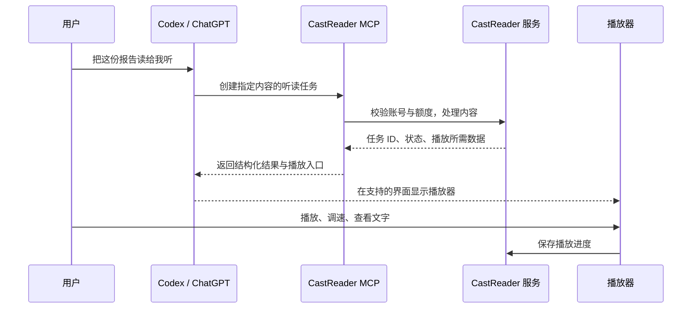

# 语音阅读产品如何进入 Codex：Speechify、ElevenLabs、ElevenReader 与 Readwise

调研日期：2026-09-15。

方法：查询当前账号可见的插件目录，阅读官方仓库、厂商文档及 OpenAI 开发者文档，并对 Speechify 公开 MCP 做未登录的协议初始化和工具清单查询。未安装竞品插件、登录竞品账号或执行付费生成；播放体验、账户权益和转化数据未实测。

## 1. 结论

语音阅读产品已有三种可参考的接入方式：

| 路线 | 案例 | 用户要完成的事 | 对 CastReader 的参考 |
| --- | --- | --- | --- |
| 消费内容 | Speechify 目录插件 | 把 AI 回答、文章、PDF 变成可听、可跟读的内容 | 最接近 CastReader 的朗读定位 |
| 生产内容与开发 | ElevenLabs 官方 Codex 插件 | 生成配音、调用语音能力、构建和管理语音 Agent | 学习插件包装、鉴权和工作流组织 |
| 使用个人阅读资料 | Readwise / Reader | 搜索全文与划线、整理待读队列、利用阅读资料回答问题 | 借鉴文库连接和持续使用场景 |

ElevenReader 阅读器与 ElevenLabs 开发者平台需要分别看。本次没有在当前目录查到 ElevenReader 或 ElevenLabs 条目，但确认 ElevenLabs 官方 GitHub 插件支持通过自有 marketplace 接入 Codex。目录未命中不代表不存在其他渠道或账号可见的集成。

对 CastReader 的建议是优先形成“AI 产出的内容 → 立即听读 → 手机继续”的完整体验，再扩展“讲解与原文定位”。这是基于产品定位的建议，尚无竞品获客或付费数据能证明商业收益。

## 2. 已确认的竞品情况

### 2.1 Speechify：已有面向听读的目录插件

当前插件目录返回 Speechify，状态为可安装、当前未安装。其介绍覆盖 PDF、文章、ChatGPT 回答、音色选择、逐词高亮与速度调整。

Speechify 的官方说明给出的用户路径是：在 ChatGPT 的应用入口安装，然后在对话中输入 `@Speechify` 启用听读。旧文章称入口为 Apps，最新 OpenAI 文档称为 Plugins；具体标签以客户端为准。[Speechify 官方使用说明](https://speechify.com/blog/how-to-use-speechify-voice-typing-dictation-in-chatgpt/)

典型任务示例：

> 用 Speechify 读一下刚才的回答。
>
> 把这篇文章转成可以边听边看文字的内容。

其产品价值是减少复制答案、切换阅读工具和重新导入的步骤。目录与官方文案可以证明产品定位；本次未登录验证 Codex 各客户端中的播放器、同步、限额或付费细节。

#### Speechify 另有开发者 CLI 和公开 MCP

官方 CLI 提供 `speechify say`、音色查询、音频格式与输出文件选项，能返回适合 Agent 解析的 JSON。它还提供 MCP 中继，将请求转发到厂商托管端点。[Speechify 官方 CLI 仓库](https://github.com/Speechify-AI/cli)

本次对该公开端点进行未登录探测：

- 地址：`https://mcp.speechify.ai/mcp`。
- 初始化返回服务名 `speechify-ask`。
- 在同一 MCP 会话中查询 `tools/list`，得到 `ask`、`search` 两个工具。
- 两者都查询公开仓库、API、SDK、示例和产品文档；本次清单没有音频生成工具。

因此，公开文档 MCP、CLI 的语音生成功能、目录中的消费型插件应分别描述。不能由“Speechify 有 MCP”推断该公开端点就是目录插件的播放后端，也不能据未登录清单断言所有授权账号都只有这两个工具。

### 2.2 ElevenLabs：官方 Codex 插件已能检查源码

官方仓库明确支持 Codex、Claude Code 和 Cursor，提供 Codex marketplace 安装说明。[ElevenLabs 官方插件仓库](https://github.com/elevenlabs/plugin)

源码结构说明了各层职责：

| 文件或目录 | 职责 |
| --- | --- |
| `.codex-plugin/plugin.json` | 插件身份、描述、关键词、界面信息与组件路径 |
| `mcp.json` | 托管 MCP 地址和 OAuth 授权配置 |
| `skills/general/` | 使用 API / SDK 开发语音功能的说明 |
| `skills/mcp/` | 指导 Agent 调用已连接的厂商工具 |
| `architect/skills/` | 构建、测试和迭代语音 Agent 的工作流 |

以上来自[实际 manifest](https://github.com/elevenlabs/plugin/blob/main/.codex-plugin/plugin.json)和[MCP 配置](https://github.com/elevenlabs/plugin/blob/main/mcp.json)。

它把两类需求分得很清楚：

- **用户现在需要一个作品**：`creative-studio` skill 指导 Agent 选音色、调用生成工具，并取得结果或后续编辑入口。
- **用户在开发一个产品**：通用 `text-to-speech` skill 指导 Agent 使用 SDK / CLI 把语音功能加入代码。

托管 MCP 路线使用 OAuth；通用 SDK skill 明确需要 ElevenLabs API key。两种鉴权方式不能混写。[Creative Studio skill](https://github.com/elevenlabs/plugin/blob/main/skills/mcp/creative-studio/SKILL.md)、[TTS skill](https://github.com/elevenlabs/plugin/blob/main/skills/general/text-to-speech/SKILL.md)

其官方 Codex 安装命令：

```bash
codex plugin marketplace add elevenlabs/plugin
```

随后在 Codex 的 `/plugins` 中安装，完成所需授权，并在新会话使用。命名调用与自然语言请求都可以成为入口；具体可用工具取决于所连接服务与权限。

### 2.3 ElevenReader：本次未确认独立官方 Codex 插件

ElevenReader 已确认的内容入口包括 Chrome 扩展导入网页或选中文本，再进入其阅读体验。这可以作为“把内容送去听”的产品参考，不能当作 Codex 插件证据。[ElevenReader Chrome 扩展说明](https://help.elevenlabs.io/hc/en-us/articles/41076873230097-How-does-the-ElevenReader-Chrome-extension-work)

官方还明确区分 ElevenReader 与 ElevenLabs 的订阅计划。因此，不能假定 ElevenLabs 插件会访问 ElevenReader 私人文库，或继承 ElevenReader 的听读权益。[ElevenReader 计划说明](https://elevenlabs.io/docs/help-center/product/mobile-apps/eleven-reader/how-do-eleven-reader-hours-work)

### 2.4 Readwise：阅读产品接入 Agent 的另一种完整样本

Readwise 的官方 MCP 页面直接给出 Codex App 与 CLI 安装路径，并列出真实工具，例如搜索文档、读取全文、保存 URL、管理标签和划线。它解决的是“让 AI 使用我积累的阅读资料”。[Readwise 官方 MCP 页面](https://readwise.io/mcp)

例如：找出与某主题有关的既往划线，整理本周保存内容，或从待读文档中挑选适合当前时间阅读的文章。其 CLI 同样面向 Codex 等终端 Agent。[Readwise 工具说明](https://docs.readwise.io/tools)

对 CastReader 的启发是：除了生成音频，还可以让用户在对话中保存听读任务、找到已有内容并继续使用。此处的 CastReader 功能是建议，并非已经实现的集成。

## 3. 技术上怎样做成插件

可以把职责理解为四层：

1. **Plugin：安装包。** 声明身份、展示文案和包含哪些组件。
2. **Skill：操作说明。** 告诉 Agent 什么需求适用、调用顺序、输出要求和边界。
3. **MCP 或 CLI：实际能力。** 完成鉴权、读取资料、创建任务、查询生成结果等操作。
4. **可选 UI：用户操作面板。** 承担播放、音色、速度、文字跟随等连续交互。

Skill 可以独立存在；需要账号、生成服务或持久化数据时，再连接实际后端。OpenAI 的官方文档明确区分了 skill 的工作流指导与 MCP 的实时数据、授权和动作职责。[构建 Skills](https://developers.openai.com/plugins/build/skills)

截至调研日，新版官方打包文档推荐根目录 `plugin.json` 的可移植 Agent Plugins 格式，同时继续支持 `.codex-plugin/plugin.json` 兼容布局。ElevenLabs 使用的是后者。新项目应以实现时的官方规范为准。[插件打包文档](https://developers.openai.com/plugins/build/plugins)

### 一次听读请求的建议实现

以下是 CastReader 的设计建议：



播放器内的播放暂停、进度变化和逐词高亮由客户端处理，后台承担生成、权限和进度持久化。可以复用 CastReader 现有服务与 Web 阅读体验，但需另行核对其是否具备可供外部插件调用的接口。

官方支持通过 MCP Apps 为工具附加 UI；组件在支持的宿主中渲染。工具也应返回可独立使用的结果，给不支持该 UI 的客户端提供播放链接等替代入口，不能承诺所有 Codex 界面都渲染相同播放器。[MCP UI 指南](https://developers.openai.com/plugins/build/chatgpt-ui)

## 4. 如何被用户发现，以及如何被 Agent 调用

这是连续的几个步骤，各自需要验证。

### 4.1 进入可搜索的分发渠道

OpenAI 当前文档说明，公开插件使用 ChatGPT 与 Codex 共享的目录。自有 GitHub marketplace、个人安装和工作区发布另有分发范围；放进自己的 marketplace 不会自动获得公共目录曝光。[插件目录说明](https://developers.openai.com/codex/plugins)、[打包与分发](https://developers.openai.com/plugins/build/plugins)

公共发布路径为：开发者身份验证 → 提交插件资料与工具/skill → 审核 → 开发者发布 → 进入公共目录。当前提交支持仅 skill、仅 MCP 以及两者组合，并要求可复现的正向和负向用例。[提交插件](https://developers.openai.com/plugins/deploy/submission)

### 4.2 用户用品牌或需求搜索

本次实际查询当前目录：

| 查询 | 本次观察 |
| --- | --- |
| `Speechify`（包含在联合品牌查询中） | 返回 Speechify，当前可安装 |
| `ElevenReader` | 未返回条目 |
| `ElevenLabs` | 未返回条目；但其官方自有 marketplace 存在 |
| `read aloud` | Speechify 排在本次返回结果首位 |
| `text to speech` | Speechify 排在本次返回结果首位 |

这证明需求词可以在本次环境召回 Speechify。它不是全平台固定排名、推荐概率或流量规模的证据。

### 4.3 对话中发现与安装

当前会话具备插件目录搜索能力，能根据用户表达的需求查询候选插件。目录检索、安装、授权和真正调用是不同步骤：查得到不代表已经连接，模型不能直接使用未连接的账号能力。

这为“用户只说需要听读，助手帮助找到适用插件”的路径提供了条件，但没有公开证据表明任何特定插件会稳定获得自动推荐。

### 4.4 安装后，Agent 根据描述选择工具

官方文档直接说明：工具名称、描述和参数文档会影响相关需求的召回和误触发；skill 的描述决定模型何时考虑该工作流。[工具元数据优化](https://developers.openai.com/plugins/guides/optimize-metadata)、[Skill 触发条件](https://developers.openai.com/plugins/build/skills)

对 CastReader 的建议是用具体任务描述能力，例如：

> Read uploaded documents, articles, or assistant responses aloud with synchronized text highlighting. Use when the user wants to listen or follow along while reading.

这是建议文案。正式描述只能包含实际支持的输入与功能。应同时写清“只要求文字摘要时不启动音频生成”等边界，避免把普通回答误判成听读任务。

### 4.5 官网与已有用户渠道

Readwise 的官方入口同时提供各客户端安装步骤、场景提示词和工具清单；ElevenLabs 在官方仓库提供 marketplace 和 skills 安装路径。这些是可观察到的分发做法，尚不能由此判断其转化表现。

CastReader 可建立面向 ChatGPT / Codex 的专页，提供真实演示、直接安装入口和三个可复制场景。已有 Web、扩展与移动端用户也可以通过功能介绍找到这一入口。效果需要安装来源与播放数据验证。

## 5. CastReader 建议的首版范围

以下是产品建议，不是已存在的接口声明。

### 第一优先：读给我听

输入用户指定的回答、文本、URL 或受支持文件，创建听读任务，返回播放器或可打开的阅读链接。保留文字跟随、变速和再次打开时继续播放的能力。

### 第二优先：讲解这段，同时保留原文

接入 QuickRead 的讲解音频与原文标注，明确区分朗读原文和讲解原文。此功能能呈现 CastReader 的产品特色，但应在插件中的锚定、播放和渲染实际验证后再宣传。

### 第三优先：在手机继续

让用户保存本次内容到自己的文库，并从其他端继续。账号身份、会员权益和额度应复用现有统一口径；是否支持全部文件类型和恢复字段需要实现前核查。

### 建议的最小工具集合

| 概念工具名 | 用户结果 |
| --- | --- |
| `create_listening_session` | 把指定内容变成可听读任务 |
| `get_listening_session` | 查看状态、获取结果或恢复入口 |
| `save_to_library` | 按用户要求保存到个人文库 |

讲解任务可后续增加。首版工具应围绕完整用户任务设计；TTS 请求、段落切分和时间戳处理可以封装在后端。

### 验证什么才知道值得做

- **发现**：品牌词与需求词能否搜到；测试提示词能否正确选择插件。
- **激活**：从安装到第一次成功播放的完成率和耗时。
- **使用**：首次播放是否持续、是否再次打开、是否在手机继续。
- **质量**：首音等待、失败恢复、逐词同步和长文连续播放。
- **经济性**：实际音频成本、额度消耗、回访及付费变化。

上述是建议指标，本次没有取得任何竞品的安装、使用、留存或收入数据。

## 6. 最值得借鉴的做法

- **Speechify**：把“听 AI 产出的内容”做成清晰可搜索的消费场景。
- **ElevenLabs**：用插件统一包装技能说明和托管工具，并区分直接生成与开发接入。
- **Readwise**：让用户的既有阅读资料在 Agent 中继续产生价值，提供具体客户端入口和提示词。
- **CastReader 的切入点**：让指定内容能立即听读、看见文字跟随，并能在手机上继续；再用原文定位的讲解增强体验。

插件有潜力成为 CastReader 的新使用入口。是否能成为有效获客渠道，应由真实的发现、首次播放和后续使用数据决定。
