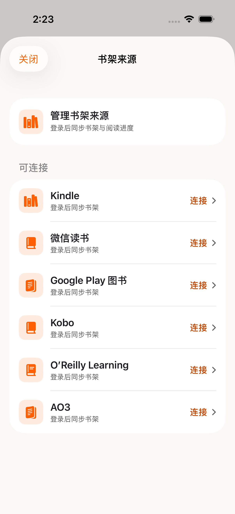

# AO3 iOS 实现与验证记录

日期：2026-09-27。基线：`9eb758b026ec8b7a838df0c332df81cf546de459`（包含 iOS 1.2.46 / 69 源码）。仅 AO3，未实现 Wattpad，未发布。

## 已完成

- 来源页绑定入口、账号隔离的官方登录 WebView、History 分页扫描、首页最近作品、全部作品搜索、重同步与解绑。
- 同一稳定作品 ID 打开统一 Read / Explain；保留 CastReader 当前章节和段落，同步元数据不覆盖收听位置。
- 朗读自然换章、手动翻页取代在途自动翻页、换章期间暂停、重播、末章结束后从头播放。
- 下一章正文与首段语音预加载；解读首块预加载。实际落页后验证内容、账号及设置，才使用缓存。
- 当前章词级高亮、原文解读标注和旧音频清理。

## 执行环境

隔离工作树：`/Users/xuxuheng/.codex/worktrees/ao3-wattpad-library/CastReader`。
专用模拟器：`CastReader-AO3-20260927`，iPhone 17 Pro / iOS 26.5，UDID `70B69701-35A1-475D-B223-1768AA16A666`。
独立 DerivedData：`build/ao3-derived`。未覆盖用户的真机包或其他模拟器。

## 测试结果

| 测试集 | 通过数量 | 结果来源 |
|---|---:|---|
| AO3LibraryTests | 8 | AO3Final6.xcresult |
| AO3WebReaderTests | 13 | AO3Final6.xcresult |
| ProductAnalyticsTests | 25 | AO3Final6.xcresult |
| ReadingResumeTests | 88 | AO3Regression5.xcresult |
| SpeechPipelineTests | 28 | AO3Regression5.xcresult |
| PlaybackSleepTimerTests | 8 | AO3Regression5.xcresult |
| WeReadPageAvailabilityTests | 20 | AO3Regression5.xcresult |
| KoboContractTests | 28 | AO3Regression5.xcresult |

218 个不同 XCTest 方法最近一次结果通过。最终专项轮 46/46，其他相关回归 172/172。此数字不是对真实 AO3 站点的验收结论。

第一轮扩大回归总计 216 个方法，埋点契约测试中两个断言失败：文档白名单缺少 AO3。补齐 `librarySource` / `onboardingSource` 后，完整 ProductAnalyticsTests 25 项复测通过。保留原失败结果 `regression-before-contract-fix.json`，最终结果 `final-unit-tests.json`。

开发中发现并修复了两个真实播放状态问题：暂停后重播没有恢复播放意图；解读音频刚入队便翻页时没有延续播放。相应回归均通过。

## 模拟器界面检查

全球版来源页与中国区来源页两个 UI 测试均在最近一次执行通过：AO3 与 Kindle 等其他来源并列，全球版还检查 AO3 按钮可点击并保存截图。合计 218 个单元/集成方法 + 2 个 UI 方法通过。

首轮中国区检查被前面播放测试触发的 StoreKit 评分弹窗遮挡；可访问性快照确认是 `Enjoying CastReader?` / `Not Now`。测试辅助函数增加关闭这个已识别弹窗的处理，未选择星级或提交评分；中国区复测通过。保留 `ui-before-review-dismissal.json` 和 `final-china-ui-test.json`。



## 测试方式及覆盖边界

使用实际 WKWebView 执行 AO3 JavaScript 和原生桥，HTML 是参照官方开源模板构造的本地页面。登录身份页 → 两页 History → 提交书架，以及首页作品打开统一播放器，均有集成检查。

音频测试使用可控 TTS / QuickRead 传输与生成的 WAV，播放由实际 AVPlayer 完成，包括自然完成触发自动换章。检查下一章首段只生成一次、手动翻页和暂停竞争、高亮 DOM、解读原文标注、相同正文不串用跨章进度，以及暂停状态下预加载不替换当前章。没有调用真实付费语音或云端解读服务。

`bash scripts/build-voice-toc-integration.sh --check` 通过；`git diff --check` 通过；应用与测试 target 已通过 xcodebuild 编译。AO3 JS bundle 单独重建，其他平台 bundle 未改。

## 未完成的真实站点验收

浏览器工具明确禁止访问 AO3，并结束了该站点操作；没有尝试绕过。用户没有可用 AO3 账号。因此真实邀请注册、登录、私有 History 同步、线上提示/风控、真实语音与解读时延尚未验证。不能将本地 fixture 通过描述为账户绑定和线上全流程已验收。

AO3 要邀请链接创建独立账号；Gmail 可接收邀请邮件，但不是 Google OAuth 授权登录。本次没有申请邀请、创建账号或接受网站条款。

上线前仍须使用真实账号完成上述验收，并协调后端 analytics ingest 对新增 `ao3` 来源值的契约支持；本次只更新本仓库 canonical 契约，未部署服务端。中文/英文新增文案已加入，其他语言尚未补齐。

## 复现

```sh
xcodebuild -workspace CastReader.xcworkspace -scheme CastReader \
  -destination 'platform=iOS Simulator,id=70B69701-35A1-475D-B223-1768AA16A666' \
  -derivedDataPath build/ao3-derived -jobs 4 -parallel-testing-enabled NO \
  -only-testing:CastReaderTests/AO3LibraryTests \
  -only-testing:CastReaderTests/AO3WebReaderTests \
  -only-testing:CastReaderTests/ProductAnalyticsTests test
```

扩大回归另含表格中的 5 个相关测试集。完整 xcresult 留在工作树 `build/`，精简 JSON 随本报告保存。
