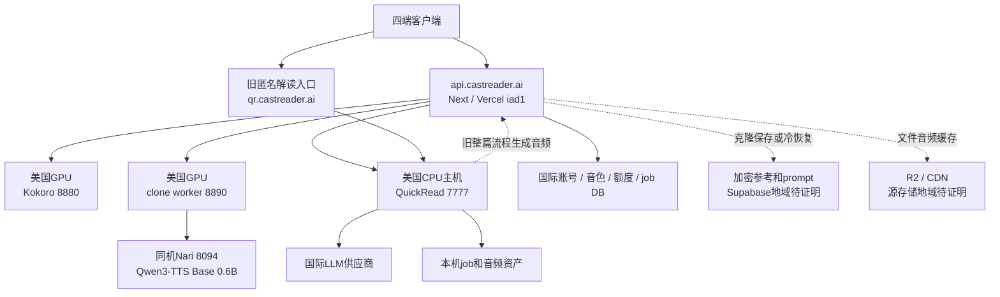
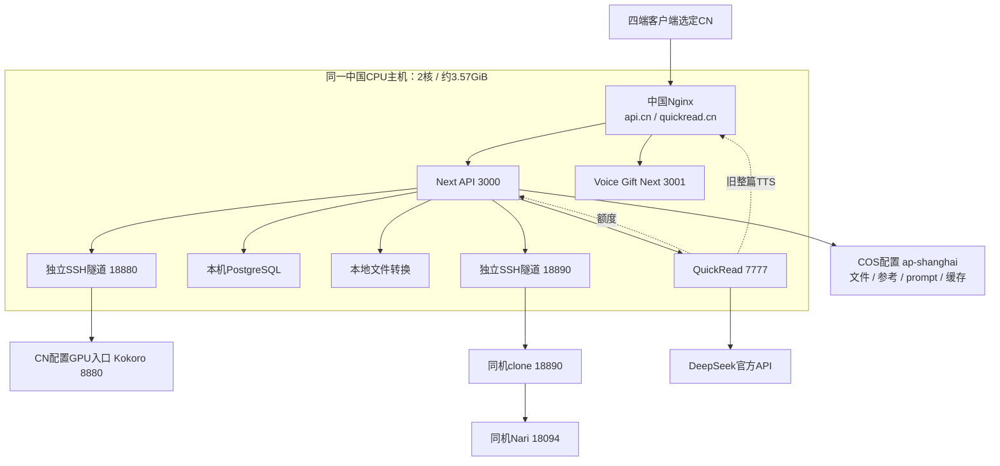
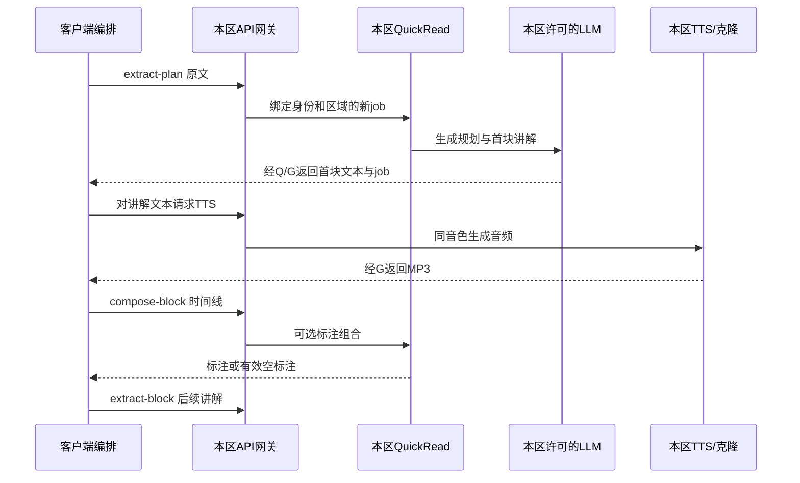
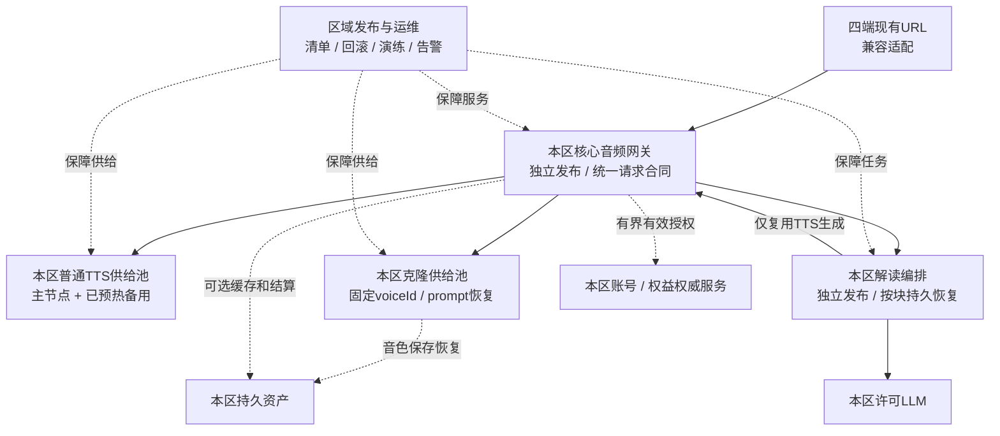

# CastReader 核心音频后端架构与稳定性审计

审计日期：2026-09-05。覆盖中国区和国际区，服务对象为 iOS、Android、Web、扩展的普通朗读、克隆朗读及解读。依据昨天的审计/迭代文档，重新读取当前源码、公开部署身份、服务器运行信息、GitHub/Vercel 发布控制和现有日志。

生产证据集中采集于当日北京时间18:32–18:57；后续时间用于源码对照与文档复核。文中“当前”指这些快照，未持续轮询或在本轮修复故障。

**本轮只做整理：没有修改应用代码、模型、数据库、线上配置或部署，没有主动生成音频、上传录音、创建解读或扣减额度。新增内容仅为本文、分系统审计文档和脱敏取证资料。**

本文有三种性质：**现场事实**指本轮实际读取；**代码风险**指有可到达的实现或配置依赖，但不代表已经造成某次用户事故；**建议方案**指未来应做、尚未执行。昨天的部署成功与测试通过属于历史验证，不能代替今天的可用性。

## 1. 核心判断

当前问题不能简单归为“模型慢”或“服务器配置低”。根本脆弱点是：**用户连续播放要依赖多套生命周期不同的服务，但这些服务缺少统一的供给预算、故障隔离、运行版本约束和端到端验收。**

上一轮修复确实消除了不少误拒：坏时间戳、可选标注、缓存写入、GIF 和 Kokoro 健康检查连带重启克隆等。但是，它们没有把系统变成有同区冗余、能持续恢复、能阻止任意发布覆盖的稳定基础服务。

本次重新核实的重点：

| 问题 | 当前证据 | 结论 |
|---|---|---|
| 国际区仍有朗读失败 | 最新500条5xx样本中，480条为普通TTS的500；最近30条与GPU日志30/30关联，落在英语发音前端及audio-only降级失败 | 存在可定位的实际供给故障；不是所有音色或整个区域均崩溃 |
| 中国区容易共同受影响 | API、QuickRead、PG、文件转换及GPU隧道汇聚同一2核/约3.57GiB主机；区域内未核实有可接流量的第二套服务 | 一个主机故障可同时影响多条核心链路；进程分开不等于故障域分开 |
| 连续播放恢复不完整 | 普通TTS是逐小段HTTP；解读另有客户端分块和服务器整篇两套流程；完成资产持久化不等于执行中的任务可恢复 | 停机/超时/断连后仍可能丢失供给进度或重复工作 |
| 发布隔离不足 | 国际核心API与会员、营销功能同项目；beta未受平台保护；部署环境无保护规则；两区实际解读编排文件未完整纳入发布清单 | 正确脚本已存在，但尚不能约束所有生产变更或从一个提交重建全部线上文件 |
| 监控缺口 | 国际有固定英文合成探针；运行评估器告警未启用；CN未发现TTS定时探针 | 容易出现“health正常、某类正文一直失败、用户先来投诉” |
| 跨境不能只看主模型地址 | 主要正文/音频路由已钉区；仍有跨区身份会话代码、国际图片任意URL抓取；两区供应商物理地域仍有缺证 | 存在待封闭的代码路径，尚不能签署全链路零跨境结论；未证明这些路径今日发生了跨境实流 |

**巩固方向：把复杂性放在服务部署、同区恢复和运维保障上；让一次已获业务授权的播放只等待必要音频，不等待高亮、统计、缓存或非必要检查。**

## 2. 先统一“区域”和“核心服务”的含义

区域约束沿用本任务此前确认的口径：选定中国线路，正文、录音、prompt、模型请求、音频、文件、恢复和缓存不得转到国际线；国际线路不得暗中转入中国线。重试、备用和历史入口同样遵守。

现有产品只有中国/国际两套服务。国际用户访问美国服务可能跨越所在国家边界；“中国与国际两套服务不混用”不等同于“世界上每个用户都在本国处理”。本文不以域名后缀、CDN边缘IP或一次HTTP200证明供应商内部地域。

核心能力分为四种，不能混为一条执行路径：

1. **普通朗读**：原文 → Kokoro → 声音。
2. **克隆朗读**：原文 + 已建好的音色 → clone worker → Nari模型 → 声音。
3. **解读**：原文 → LLM讲解文本 → 上述任一TTS → 声音；标注安排为旁路。
4. **音色准备**：录音/文件片段 → 上传 → 降噪 → 建prompt → 持久化。它为后续克隆合成供给音色，正常播放不应每段重新执行。

## 3. 当前整体结构

### 3.1 国际线路

国际 GPU 是单台 RTX4090 上承载多个进程；Kokoro 和 clone/Nari 不是三台独立服务器。API 弹性扩容不改变 GPU 的实际供给能力。QuickRead 则在另一台 CPU 主机运行。

### 3.2 中国线路

两条 GPU 隧道是独立 systemd 单元，已不再通过 Kokoro 健康检查连带重启 clone。它们仍依赖同一入口主机、同一远端 GPU 基础设施及SSH连接条件。CPU主机故障会同时切断API、解读、DB和两条GPU入口。

这里的CN GPU是配置为CN/bjb1的入口，COS handler固定使用`ap-shanghai`且无endpoint override。它们是较强的区域配置证据；本轮没有取得GPU供应商地域控制面或COS bucket-location/ACL回读，不能把配置标签当成独立物理地域证明。

### 3.3 各组件在哪里、如何被替换

| 组件 | 当前承载/入口 | 发布管理 | 主要故障影响 |
|---|---|---|---|
| 国际API | Vercel iad1；固定域名 | 整个readout-web项目候选/晋升 | 普通/克隆入口、移动解读网关、账号和文件 |
| 中国API | Nginx → Next 3000 | systemd + release目录 + 激活脚本 | 同上，且与本机其他核心服务共享CPU/内存 |
| 国际QuickRead | 美国CPU主机，7777 | PM2 + release软链接 | 解读文本及旧资产，不应成为普通朗读依赖 |
| 中国QuickRead | 中国API同机，7777 | systemd + release软链接 | 解读；同机资源竞争还能间接影响API |
| 两区Kokoro | 每区一台GPU上的8880 | 独立运行目录及切换/恢复脚本 | 对应区域普通音色及用普通音色读出的解读 |
| 两区clone | US GPU 8890 → Nari8094；CN GPU 18890 → Nari18094 | clone进程/模型进程/监管脚本 | 已建音色合成、建声、试听及冷恢复 |
| 数据与资产 | 两区各自DB/对象存储；QR有本机磁盘 | DB迁移、对象版本和备份另行管理 | 鉴权、音色恢复、任务资产，不等同于程序版本回滚 |

完整端口、进程、哈希、部署路径及日志证据分别见[国际网关](/Users/xuxuheng/Documents/CastReader/reports/backend-architecture-review-20260905/global/README.md)、[中国服务](/Users/xuxuheng/Documents/CastReader/reports/backend-architecture-review-20260905/cn/README.md)、[GPU和克隆](/Users/xuxuheng/Documents/CastReader/reports/backend-architecture-review-20260905/worker/README.md)、[解读服务](/Users/xuxuheng/Documents/CastReader/reports/backend-architecture-review-20260905/quickread/README.md)。

## 4. 六条真实执行流程

### 4.1 普通逐段朗读

客户端负责获取当前段、预取后续段和播放队列；后端将每次正文切成兼容小段，送到本区Kokoro，收完整MP3，再返回音频、余文及可选时间戳。客户端再次提交余文并继续入队。

后端普通TTS目前不是“整本书的持久播放会话”。它通常不知道下一页尚未提取、客户端已暂停、播放缓冲剩几秒，或某次超时后客户端是否已放弃。服务端可先保证每个请求完整、快速、同区且可恢复；Kindle翻页后的实际连续性，最终仍需用客户端事件串起整次会话。

### 4.2 已建音色的正常克隆朗读

原文及voiceId → 本区身份 → Pro/音色访问权 → 额度预留 → clone队列 → 同机已准备的Nari prompt → 生成 → 编码 → 可选时间戳 → 返回。实际额度结算在音频返回后执行。

这里没有每段重新录音、上传、降噪或训练。克隆理论模型更慢却显得更流畅，可能来自段长、队列、预取、缓存和请求失败差异；不能仅用模型速度比较体验。

### 4.3 克隆冷恢复

worker内没有该音色 → 本区持久化prompt读取/import → 继续同音色生成；只有prompt确实不存在时，才读取参考音频重新建声。恢复时对象存储、解密、模型准备会重新进入关键路径。

因此“热合成只需几秒”和“重启后的首次克隆请求需要恢复”是不同场景。备用节点若没有预热模型和可用prompt，同样可能来不及接住正在播放的请求。

### 4.4 录音、上传、降噪和建声

本地录音/文件选段 → 本区上传（Global multipart；CN账号隔离STS和配置为ap-shanghai的COS）→ 格式/人声检查 → DeepFilter固定atten24一次 → 构建x-vector prompt → 本机运行缓存与本区加密持久化 → 试听/音色启用。

当前线上不是24/100自适应搜索流程，旧辅助代码与分支名称不能当成运行事实。参考录音不可解码、无可用人声、prompt无效等会使**建声**失败；建声失败与已经正常在读的音色是不同故障域，应该分开排队和告警。

### 4.5 当前分块解读

这条流程中，LLM读原文生成的是讲解文本；TTS读讲解文本。标注不应该成为音频成功条件。顺序图表达服务依赖，是否在客户端等待标注后才入播放队列仍取决于已安装客户端版本，不能以服务器支持降级代替四端实际播放验收。

### 4.6 旧整篇解读和文件缓存朗读

旧整篇接口由QuickRead在服务器执行“抽取/LLM → TTS → 音频合并与本机资产 → preview/下载”；它与客户端逐块解读并存。两者的身份、预算、队列、恢复和输出合同不同，需要独立兼容验收。

GIF搜索/下载/上传已退出这两区线上解读；旧任务返回也移除GIF地址。应继续保持这条边不再参与音频服务，独立离线视频脚本无需被误认为线上必经依赖。

文件朗读缓存未命中时返回新音频，缓存写入为旁路；国际命中时通常返回CDN音频URL，CN返回`api.castreader.cn/api/regional-assets`能力URL，由本区controller读取配置为ap-shanghai的COS。下载仍可能失败，后端不能把“返回了URL”当成“声音已经播放”。

## 5. 哪些状态决定能否继续

| 状态 | 当前保存位置/作用 | 当前恢复边界 |
|---|---|---|
| 播放位置、缓冲、下一页提取 | 主要在客户端 | 普通TTS后端无法独立恢复整本书播放队列 |
| 普通TTS请求 | 单次HTTP和GPU执行上下文 | 未形成全书持久任务；跨层重试可能再次计算 |
| clone排队、正在执行任务 | worker进程内 | 进程死亡不等于在另一节点接续同一任务 |
| 音色身份/访问权/额度 | 本区DB | 必须保持权威；技术查询失败与真实拒绝要分开 |
| prompt和参考音频 | worker本机缓存 + 本区加密对象 | 可恢复音色，不等于自动恢复中断的音频请求 |
| QuickRead公开job绑定 | API数据库、有效期及区域/账号绑定 | 有效续块可续期；数据库不可用仍影响绑定查找 |
| QuickRead已生成内容与资产 | QuickRead本机job/JSON/音频文件 | 重启能恢复已保存成果，不保证执行中的LLM/队列可重放 |
| 上游路由 | 国际DB/进程缓存/环境；CN固定环境 | 上次好配置可缓解配置DB失败，不提供第二台GPU |
| 发布身份 | 多仓库commit、服务release、环境、模型包、备份回执 | 单个commit不能描述全部正在运行的系统 |

“有备份”“保存了job”“复用了request id”分别解决不同问题；不能合并成“系统已经支持不中断容灾”。

持久性还有两项实际缺口：US clone使用的`/workspace`现场不是独立持久volume，不能以进程重启可读推断实例销毁后仍在；CN PG自动备份目前落同机`/var/backups/castreader`，昨天手工COS备份回执不等于每日自动异机备份。两项都需要本区空白节点恢复演练，才能证明灾难恢复能力。

## 6. 超时、重试、排队为什么会让快模型也卡顿

单段到达时间可以拆为：

`鉴权/额度 + 排队 + 冷恢复 + 模型生成 + 编码 + 网络传输 + 可选依赖等待`。

连续播放要求**下一段完整音频到达时，当前可播放缓冲还没有耗尽**。平均模型速度不能掩盖排队尾延迟。2倍速播放会把同一段音频可用于等待下一段的时间减半。

| 层 | 当前可证实的预算或队列 | 需要关注的边界 |
|---|---|---|
| 普通partly网关 | 总28秒；单尝试20秒；默认最多3次 | 路由读取等前置时间不完全属于这个28秒；客户端普通请求等待约30秒 |
| 完整正文网关 | 总90秒；单尝试65秒 | 与客户端小段流式不是同一合同 |
| clone网关 | 合成/恢复共享90秒；最多10次HTTP尝试 | 身份、Pro、音色查找、额度预留在该预算之前；不能写成全请求90秒上限 |
| 当前iOS源码 | 普通请求30秒；克隆75秒；解读90秒；各有resource timeout | 它是源码合同参考，不是用户已安装版本证明；75秒客户端可能先于90秒服务端放弃 |
| QuickRead网关 | 非可选操作上游超时900秒；可选compose约2秒 | 900秒远大于典型客户端等待；不能用扩大网关超时解释为何用户已停止 |
| QuickRead新任务 | US并发1，CN并发3；代码默认等待队列30，CN生产显式设为10 | 新任务容量与续块并非同一全局调度；续块也会争用LLM/CPU资源；US队列配置上限未独立回读 |
| 解读客户端与LLM | 已审计扩展源码fast/续块/plan等待8/20/90秒；国际实际Gemini调用无总超时，CN provider有180秒上限 | 不能推广为四端已安装版本；断连未取消排队/LLM，超时工作仍可能占用国际唯一新任务槽 |
| GPU任务 | 单GPU多进程、各自锁/队列 | 各服务局部认为有容量，不代表整卡及后端总容量安全 |

建议在现有端点上增加**一次业务合成的统一总预算、一个稳定幂等键、按错误类型恢复**，让调用链传递剩余预算。临时网络失败可以有限重试；确定性发音前端失败原样重试不会自愈；业务拒绝按权威结果执行。重试不能产生双倍音频、重复扣量或多份过期GPU工作。

取消、超时和完成必须形成明确合同：已交付段继续播放；尚未交付的同一段保留位置并恢复；用户主动取消应能停止排队工作；服务端收到断连不能无限继续制造无人接收的任务。

## 7. 本次新取得的故障证据

### 7.1 国际普通TTS：特定发音前端路径反复失败

国际最新500条5xx截断样本中，480条普通TTS500集中在北京时间17:34–18:02。最近30条全为 `en / am_adam`、141字符，安全字符统计一致；上游request id已与worker日志逐条关联。

已确认因果链：**英语辅助前端不可用 → audio-only真实发音符号生成仍发现缺口 → 同单元重试一次仍失败 → worker 500 → 网关返回500**。它不是坏时间戳丢弃已生成的声音，而是这个路径最终没有产生完整可交付音频。

worker近24小时记录487条 `request_failed(status=500)` 响应事件，按request id为140个不同上下文。这些数字不能当作487位用户，也不能与Vercel480条截断样本相加。最近30条的跨层对应是严格证据，其余不能逐条推定。

这类问题需要完善同音色语言前端/规范化能力及完整正文覆盖，用回归固定住；既不能只重启进程，也不能吞掉没有发音的正文以制造成功。详见[worker因果证据](/Users/xuxuheng/Documents/CastReader/reports/backend-architecture-review-20260905/worker/us-gateway-worker-correlation.json)。

### 7.2 中国区：当前有成功流量，但故障域过大

CN当前`/var/log/nginx/access.log`在2026-09-04 10:43至09-05 10:43 UTC窗口内记录`/api/captioned_speech_partly` POST 3,869条，其中3,866条200、3条500；不含轮转文件，该范围未见502/503/504/499。QR/部分资产入口关闭access log，因此这不是全平台可用率，也不能把200当成整本听完。

CN GPU自身`playback.jsonl`在09-04 10:52至09-05 10:52 UTC窗口另有9个500响应事件，最后一条为09-05 06:35:23 UTC，错误指纹与US所查类别不同。这是另一执行层、另一采集窗口；网关重试可能吸收上游失败，网关也可能在worker之外失败。未逐条关联前，两层数字不能相加或一一对应，更不能当作用户数。见[CN worker快照](/Users/xuxuheng/Documents/CastReader/reports/backend-architecture-review-20260905/worker/cn-runtime-snapshot.json)。

几个核心systemd单元启动以来 `NRestarts=0`，说明这些单元没有被systemd重复拉起；不能证明模型内部从不出错、隧道端到端始终可用。3条500缺少完整请求关联，暂不能归因为OOM、跨境或昨天的发音前端问题。

### 7.3 当前部署没有丢掉昨天的修复

国际API已经由昨天的 `2d5575b6` 更新为今天的 `3ce12a7c`。Git比较是前者后代，核心播放修复保留，最新维护发布workflow成功。因此“其他分支可以影响核心服务”是已证实的结构风险，**本轮没有证据认定今天的会员发布撤销了播放修复**。

中国API公开版本仍为 `62386e90 / release-20260904120513`。两区模型和QuickRead的实际进程/源码核对结果在各分系统报告中；它们不是跟随Vercel一起自动更新的一套制品。

### 7.4 解读：已有真实技术拒绝，另有可证实的恢复缺口

US解读日志在`2026-09-04T23:11:45.300Z`有一次`extract-plan`错误，分类为`ordered_paragraphs_missing`。代码要求有效段落数组；在全文可用、段落数组缺失或都短于20字符的情况下也会拒绝。本轮未读取当次正文，因此只证明错误类型发生过，不推定当次输入内容或用户是否已经开始播放。

更大的结构风险来自当前实际执行代码：US新计划只允许一个在执行，而Gemini子进程没有整体超时；客户端断连只清心跳，不取消排队和生成；续块又绕过新任务队列。结果可能同时出现“新用户等唯一槽”和“旧任务续块并发不受同一容量上限约束”。这是源码直接推出的风险，本轮没有主动压测或声称已关联到某次真机停播。

首块提前发出时，还可能只落盘一个没有`_streamState`的半成品。若随后plan失败或进程重启，网关的job能力凭证仍存在，worker却无法续块。已保存资产不等于已保存可继续执行的状态。详见[解读报告](/Users/xuxuheng/Documents/CastReader/reports/backend-architecture-review-20260905/quickread/README.md)。

### 7.5 运行来源：部分解读文件不能从当前发布提交重建

两区`server.mjs`哈希与9月4日回执一致，但实际执行的`tools/extract-content.mjs`未列入activation manifest。US为2221行、CN为3280行，SHA分别以`8eba8764`、`199489b2`开头；在本次审计的本地可达Git历史中均没有精确匹配对象。该结论不覆盖未获取的远端或其他仓库。

这意味着运行目录是“各区既有版本加局部补丁”，还不是从一份完整、不可变制品部署。国际缺少新超时逻辑便是具体差异。仅检查一个入口文件或一个commit，会漏掉实际LLM编排。详见[完整来源比对证据](/Users/xuxuheng/Documents/CastReader/reports/backend-architecture-review-20260905/quickread/evidence/source-provenance-20260905.json)。

## 8. 隐藏跨境与绕路：按依赖类型看

| 边 | 当前判断 | 后续证明/治理 |
|---|---|---|
| 中国API → 普通/clone GPU | 固定本机隧道到CN/bjb1入口；无美国故障回退 | 物理地域待供应商证据；持续核验隧道终点，不能只看127.0.0.1 |
| 国际API → 普通/clone GPU | 固定美国地址；clone有私有CA TLS | 恢复节点需独立地域证明；普通TTS当前HTTP链路也应纳入传输治理 |
| 两区QuickRead → TTS/额度 | 当前配置固定本区 | 配置变更和旧整篇路径都纳入发布清单 |
| CN参考/prompt/文档 | COS配置固定ap-shanghai，本区前缀和受保护入口 | bucket实际地域/ACL待独立回读；冷恢复及备份禁止改用国际副本 |
| 国际参考/prompt/缓存 | Supabase、R2/CDN | 实际源区域仍需控制面证明，不能按域名推断 |
| LLM内部处理 | CN固定DeepSeek，Global许可Gemini/Claude | 入口可审计；供应商内部处理地域及备份/留存需合同或控制面证明 |
| CN公开音色目录 | 当前Nginx exact静态alias，本地目录中的URL指向api.cn | Next内部同名route仍带国际Supabase默认；当前公开路径未走它，未来Nginx漂移可重新暴露此元数据依赖 |
| QuickRead跨区compute session | 审计网关源码保留accountRoute与targetRoute不同的显式身份交接能力 | 属身份/会话控制数据路径，非今日跨境实流证明；需在严格同区目标下收敛为本区会话 |
| 国际QuickRead图片水合 | 线上源码用`curl -sL`抓取任意http(s) srcUrl并跟随跳转，缺区域和目的地址约束 | 可能访问中国或私网目标；CN当前关闭vision并跳过水合。未读取实际URL日志，不宣称今天已发生跨境 |
| CN登录凭证验证 | Apple公钥地址、Google验证库仍有国际身份供应商依赖 | 与正文/音频出口分开记录；公钥获取不等于上传正文。严格“任何依赖不跨境”的口径也必须覆盖登录和凭证刷新 |
| 监控、告警、配置、恢复物料 | 与主音频路径不同，须单列 | 仅合成探针文本、运行计数等也应符合区域政策；不能让运维旁路携带用户正文/录音 |
| 客户端遗留入口 | 已安装旧包和内部选区会影响实际入口 | 服务器能保持本区处理；入口版本分布和真机路径仍需独立验证 |

目录/监控跨区和正文/录音跨区的影响不同，都需要透明标注，不能把前者写成已发生用户正文外流，也不能把“没有正文外流证据”写成完全没有任何国际依赖。

要从一次审计提升为保证，区域必须成为发布清单和运行出站策略的一部分：每个出口有归属、目的、协议、数据类型及恢复路径；未确认节点不进入可用池。域名白名单应配合供应商地域证明，不能替代它。

## 9. 仍可能把技术故障传给用户的地方

| 剩余点 | 为什么脆弱 | 应有行为（建议，未实施） |
|---|---|---|
| 发音前端缺口 | 同一输入重复失败、每层继续重试 | 修复完整正文生成能力；确定性错误与暂态错误分开，不造静音成功 |
| clone响应拒绝新增字段 | worker增加无害字段也可能触发503 | 保留音色/音频必要校验，允许向前兼容的可选字段 |
| 身份/Pro/音色记录每段同步读取 | DB抖动仍处在声音之前 | 有效授权在有界期间可验证复用，撤销/所有权保持权威；禁止伪装成额度不足 |
| 克隆600字符与普通分块合同不同 | 通用partly分块不等于自动满足所有模型输入合同 | 统一由后端模型适配器安全分块并保留余文，客户端旧合同也验收 |
| 缓存命中只返回URL | 存储404时后端仍可能统计200 | 同区重建失效资产或可靠回源；不得永远返回坏URL |
| QuickRead保存资产但不保存全部执行状态 | 进程重启后已完成内容可读，执行中任务可能悬空 | 持久记录可重放的阶段/块；继续从未交付部分恢复 |
| 新任务与续块没有整体容量模型 | 每个局部队列合规但总体过载 | 已开始播放和下一段优先；建声/试听/批处理低优先，不靠清空正在播放来降载 |
| 多层超时与取消不一致 | 客户端放弃，后台仍占队列/GPU；或后台先终止 | 同一次合成携带剩余预算、取消状态和结果幂等键 |
| CN watchdog把显存读数失败等同低显存 | 一次nvidia-smi异常即可触发clone/Nari重启，活跃请求受影响 | 区分监控不可读与真实容量危险；只恢复确实故障的服务，不连带中断可用播放 |
| 多个GPU进程各自调度同一卡 | 建声、Kokoro、Nari会争显存/执行资源；registry漂移还可能预加载不可达模型 | 统一资源预算和正在播放的优先级；发布前排除不可达模型包 |

身份、音色所有权、真实额度不足、用户取消、不可解码/空音频有各自必要语义。要修的是基础设施异常误分类、辅助步骤阻塞、不能恢复和没有备用供给，不能通过关闭所有检查来换取“看起来返回200”。

## 10. 为什么其他分支容易影响它

当前至少有四种变更单位：readout-web整站构建、QuickRead运行目录、Kokoro运行包、clone/Nari及监管配置。它们分散在不同仓库/工作树/服务器目录，代码、环境、模型和软链接又可分别变化。

已存在的保护值得保留：明确SHA、干净工作树、继承现网版本、候选验证、同制品晋升、切换前检查基线、自动回滚、备份回读。但仍有以下差距：

- `beta`在GitHub当前显示未保护；Production环境无部署保护或分支规则。文档中“受保护分支”的字样不构成平台强制。
- CODEOWNERS覆盖克隆和部分控制路径，没有覆盖所有普通TTS、QuickRead、监控及新维护发布流程。
- GitHub发布互斥只覆盖使用同一个concurrency group的workflow，不能约束工作站CLI、控制台和独立服务器脚本。
- 最新国际两次发布确实跑过维护workflow，`source:cli`也可能是CI调用CLI，不能把所有CLI来源都描述成绕过流程。
- 营销/会员页面和核心网关共享部署，依赖升级、构建配置、环境、数据库变化都能扩大影响范围。
- 旧“功能激活”workflow仍写入较老TTS release元数据、处理迁移和功能开关，不适合承载所有日常维修发布。
- QuickRead实际`extract-content.mjs`没有被当前manifest完整记录，在已审计Git历史中也没有精确来源对象；GPU另有区域模型清单差异。只看某个工作树HEAD不足以重建实际生产系统。

**需要保护的是完整发布单位和生产写入口，而不只是分支名。**

## 11. 建议收敛后的架构

不建议一上来把现有代码拆成十几套服务。先保留少量清晰单元，把发布和资源边界做实：

这是目标图，**目前未实现供给池或热备，也未拆分Vercel项目**。其中Nari仍是clone内部实现，不需要暴露为另一套客户端协议；四端旧URL可由兼容层保留。

具体边界：

1. **核心音频网关**只处理身份/业务判定、分块、同区模型选择、请求预算和音频结果。营销、SEO、广告和增长页面不随它发布。
2. **模型供给**管理Kokoro及克隆各自的容量、资源、预热和恢复。普通朗读不依赖LLM；克隆热合成不依赖重新建声。
3. **解读编排**管理LLM和块进度，复用同一音频合同；标注失败可为空，完成音频不回滚。
4. **资产与运维**保管可恢复成果、版本清单、统计和告警；其可选工作不能串在实时音频返回前。

核心代码可以暂时仍在同一仓库。先拆发布边界和依赖边界，比先拆仓库、引入集群平台更直接。

原有普通扩展直连QuickRead、移动端经账号网关、旧整篇解读等兼容入口应保留清单和明确使用范围。不能为了架构统一立即删除已发布端点；也不能让旧入口绕过新区域约束、独立制造一套额度或容量政策。

## 12. 一套能执行的稳定性机制

### A. 发布机制

每次生产变更只有一份区域发布清单：`区域、API/QR/worker提交、构建制品哈希、模型包哈希、区域配置版本、数据库兼容版本、当前基线、备用/回滚目标、验证回执`。不保存密钥正文。

常规路径：变更范围识别 → 必要代码审查和区域合同 → 隔离环境生成候选 → 真实音频及长会话验收 → 核对当前生产未变化 → 排空/原子切换 → 回读真实版本 → 观察供给指标 → 归档。任何不满足条件都在**部署前**停止，不能把检查移到用户播放时才拒绝。

正常生产凭据由受控发布入口持有；工作站和功能任务使用候选权限。紧急恢复入口也必须留下操作者、事故、前后版本和验证记录。平台套餐不支持的保护要明确补齐或采用等效受控执行器，不能把普通环境变量当成独立审批证据。

### B. 运行机制

- 同区至少有已验证、已预热且容量足够的替代供给，模型/音色兼容；不跨区避难。
- 已开始会话的下一段优先于新建音色、试听及后台批处理。新流量过多时管理准入和等待，不能把正在听的用户赶出队列。
- 临时失败重试有上限并共享总预算；相同业务键返回已生成结果，避免重复计算/重复扣量/重复播放。
- 完成音频、未交付块及任务阶段分别记录。部署排空不丢在途任务；进程丢失能从未完成阶段恢复。
- `/live`只表示进程存活，`/ready`表示可接任务；模型合成和用户连续播放有独立指标。单次慢健康检查不应重启不相关服务。
- 模型、依赖、音色文件和恢复材料预先放在本区，固定版本和哈希；常规重启不依赖临时跨境下载或最新上游包。

### C. 观察与响应机制

每个业务请求关联 `region、release、model/package、voice类型、session/job、segment、attempt`，日志只保留安全结构、长度、时间和错误指纹；不记录正文、参考录音或凭据。

分别统计鉴权、队列、恢复、生成、编码、回传及播放缓冲事件。把真实业务拒绝与技术失败分开，把高亮缺失与音频失败分开，把客户取消与服务超时分开。一个持续失败的输入应成为一个可跟踪事故，而非几百条无法关联的500。

告警应送给明确责任人并有处理流程，不能依赖用户邮件才发现。记录“何时影响、何时确认、何时恢复、哪些区域/音色受影响”，支持后续向客户准确说明。不能用聚合英文短句健康覆盖所有语种和克隆。

## 13. 建议验收指标和场景

以下为**建议目标与验收定义，尚无足够生产基线可宣称达到**。具体阈值应在同区代表负载下量化，不能直接作为用户播放时的新硬门槛。

| 维度 | 应测什么 | 如何判定 |
|---|---|---|
| 区域 | 主请求、缓存、冷恢复、备用、上传、LLM、监控出口 | 业务载荷没有跨CN/Global；地域证明及配置可追溯 |
| 内容完整 | 一段/一章从首字到末字是否都有对应音频 | 不因规范化/词时间戳差异漏尾、不重复、不换音色 |
| 首音频 | 从用户有效开始到拿到可播放音频 | 分普通/克隆热/克隆冷/解读，记录P50/P95/P99，不混算平均 |
| 供给持续 | 后续音频是否在可播放缓冲耗尽前到达 | 统计因后端供给造成的卡顿次数、时长及整次会话完成 |
| 实时系数 | 生成链路耗时 ÷ 可播放音频时长 | 2倍速需要长期供给比0.5更快并留有尾延迟余量，不能只测单次模型耗时 |
| 技术成功 | 有效且获业务授权的请求是否交付完整音频 | 从分母排除明确额度/身份拒绝与主动取消，保留技术误拒 |
| 恢复 | 同区节点失效、进程重启、部署切换后何时续上 | 同一内容位置、同音色、无重复扣量；记录真实恢复时间 |
| 发布 | 上线制品、配置、模型与清单是否一致 | 其他分支只可产生候选；能一键恢复已验证基线 |
| 可观测 | 一个用户问题能否关联API→QR→GPU→音频 | 聚合错误可区分根因，日志缺失本身可被发现 |

必要场景应形成持续保留的契约套件：两区 × 普通/克隆 × 朗读/解读；热启动和冷恢复；长文章/长书与翻页；1倍和2倍；并发听书与建声；存储/标注/统计失败；同区节点失效；部署排空；明确额度不足。中文、英文及主要多语输入要覆盖数字、缩写、连字符、混合文字及已出现的发音前端问题。

不用每次改一行营销文案都重新压测GPU；通过独立发布边界及依赖影响分析，保证触及核心合同的变更必须跑核心验收，其他变更无法替换核心运行制品。

## 14. 建议实施顺序

| 优先级 | 工作包 | 完成标准 | 是否需要客户端发包 |
|---|---|---|---|
| P0 | 修复本次已关联的Kokoro发音前端失败；消除确定性错误重试放大 | 原失败类别完整出声、尾文无遗漏、同音色；请求链可追踪 | 后端修复可直接生效 |
| P0 | 固定当前两区完整运行清单和解读源码来源，收拢正常生产写入口 | 可从清单重建全部执行文件；候选/现网/回滚可区分；其他任务不能直接覆盖 | 不需要 |
| P0 | 修复解读无界LLM任务、取消失效和段落结构误拒 | 超时工作不长期占槽；有效全文可生成计划；已获首块的任务不会成为永久半成品 | 后端先做，客户端预算与重连合同另行核对 |
| P0 | 补CN主动合成探针、两区真实供给错误告警 | 演练能发现普通/克隆/解读问题并送达责任人 | 后端指标不需要；真实播放缓冲指标可能需要 |
| P1 | 统一音频合同、预算、错误分类、可选字段和缓存失效恢复 | 无辅助字段误拒；同请求不反复占GPU；缓存坏了能本区恢复 | 优先保持旧接口；新增客户端能力单列 |
| P1 | 解读任务持久阶段与续块恢复、队列优先级 | 重启/断连后未完成块可继续，已播放块不重复 | 服务器恢复可先做；跨整书会话能力需兼容评估 |
| P1 | 中国CPU故障隔离、两区同区备用GPU与预热 | 候选测试不争生产显存；单节点失效实测可接管 | 固定公开URL时不需要 |
| P1 | 核心音频网关独立发布、配置和模型清单统一 | 会员/营销部署不能替换音频网关制品 | 保持URL和协议时不需要 |
| P1 | 封闭已发现的跨区身份、任意URL和目录配置漂移路径 | 重试、图片抓取、身份绑定均符合本区合同；不让这些路径成为跨境备用 | 本区会话能力及旧客户端兼容需评估 |
| P2 | 补齐供应商地域证明、出站政策、周期恢复演练和容量基线 | 可审计的全链路区域结论与稳定性目标 | 后端为主 |

地域证明中只要发现实际用户载荷跨境，应立即按P0处理；表中的P2指尚缺证据的长期治理，**不是允许已知跨境继续运行**。

需要新机器、套餐能力或部署单元调整的项目，应在实施时基于实际容量和成本确定，本文不替用户购买资源。稳定性不靠无限重试、无限排队或放宽所有检查；需要可用的同区供给和可恢复状态。

## 15. 本轮结论的边界

- 今日现场与昨天报告的差异已单独记录；没有把昨天的测试数字当成今天持续可用率。
- 本轮没有读取用户正文/录音来解释特定词的发音失败；已证明失败的执行路径，具体语言前端修复仍需下一轮针对性实现与验证。
- 国际Vercel错误查询受500条上限影响；全量metrics查询受套餐限制，无法给出完整成功率或P95。CN统计也仅限明确日志范围。
- 当前存在脚本和备份，但没有完成同区热备/无感接管的演练，不能承诺任何物理故障都零停顿。
- 核心后端更稳定不依赖先发布新iPhone包；真正的翻页、播放缓冲和整书续听验收仍需要相应客户端行为证据。
- 国际Supabase/R2源地域及LLM内部处理地域仍待证明；CN GPU/COS也仅有较强配置证据，缺本次供应商控制面回读。跨区身份代码和图片URL出口亦未封闭，不能宣布全链路完全无跨境。

本次应形成的长期资产，是**一份当前真实架构、一套唯一发布与回滚机制、一组持续播放合同和一套有人负责的运行指标**。后续改动应向这四件事收敛，而不是为每次停播继续增加孤立补丁。

## 16. 文档与证据入口

- [国际API、缓存、请求预算及发布治理](/Users/xuxuheng/Documents/CastReader/reports/backend-architecture-review-20260905/global/README.md)
- [中国区入口、进程、存储、隧道及运行证据](/Users/xuxuheng/Documents/CastReader/reports/backend-architecture-review-20260905/cn/README.md)
- [Kokoro、clone/Nari、录音降噪及当前失败因果](/Users/xuxuheng/Documents/CastReader/reports/backend-architecture-review-20260905/worker/README.md)
- [两区QuickRead、任务状态、队列与恢复](/Users/xuxuheng/Documents/CastReader/reports/backend-architecture-review-20260905/quickread/README.md)
- [2026-09-04已执行修复与验收记录](/Users/xuxuheng/Documents/CastReader/reports/backend-core-iteration-20260904.md)
- [此前代码及部署证据提交索引](/Users/xuxuheng/Documents/CastReader/reports/backend-core-commit-index-20260904.md)

设计建议参考[Google SRE服务目标告警](https://sre.google/workbook/alerting-on-slos/)；发布能力与平台边界参考[GitHub分支保护](https://docs.github.com/en/repositories/configuring-branches-and-merges-in-your-repository/managing-protected-branches/about-protected-branches)、[GitHub部署环境](https://docs.github.com/en/actions/reference/workflows-and-actions/deployments-and-environments)及[Vercel候选晋升](https://vercel.com/docs/deployments/promoting-a-deployment)。现场结论由本目录取证支持，建议机制尚未部署。
