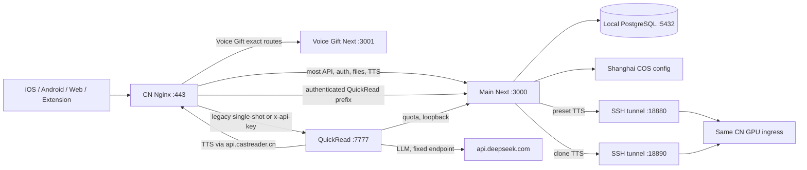

# 中国区后端架构只读审计（2026-09-05）

## 1. 结论先行

中国区当前不是“请求先去国际区再回中国”的结构。公开入口 `api.castreader.cn` 和 `quickread.castreader.cn` 先到腾讯云同一台控制机；普通 Kokoro、克隆音色、文档、额度、QuickRead 网关都已有中国区固定路由，代码里的主要运行链路采用 fail-closed 区域校验，没有发现 TTS 失败后自动回退国际节点的实现。

但当前也不能把整条链路表述为“已经具备完整、持续的无跨境证明”。有三类边界：

1. QuickRead 正文会请求固定的 `https://api.deepseek.com/chat/completions`。代码没有国际 fallback，但本次只读审计没有运营商路径或供应商控制面证据证明请求落地地点。
2. 本区 COS 配置固定 `ap-shanghai`、数据库固定 loopback、GPU 隧道名称与路由标记为 CN；这些是强配置证据，不等于云供应商侧的地理证明。本次没有调用 COS 控制面，也没有做合成探针。
3. 公开 `/api/tts/catalog` 已被 Nginx 精确静态路由覆盖，目录内 849 个资源 URL 均为 `api.castreader.cn`；Next 内同名备用 route 仍默认访问国际 Supabase 且没有 `redirect: 'error'`。它现在不是公开流量的实际路径，但属于应清理的潜在国际元数据依赖。它不承载用户正文或生成音频。

当前最大的稳定性问题是故障域过于集中：一台 2 核、约 3.57 GiB 内存且无 swap 的控制机同时承载 Nginx、主 Next、Voice Gift Next、QuickRead、PostgreSQL、文档转换和两条 GPU 隧道。Kokoro 与克隆虽然是两个独立 systemd 隧道，却连接同一个远端 CN GPU 入口。控制机或 GPU 主机故障会同时影响多条核心链路。

昨日发布仍在线。主 Next 对外版本为 `62386e902cb7201919e9680e56c82c8627b47110`，QuickRead 为 `5728d1cbbaf1bbdc57f799cb4ed355fddac0e32f`；五个核心 systemd 单元本次观察均为 active，`NRestarts=0`。这只能证明从各自启动时间到观察时没有 systemd 记录的重启，不能证明网络从未短断。

## 2. 审计口径与证据等级

本次在 2026-09-05 10:37–10:48 UTC 读取生产元数据、health、有效 Nginx/systemd 配置、脱敏环境布尔值、PostgreSQL 聚合和日志计数。没有上传文件、没有发送 TTS/LLM 合成、没有生成 STS、没有读取用户正文/录音、没有重启或部署。

- **已证事实**：当前有效配置、监听端口、进程状态、源代码、脱敏聚合或自然访问日志直接支持。
- **风险推断**：由当前拓扑或代码行为推导，未主动制造故障验证。
- **缺证**：仅有配置/自报 region，缺供应商控制面、网络路由、端到端生成或客户端播放证据。

脱敏现场摘要见 [live-runtime-summary.json](/Users/xuxuheng/Documents/CastReader/reports/backend-architecture-review-20260905/cn/live-runtime-summary.json)、[traffic-observability-summary.json](/Users/xuxuheng/Documents/CastReader/reports/backend-architecture-review-20260905/cn/traffic-observability-summary.json) 和 [source-governance-summary.json](/Users/xuxuheng/Documents/CastReader/reports/backend-architecture-review-20260905/cn/source-governance-summary.json)。

## 3. 当前拓扑

### 3.1 同机进程和资源

| 进程 | 本机监听 | 现场状态 | 角色 |
|---|---:|---|---|
| `castreader.service` | `127.0.0.1:3000` | active，0 restarts | 主 Next：鉴权、TTS gateway、文档、额度、区域资源 |
| `castreader-voice-gift-cn.service` | `127.0.0.1:3001` | active，0 restarts | Voice Gift 独立 Next |
| `castreader-quickread-cn.service` | `127.0.0.1:7777` | active，0 restarts | QuickRead worker，默认并发 3，生产队列上限 10 |
| `castreader-cn-kokoro-tunnel.service` | `127.0.0.1:18880` | active，0 restarts | 到同一 CN GPU 的 Kokoro 8880 隧道 |
| `castreader-cn-clone-tunnel.service` | `127.0.0.1:18890` | active，0 restarts | 到同一 CN GPU 的 clone 18890 隧道 |
| PostgreSQL 14.23 | `127.0.0.1:5432` | cluster active | 本区账号、额度、文档、clone metadata |

控制机为 2 CPU、总内存约 3.57 GiB，观察时约 2.32 GiB 可用，无 swap；根盘约 52.7 GB，使用 29%。**风险推断**：PDF/DOCX 转换、Next 构建后的运行内存、QuickRead 和数据库争用同一 CPU/内存/磁盘，突发文件转换能扩大 TTS 控制面的尾延迟。无 swap 使内存尖峰更容易演化为 OOM，而不是缓慢降级。

## 4. Nginx 实际入口

有效生产配置与仓库镜像一致，关键静态定义位于 [nginx-api-castreader-cn.conf](/Users/xuxuheng/Documents/MyProject/.worktrees/readout-web-cn-local-core-services/scripts/nginx-api-castreader-cn.conf:23)。

| 公网入口 | 实际上游 | Nginx 超时/行为 | 结论 |
|---|---|---|---|
| `/api/captioned_speech_partly` | Next `:3000` | 600s，buffering off | 普通与 `vc_` 先过本区控制面，见配置第 72–94 行 |
| `/api/tts/catalog` | 本机静态 JSON | 5 分钟缓存 | 精确 location 遮蔽 Next route，见第 96–103 行 |
| `/api/tts/*`、`/api/markdown-tts/*` | Next `:3000` | 600s，buffering off | Web/文件朗读也走本区 gateway，见第 132–146 行 |
| `/api/regional-assets/*` | Next `:3000` | 120s，access log off | capability URL 不写日志，见第 147–154 行 |
| `/documents`、`/sts` | Next `:3000` | 120s | 旧二进制兼容路径已经本地化，见第 155–165 行 |
| `/async-md-upload-by-url` | Next `:3000` | 600s | 本地兼容处理，见第 166–172 行 |
| `/upload` | Next `:3000` | 900s，最大 21 MiB | 同步文件转换，见第 173–180 行 |
| `/api/quickread` | QuickRead `:7777` | 900s，access log off | 单次旧/API-key contract，见第 186–206 行 |
| `/api/quickread/*` | Next `:3000` | 900s，SSE buffering off | 新版会话鉴权网关，见第 208–225 行 |
| `quickread.castreader.cn/api/quickread/*` | 无 key 到 `:3000`，有 key 到 `:7777` | 900s，access log off | map 在第 1–14 行，vhost 在第 342–428 行 |

`/download/` 的 `limit_rate_after 2m; limit_rate 90k;` 是当前有效值，见第 108–123 行。它限制 APK/静态下载，目标是避免占满约 1 Mbps 出口；它不限制 TTS location。反过来，这也证明安装包与核心音频仍共享同一台机器的出口，带宽隔离只靠该单条 Nginx 限速规则。

## 5. 两类 TTS 的完整链路

### 5.1 Kokoro / 预置音色

路径是：客户端 → `/api/captioned_speech_partly` 或 `/api/tts/*` → 本机 Next → `127.0.0.1:18880/dev/captioned_speech` → SSH → CN GPU `127.0.0.1:8880`。

- 本区固定地址定义在 [tts-regional-routing.ts](/Users/xuxuheng/Documents/MyProject/.worktrees/readout-web-cn-local-core-services/src/shared/ops/tts-regional-routing.ts:10)。入口、环境与域名冲突会报配置错误，而不是切全球节点，区域判断见第 59–130 行。
- gateway 对单次 partly 请求给 28 秒预算，对全文请求给 90 秒预算；同一固定上游内重试，HTTP redirect 被拒绝。请求先完整读完 200 body 并校验 JSON/音频，再接受结果。[speech-request-budget.ts](/Users/xuxuheng/Documents/MyProject/.worktrees/readout-web-cn-local-core-services/src/shared/lib/speech-request-budget.ts:3) 定义总预算与重试；[tts-gateway.ts](/Users/xuxuheng/Documents/MyProject/.worktrees/readout-web-cn-local-core-services/src/shared/lib/tts-gateway.ts:204) 第 204–473 行实现文本分段、固定节点调用、完整音频校验及 timestamps 降级。
- timestamps 缺失或格式不佳会退化为空数组，音频仍返回；这是“播放第一、高亮第二”的正确优先级。
- `proxy_buffering off` 不代表真正的音频字节流。Next 要读完 GPU 返回的 JSON/base64 音频后才响应；连续感主要依赖客户端提前生成与队列缓冲。**风险推断**：当下一段生成超过当前段可播放时长，用户仍会听到间隙，即使每个 HTTP 请求最终 200。
- 现场 `HEAD`、tunnel `/health` 均为 200，只证明路由和进程可达；本审计没有合成音频，因此不能用这些 health 证明音色、时长、音质或持续播放。

### 5.2 克隆音色

通用入口遇到 `vc_` 音色后转入 clone contract；专用 clone API 也复用同一实现。路径为 Next → `127.0.0.1:18890` → SSH → 同一 CN GPU 的 clone 服务。

- 固定 CN worker 地址和 fail-closed 校验在 [worker-regional-routing.ts](/Users/xuxuheng/Documents/MyProject/.worktrees/readout-web-cn-local-core-services/src/shared/voice-clone/worker-regional-routing.ts:3)。
- [captioned.ts](/Users/xuxuheng/Documents/MyProject/.worktrees/readout-web-cn-local-core-services/src/shared/voice-clone/captioned.ts:68) 第 68–263 行依次执行 Pro、音色 owner/share、额度 reservation、90 秒总预算、相同 worker 重试；404 时只在同一 worker 恢复音色再重试。收到完整 200 body 并确认音频身份后才结算额度。timestamps 可降级，不拒绝音频。
- clone 的数据库身份与 voice metadata 是必经依赖。额度账本基础设施故障可在已完成 Pro/身份判定后 fail-open；数据库整体不可用时，音色所有权查询仍会失败。因此“额度 fail-open”不等于 clone 脱离数据库仍能播放。
- 两条隧道独立监督，避免重启 Kokoro 进程直接重启 clone 隧道；但它们连接同一远端主机。**风险推断**：远端主机、入口网络、SSH 身份或 authorized-key 配置出错会同时损伤两类声音。

### 5.3 并发、重试与错误范围

普通 TTS 没有曾经的 120/min 技术限流；仍保留身份、Pro 与业务额度。Kokoro 同一请求最多约 3 次尝试，clone 最多可进行更多短重试，但始终受同一个 90 秒总预算约束。worker 返回 429/5xx 时，控制面只重试同一区同一 worker，不跨区。

在当前 `/var/log/nginx/access.log` 的 2026-09-04 10:43 至 2026-09-05 10:43 UTC 过滤窗口内，`/api/captioned_speech_partly` 有 3869 个 POST，其中 3866 个 HTTP 200、3 个 HTTP 500，HTTP 200 比例 99.92%；没有看到 502、503、504 或 499。三个 500 分别在 16:20:14、16:24:27 和次日 06:19:19 UTC。

这个统计只来自当前 access 文件，不含轮转文件；也不是“全站真实用户成功率”，更不能证明 iPhone 最终持续播放成功。Next stderr 没有可靠时间戳，Nginx 默认日志没有请求 ID 和 upstream phase/timing，因此无法把这三个 500 对应到 GPU、gateway、鉴权或应用异常。当前日志结构不足以回答单次用户“为什么停了”。

## 6. QuickRead / 解读

新版移动端走 `quickread.castreader.cn/api/quickread/*` → Next `:3000` 的 `cms_` 会话鉴权 → 本机 QuickRead `:7777`。扩展的 API-key contract 可由 Nginx 分到 `:7777`，worker 自己再次验 key。

部署源码在远端 `/opt/castreader-quickread-cn/current/server/server.mjs`：

- 第 77–111 行读取 bind、API key、队列和本区 Pro 配置；现场为并发 3、队列上限 10。
- 第 116–154 行只向 `http://127.0.0.1:3000/api/pro/entitlement` 查询额度，5 秒超时且 `redirect: 'error'`。只有 HTTP 200 且明确 `allowed:false` 才作为业务拒绝，其余内部异常 fail-open。
- 第 180–207 行用同步 admission reservation 封住“查容量 → 等额度 → 入队”的并发窗口，并在入队后立即释放 reservation，不占满整个任务寿命。
- 三个新会话入口先完成 body 校验和队列 reservation，再消费一次解读额度；fast-block0、extract-block 与 compose-block continuation 不重复扣同一 job 的次数。
- `/health` 只暴露进程、active、queue、concurrency、jobs cached。本次看到 active 0、queue 0、concurrency 3、jobs cached 11；它不验证 LLM、TTS、额度或 SSE 完整性。

区域 helper 固定本区 TTS API 与 loopback entitlement；`tools/llm-provider.mjs` 固定 DeepSeek endpoint、没有 provider fallback、拒绝 307/308。GIF 已退出主生成输出，历史 job 的 GIF 字段在 spec/preview 边界被清除；旧 Giphy/COS 工具源码仍供独立离线视频工具使用，静态 import 本身不发网络请求。由于 QuickRead location 关闭 access log，本次没有可用自然请求量或错误率统计，也没有 egress trace；所以不能把“固定 DeepSeek 且无 fallback”进一步写成“正文链路地理位置已证明”。

QuickRead job 缓存与资源落本机磁盘并由单进程恢复，没有共享任务存储或第二实例。**风险推断**：控制机磁盘损坏是任务恢复单点；单实例并发 3 也会在长 LLM/TTS 请求时迅速把 10 个等待位用完。900 秒 Nginx timeout 只防止代理过早切断，并不增加 worker 容量。

## 7. 文档、上传、COS 与数据库

### 7.1 上传和 STS

- [cos-sts.ts](/Users/xuxuheng/Documents/MyProject/.worktrees/readout-web-cn-local-core-services/src/shared/upload-gateway/cos-sts.ts:6) 第 6–187 行限制单文件 20 MiB、STS 默认 900 秒、仅允许对应 prefix 的 PutObject；CN 必须 `ap-shanghai` 且禁止 endpoint override。
- 新版 `/api/mobile/upload/sts` 与 notify 要求 `cms_` session；旧 `/sts` 只保留已发布二进制兼容。[sts-handlers.ts](/Users/xuxuheng/Documents/MyProject/.worktrees/readout-web-cn-local-core-services/src/shared/upload-gateway/sts-handlers.ts:86) 第 86–171 行显示旧兼容和新版鉴权边界。
- 上传使用 5/min 的本地 PostgreSQL 限流。CN 分支不会使用仍存在的 Upstash 环境值；本区数据库不可用时返回 503，不会跨境 fallback。[rate-limit.ts](/Users/xuxuheng/Documents/MyProject/.worktrees/readout-web-cn-local-core-services/src/shared/lib/rate-limit.ts:231) 第 231–257 行选择本区 limiter；[cn-rate-limit.ts](/Users/xuxuheng/Documents/MyProject/.worktrees/readout-web-cn-local-core-services/src/shared/lib/cn-rate-limit.ts:7) 强制 DB host 为 loopback，连接 2 秒、statement 2 秒、lock 1.5 秒。
- 技术限流只保留在上传等高滥用入口，不再限制普通朗读。**边界**：新版 STS/notify 当前在认证前先做 IP 限流，NAT 下多人可能共享 5/min；数据库短故障也会使上传失败。这不会中断已经在播放的音频，但会影响新文件进入系统。

### 7.2 本地兼容处理与转换

[compatibility-proxy.ts](/Users/xuxuheng/Documents/MyProject/.worktrees/readout-web-cn-local-core-services/src/shared/upload-gateway/compatibility-proxy.ts:77) 第 77–126 行禁止 Reader origin 指向公开 CastReader 域；第 310–318 行在 CN 直接调用 `chinaUpload`，绕开任何配置的 Reader origin。因此四个旧文档入口当前没有主动代理全球服务。

[cn-documents.ts](/Users/xuxuheng/Documents/MyProject/.worktrees/readout-web-cn-local-core-services/src/shared/documents/cn-documents.ts:20) 实现本地转换队列：单条 promise chain、最多 32 个内存 pending、每份文件最长 15 分钟，通过本机 `/usr/bin/python3`、nice 10、单线程转换，再写本区 COS 和本地 PG。它不是独立持久 worker；进程重启后，pending 任务要等后续 list/get 请求触发恢复。当前 `documents` 表为 0 行，因此没有现存中国区文库可用来做恢复抽样。

同步/旧兼容 handler 支持的格式比新版 mobile notify 广；新版当前主要接受 EPUB/PDF。需要把“产品支持格式”定义成一份共享 contract，避免四端与旧路由各自推断。

### 7.3 存储与删除

[storage.ts](/Users/xuxuheng/Documents/MyProject/.worktrees/readout-web-cn-local-core-services/src/shared/services/storage.ts:9) 第 9–14、65–70 行让 CN 在读取任何全局存储配置前直接选 `ChinaCOSProvider`。[cn-regional-assets.ts](/Users/xuxuheng/Documents/MyProject/.worktrees/readout-web-cn-local-core-services/src/shared/lib/cn-regional-assets.ts:6) 固定 `ap-shanghai`、禁 endpoint override，支持 Range/HEAD，并在读取文档对象前检查本地 documents 行仍存在。

现场数据库只有 `voice-clone-cn` storage namespace；COS 环境为 `ap-shanghai` 且无自定义 endpoint。**缺证**：本次没有读取腾讯云控制面或对象 HEAD，不能独立证明 bucket 实际地域、ACL 和生命周期。删除文档会先删 DB 行，使旧签名 URL 无法再经 regional-assets 读取，但当前 handler 不删除底层 COS 对象；对象会成为私有孤儿，属于删除完整性、留存和成本风险。

本地 PostgreSQL 同时承载账号、Pro/额度、文档、voice metadata、上传限流和 analytics。数据库进程仍在同一台控制机；每日 `pg_dump` 有 restore-list/restore-probe 和 checksum，但自动备份仍落同机 `/var/backups/castreader`，保留 14 天。昨日手工发布备份有上海 COS readback 回执，当前 cron 并没有自动异机复制。控制机磁盘故障仍可能同时失去服务与最新自动备份。

## 8. 外部依赖与跨境边界

| 依赖 | 携带数据 | 当前路由事实 | 结论 |
|---|---|---|---|
| Kokoro / clone GPU | TTS 文本或 clone 请求 | 两条 SSH 隧道固定同一 `bjb1` 入口；route health 自报 CN | 无 global fallback；物理区域仍需 GPU/供应商证据 |
| 上海 COS | 上传原文件、clone 录音、生成音频/时间戳 | `ap-shanghai` 固定，endpoint override 禁止 | 强配置证据；本次无控制面证明 |
| PostgreSQL | 账号、额度、文档/voice metadata | 只监听 loopback | 已证同机，不跨网；同机单点 |
| DeepSeek | QuickRead 原文/提示与生成内容 | 固定 `api.deepseek.com`，redirect 拒绝，无 provider fallback | 内容型外部依赖；地理落点缺证，不能宣称绝对无跨境 |
| Apple/Google 登录 | 身份 token/账号资料 | Apple JWKS 固定 `appleid.apple.com`；Google 验证由 OAuth library 完成 | 明确的国际身份供应商依赖，独立于 TTS 内容链路 |
| TTS catalog Next 备用 route | 音色目录元数据 | 公开被本地 static alias 遮蔽；备用 route 默认国际 Supabase并跟随 redirect | 当前不承载公开请求，仍是潜在配置回归边 |
| Upstash | 限流/监控状态 | 环境值仍配置，CN source guard 返回 null；上传改用本地 PG | 当前核心运行不依赖；遗留 env 增加误配置成本 |

TTS catalog 的潜在边界可在 [route.ts](/Users/xuxuheng/Documents/MyProject/.worktrees/readout-web-cn-local-core-services/src/app/api/tts/catalog/route.ts:1) 第 1–18 行看到。公开 Nginx 精确 route 的实测最终 URL 未改变，响应来自本机静态文件，333,187 bytes，目录中 849 个 URL 全是 `api.castreader.cn`。因此应描述为“国际元数据默认仍潜伏在未使用的 Next route”，不能描述为当前用户正文或音频跨境。

## 9. 监控与可观测性

CN 控制机没有 `tts-health-probe` 或 `tts-ops-evaluate` 的 systemd timer/cron，也没有对应常驻监控进程。仓库 [vercel.json](/Users/xuxuheng/Documents/MyProject/.worktrees/readout-web-cn-local-core-services/vercel.json:52) 第 52–84 行的 cron 属于 Vercel/国际部署，不会在腾讯云主机自动运行。`/etc/cron.d/castreader` 只有支付宝、手机清理和本地 DB 备份。

监控 route 存在不等于有监控。CN Redis guard 还使旧 TTS monitor 的 cache 状态退回进程内存；即使手动调用，Next 重启后状态也会丢失。[tts-probe.ts](/Users/xuxuheng/Documents/MyProject/.worktrees/readout-web-cn-local-core-services/src/shared/monitor/tts-probe.ts:306) 会根据 `cn` 选择 `.cn` 探针 URL，没有发现 CN controller exporter 错发 `api.castreader.ai`；但本区根本没有调度。GPU 自身 exporter 是否外发不在本次 controller 审计范围。

该 probe 仍把 timestamps 完整性作为整体失败条件，而实际播放 gateway 已允许 timestamps 降级。它不会阻断用户播放，但未来启用后可能把“有音频、无高亮”误报警为完全故障。

当前日志有三个结构性空洞：QuickRead/区域资源为保护 capability 而关闭 access log；Next stderr 无统一时间与 request ID；Nginx 无 upstream connect/header/response timing。结果是既保护了隐私，也无法快速区分“队列等待、模型慢、网关预算、客户端缓存不足、音频本身失败”。需要增加只含 route、region、request ID、phase、status、duration、queue depth、audio bytes 的结构化指标，禁止正文、voice ID、token、对象 URL。

## 10. 发布与配置治理

主 Next 的本区发布入口 [deploy-cn.sh](/Users/xuxuheng/Documents/MyProject/.worktrees/readout-web-cn-local-core-services/scripts/deploy-cn.sh:24) 与 [verify-production-source.mjs](/Users/xuxuheng/Documents/MyProject/.worktrees/readout-web-cn-local-core-services/scripts/verify-production-source.mjs:18) 会检查完整 SHA、clean worktree、候选正好等于命名 ref tip、上一生产为祖先、数据库 authority fingerprint，再构建 release manifest。[activate-cn-release.sh](/Users/xuxuheng/Documents/MyProject/.worktrees/readout-web-cn-local-core-services/scripts/activate-cn-release.sh:1380) 第 1380–1960 行执行路由/auth/schema/回滚门禁、原子 symlink、systemd/Nginx 配置与失败恢复，并保留最近 3 个 release。

这些脚本门禁很强，但有四个治理缺口：

1. GitHub 的 `beta` 当前 `protected:false`，没有 protection rules、required review 或 required status check。脚本里的“protected ref”只是受信名字，不是 GitHub 强制保护。
2. `.github/workflows/backend-production-release.yml` 是全球 Vercel 的手动发布流程，不部署 CN。CN Next 仍由 operator 从本地执行脚本。
3. `PRESERVE_CN_NGINX=1` 会把现场 Nginx 作为下一 release 输入；虽然 activation 检查核心路由，这会让未入库漂移继续传播。
4. QuickRead 使用独立源码 commit、独立目录和单独 activation receipt，不属于主 Next 的同一 immutable manifest。一次“后端发布”可能只更新其中一半。

systemd 配置还分散在 base unit、`20-regional-routing`、`25-quickread-cn`、`26-voice-clone-worker`、`27-cn-tts-upstream`、`30-release` 和 QuickRead env。词典序决定覆盖优先级；当前 `27` 正确覆盖 `20` 的 TTS 值，但这类隐式优先级曾导致 source marker 不一致。发布脚本现会校验，架构上仍不够简单。

## 11. 建议的简化与稳固顺序

以下是架构建议，本次没有执行修改：

1. **先补可观测性闭环**：在 CN 独立调度 route、tunnel、QuickRead、PG 和 COS metadata health；音频可用与 timestamps 对齐分成两个状态。统一 request ID 和 phase timing，建立 5xx、预算超时、429、queue wait、生成时长相对音频时长的本区指标。
2. **拆故障域**：至少把文件转换和自动备份移出 TTS 控制机；把每日 PG 备份自动复制到上海私有 COS并定期恢复验证。随后为 Next/QuickRead 提供第二实例或可切换同区节点。
3. **为 GPU 提供同区冗余**：Kokoro 和 clone 可以保持模型进程隔离，但要有第二个经过地域证明的 CN 节点；重试必须仍在同区，且用健康/容量选择而不是用户请求期间盲重试。
4. **统一发布单元**：一个 release manifest 同时固定 Next SHA、QuickRead SHA、Nginx SHA、systemd drop-in SHA、schema version 与 GPU route revision；GitHub 对发布 ref 开 branch protection/required checks，CN 由审计化 workflow 调用同一制品，而不是现场构建。
5. **收敛配置层**：每个服务生成一份最终环境文件，systemd 只引用它；将 Nginx effective config 由仓库模板生成并阻止现场漂移。保留激活前精确 SHA、区域和回滚检查。
6. **清除潜在国际默认**：删除或区域化 Next 的 catalog Supabase fallback、未使用的 Upstash env 与只供离线工具的全局 URL；对所有内容型 fetch 统一 `redirect: 'error'` 与服务区 allowlist。
7. **把连续播放作为 SLO**：除 HTTP 成功率外，记录首段等待、segment generation/audio duration ratio、缓冲耗尽次数和续段恢复时间。服务端永远把可播放音频优先于 timestamps/高亮；高亮失败只降级显示，不改变音频 admission。
8. **持久化长任务 admission**：文档转换和 QuickRead job 使用本区持久队列，任务状态不依赖下一次 list/get 或单进程内存；容量不足应在扣业务额度前拒绝，并返回可重试状态。

## 12. 本次仍缺的证明

- 没有 CN GPU 供应商控制面、GPU 进程/PID/显存或模型文件 SHA；这里只证明 controller 两条隧道与 health 可达。
- 没有 COS 控制面 bucket location、ACL、生命周期或对象 readback；这里只证明运行配置、provider 选择和本地 metadata。
- 没有 DeepSeek 网络落点证明，也没有 egress flow log。
- 没有合成、上传、登录、额度消费或 iPhone 播放测试；这是用户要求的只读边界。
- 没有轮转日志和客户端 telemetry，24 小时 TTS 数字只覆盖当前 access 文件中的该 route。
- 没有对 Google token verification 的现场外连抓包；Apple JWKS endpoint 来自源码，均只作为身份外部依赖列出。

因此本报告能确认“主要 CN 路由已本地化、没有代码级 TTS 国际 fallback、昨日 release 正常在线”，也明确确认“单机单 GPU 故障域、CN 主动监控缺位、日志无法解释三个 500、若干地理证明和潜在国际默认仍未收口”。
