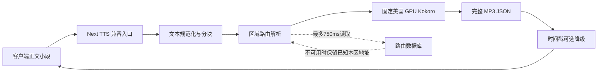
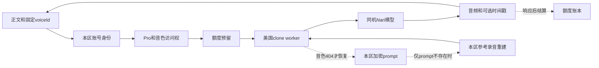

# 国际 API、音频交付与发布治理只读复核

审计日：2026-09-05。只读核对已部署身份、GitHub/Vercel 控制面、现有日志及源码；没有合成音频、创建业务任务、消费额度、改配置或发布。本文中的稳定性改进均为建议。

## 1. 当前版本与昨天的关系

- 公开 `https://api.castreader.ai/api/capabilities` 与 Vercel 生产目标均指向 `dpl_58jqfHzCrV91FpC8s2unBG7XXcfX` / `3ce12a7c794e3d9788a7982a66a62f70a9407678`。
- 生产函数区域仍为 `iad1`，Node 22，Fluid 和弹性并发开启。网关可自动增加实例，不代表后面的单台 GPU 也能增加供给。
- GitHub 比较显示，该提交是昨日 `2d5575b6` 的后代，ahead 52、behind 0。包含中国区合并历史、会员恢复、发布维护及探针小数兼容修改。不存在“当前生产直接退回昨日修复之前”的证据。
- 核心重试、克隆 captioned、音色恢复、QuickRead 网关、区域限制等文件在比较中没有净变化。`tts-gateway.ts` 仅新增路由响应头辅助函数；`worker.ts` 保留 CN 建声 50 秒 / Global 90 秒差异；`auth.ts` 新增 CMS 基础设施异常返回 503。
- 国际 API 与营销页面、会员、邀请、增长功能仍属于同一 Vercel 项目。会员发布能够重建并替换音频网关，即使 TTS 文件本身未修改。

证据：[现场版本](/Users/xuxuheng/Documents/CastReader/reports/backend-architecture-review-20260905/global/live-release-inventory.json)、[提交差异](/Users/xuxuheng/Documents/CastReader/reports/backend-architecture-review-20260905/global/source-drift.json)、[核心源码对应表](/Users/xuxuheng/Documents/CastReader/reports/backend-architecture-review-20260905/global/core-source-reference-index.json)。后者明确区分 Git 内容比较与运行文件哈希，不能把 Git 无差异扩大成全部运行环境相同。

## 2. 三种音频交付入口

| 入口 | 后端调用 | 音频交付 | 关键依赖 |
|---|---|---|---|
| `/api/captioned_speech_partly` | `readTtsPayload → proxyTtsPayload` | 一次请求返回完整小段 MP3 的 base64、余文、可选词时间戳 | 本区普通 GPU；若 `vc_` 则转克隆鉴权与生成 |
| `/api/captioned_speech`、`/api/tts/generate`、`/api/tts/tts_and_transcribe` | 共用完整正文合同 | 完整音频；不能把未读余文冒充完成 | 同一网关及 GPU，较长墙钟预算 |
| `/api/markdown-tts/generate` | 可选段落缓存 → 同一 TTS 网关 | 未命中立即返回 `audioBase64`，存储写入在响应后；命中返回 `audioUrl` | 缓存 DB、CDN 在命中时承担音频交付 |

这里的 partly 是**按小段逐次请求**，当前兼容网关先收完上游响应，再发送完整 JSON，不是从 GPU 到扬声器逐字节持续推流。上游 GPU、HTTP 重试或网络延迟超过客户端已有缓冲，就会出现“读一句等一会”。模型的平均生成速度快，不能单独保证连续体验。

普通输入上限 10,000 字符；partly 进一步按语句、最多 900 字符 / 英文 74 词等兼容边界切分，并返回余文。这些是单请求分块合同，不是朗读总字数或总段数上限。克隆 captioned 单请求上限 600 字符，调用方需要按自己的完整余文继续。

源码：[TTS 网关](/Users/xuxuheng/Documents/MyProject/.worktrees/readout-web-core-audio-regional-continuity/src/shared/lib/tts-gateway.ts:204)、[句子分块](/Users/xuxuheng/Documents/MyProject/.worktrees/readout-web-core-audio-regional-continuity/src/shared/lib/tts-sentence-boundary.ts:1)、[文件朗读](/Users/xuxuheng/Documents/MyProject/.worktrees/readout-web-core-audio-regional-continuity/src/app/api/markdown-tts/generate/route.ts:56)。

## 3. 普通 Kokoro 的必经路径

- 国际普通 GPU 固定 `http://71.175.237.103:41228/dev/captioned_speech`。代码检查只接受这个已确认美国节点；未配置第二个合格节点。
- 路由状态来自 DB，进程缓存 3 秒；读取预算 750ms，失败后复用本进程已知状态或本区代码/环境默认地址。它降低了路由 DB 故障的直接影响，但不是 GPU 故障转移。
- 新 Vercel 实例没有旧实例的内存缓存。路由读取的超时竞争不等同于取消底层 DB 查询；实例扩张时仍须看 DB 连接负载。
- 普通 partly 请求预算 28 秒，单次上游最多 20 秒，默认最多三次尝试、间隔 500/1500ms，共享总预算。完整正文总预算 90 秒、单次 65 秒。
- 完整 body 读取及 JSON 解析在重试范围内，坏帧不能以 HTTP 200 算成功；但有意义的音频内容错误需要模型层与完整性回归，不能靠 HTTP 状态验证。
- 时间戳不合格会返回空数组并保留 MP3。空音频、坏 JSON、完整正文仍有余文等继续返回 502。这些必须继续区分“辅助信息不可用”与“没有可交付音频”。

源码：[区域固定地址](/Users/xuxuheng/Documents/MyProject/.worktrees/readout-web-core-audio-regional-continuity/src/shared/ops/tts-regional-routing.ts:23)、[路由缓存及回退](/Users/xuxuheng/Documents/MyProject/.worktrees/readout-web-core-audio-regional-continuity/src/shared/ops/tts-upstream-routing-store.ts:230)、[请求预算](/Users/xuxuheng/Documents/MyProject/.worktrees/readout-web-core-audio-regional-continuity/src/shared/lib/speech-request-budget.ts:47)、[网关预算及回包](/Users/xuxuheng/Documents/MyProject/.worktrees/readout-web-core-audio-regional-continuity/src/shared/lib/tts-gateway.ts:338)。

## 4. 克隆比普通 TTS 多出的同步依赖

美国 clone worker 固定私有 CA TLS `https://71.175.237.103:41221`，不跟随重定向。音色和账号需要持续保持正确绑定，不能以“播放第一”为由去掉身份/所有权验证。

仍在临界路径上的部分：

1. 账号、Pro、音色记录查询，以及额度预留都在开始 90 秒合成预算**之前**。DB 建连配置有 10 秒超时，但这里不是统一的“整个请求包括鉴权只等 N 秒”；当前 `db()` 配置也未声明通用查询/锁等待上限。
2. 额度基础设施异常可降级，明确的额度拒绝保留；这不代表身份、Pro 和音色记录也摆脱了 DB 的同步依赖。
3. clone 最多十次 HTTP 尝试，重试等待序列为 0.5/1/2/4/8/8/8/8/8 秒，受总预算限制。404 可触发恢复，再重试，但仍共用恢复外层预算。
4. 冷恢复先加载持久化 prompt；只有明确 `VOICE_PROMPT_NOT_FOUND` 才读取参考录音重建。存储超时不会自动当成“文件不存在”。正常热合成无需每段上传/降噪，但冷恢复会重新依赖存储及模型准备。
5. 去重恢复表在 Next 单实例内存中。多个 Vercel 实例可以并发恢复同一音色；其一致性需靠 worker 已就绪语义及未来的区域级单飞机制保障。
6. 仍存在严格响应字段白名单：只要 worker 新增未识别字段，即使有 MP3、音色也正确，`Object.keys(...)` 检查仍会触发 `VOICE_CONTRACT_MISMATCH` 503。这是可证实的向前兼容脆弱点，本轮未修改。
7. 当前最新代码已把 CMS 验证基础设施异常分类为 503；浏览器会话和旧 Google/Apple 验证分支仍可能把未知基础设施异常归为 401。不能再笼统写“所有 CMS DB 故障都会让用户掉登录”。

源码：[克隆链路与字段白名单](/Users/xuxuheng/Documents/MyProject/.worktrees/readout-web-core-audio-regional-continuity/src/shared/voice-clone/captioned.ts:124)、[克隆重试](/Users/xuxuheng/Documents/MyProject/.worktrees/readout-web-core-audio-regional-continuity/src/shared/voice-clone/transient-retry.ts:3)、[冷恢复](/Users/xuxuheng/Documents/MyProject/.worktrees/readout-web-core-audio-regional-continuity/src/shared/voice-clone/worker-restore.ts:37)、[当前身份代码快照](/Users/xuxuheng/Documents/CastReader/reports/backend-architecture-review-20260905/global/source-at-3ce12a7c/src/shared/voice-clone/auth.ts.txt:1185)、[DB连接配置](/Users/xuxuheng/Documents/MyProject/.worktrees/readout-web-core-audio-regional-continuity/src/core/db/index.ts:47)。

## 5. 缓存的收益与剩余故障边界

新生成音频的缓存写入已移出返回路径；可选缓存读取最多 500ms，时间戳 URL 读取最多 500ms。中国旧缓存的国际地址会被当成未命中，重新本区生成。

但是**命中缓存后返回的通常只有 URL**。`cachedTtsPlayback` 检查 URL 区域，并未下载验证该音频仍存在、可解码。此时 CDN 404、过期地址、下载失败仍可能打断客户端；后端已回 200 不会知道播放器没有取到声音。这是交付合同风险，不是本轮已复现的 CDN 事故。应让失效缓存能按原输入/同音色在本区重建，不能反复返回同一个坏 URL，也不应跨区取备份。

国际音频缓存允许 `cdn.localdeepseek.org/markdown/`，源存储为 R2；域名名称不能证明物理地域。Supabase 参考/prompt 存储也仍缺控制面地域证明。普通热 TTS 不依赖这些存储读取，文件缓存命中和克隆冷恢复则不同。

源码：[缓存交付合同](/Users/xuxuheng/Documents/MyProject/.worktrees/readout-web-core-audio-regional-continuity/src/shared/lib/tts-playback-cache.ts:32)、[区域资产地址](/Users/xuxuheng/Documents/MyProject/.worktrees/readout-web-core-audio-regional-continuity/src/shared/lib/tts-regional-assets.ts:18)。

## 6. 本次读到的真实错误

截至 2026-09-05 10:40 UTC 的 Vercel 查询：查询窗口为近 24 小时，最多返回 500 条 5xx；返回结果达到上限。其中 480 条是 `/api/captioned_speech_partly` 的 HTTP 500，均记录 `preset upstream rejected request`；另外 20 条为会员补偿定时任务 503，不能混算成音频失败。

这 480 条 TTS 样本集中在 **09:34:17.947–10:02:07.077 UTC（北京时间17:34–18:02）**，均属于今天当前国际部署。它是截断错误样本，不是全日失败总数、失败率或用户数。

再取最近 30 条：30 个不同 Vercel request id，全为 `en / am_adam`，输入长度 141，安全字符统计相同；都有同一个错误信息指纹 `eeebd1874eb4d4a3`。没有读取正文，也不能仅凭长度/字符统计声称每条正文相同。利用上游 request id，worker 审计已完成 30/30 逐条对应，确认“英语前端失败 → audio-only 发音符号仍不可生成 → 单元重试 → 500”的链条。

这证明特定输入路径仍有真实供给故障。它不证明所有音色都崩溃，不证明 GPU 整卡失效，也不是已经生成的 MP3 被高亮检查扔掉。需要修复发音前端覆盖能力，并把不可通过原样重试恢复的失败与网络瞬断分开。

证据：[5xx 截断样本](/Users/xuxuheng/Documents/CastReader/reports/backend-architecture-review-20260905/global/production-5xx-sample.json)、[最近30条安全诊断](/Users/xuxuheng/Documents/CastReader/reports/backend-architecture-review-20260905/global/tts-recent-error-diagnostics.json)、[网关和worker逐条对应](/Users/xuxuheng/Documents/CastReader/reports/backend-architecture-review-20260905/worker/us-gateway-worker-correlation.json)。

## 7. 监控不是空白，但覆盖不完整

- `tts-health-probe` 每 5 分钟做固定英文短句合成；失败后等 15 秒再确认，告警通过飞书。它能发现固定探针失败，不能覆盖所有输入、克隆冷恢复或半小时听书连续性。
- 主探针成功后轮换额外语种。探针使用 20 秒超时，小于 partly 网关 28 秒预算：监控可更敏感，但应把“慢”与“不可播放”分别统计。
- 运行指标评估器 `tts-ops-evaluator` 明确 `alerts_enabled:false`。不能把已写评估代码表述为自动通知已闭环；已有探针告警是另一套路径。
- 网关通常只知道每个音频请求，不知道某本 Kindle 是否翻页后无后续请求。端到端连续性指标最终需要已发布客户端的队列/播放事件配合；后端仍可先补实际供给时延与错误分布。
- 本次 Vercel 全量指标查询返回 `payment_required`，要求 Observability Plus。没有更改套餐；无法从这份错误样本计算全量分母或实际 P95。

源码：[探针设置](/Users/xuxuheng/Documents/MyProject/.worktrees/readout-web-core-audio-regional-continuity/src/shared/monitor/tts-probe.ts:19)、[探针确认和告警](/Users/xuxuheng/Documents/MyProject/.worktrees/readout-web-core-audio-regional-continuity/src/shared/monitor/tts-probe.ts:727)、[运行评估暂不发告警](/Users/xuxuheng/Documents/MyProject/.worktrees/readout-web-core-audio-regional-continuity/src/shared/monitor/tts-ops-evaluator.ts:473)。

## 8. 发布机制：已有保护与实际缺口

| 层次 | 已确认事实 | 对核心服务的含义 |
|---|---|---|
| GitHub 分支 | `beta.protected=false`；保护读取404，rulesets返回当前私有仓库套餐不支持403 | 脚本把它叫“protected beta”，但名字不构成平台保护 |
| Production 环境 | `protection_rules:[]`、`deployment_branch_policy:null`、允许管理员绕过 | 没有平台审批或分支来源规则；是否能增加特性取决于计划/权限 |
| CODEOWNERS | 覆盖克隆、mobile-routing、DB、旧发布流程 | 普通TTS、QuickRead、monitor、维护发布流程等关键路径未列；且无强制分支审查时CODEOWNERS本身不拦合并 |
| Vercel Git | productionBranch=beta，仓库 `deploymentEnabled.beta=false`，无deploy hook | beta合并不自动等于国际上线；仍有CLI/控制台/工作流发布入口 |
| 旧 production 流程 | 源码干净、完整SHA、继承现网、候选验证、正式验证与回滚 | 还夹带Voice Gift开关、迁移、TTS环境写入，作用范围较大 |
| 新 maintenance 流程 | 保留配置、同一候选制品、发布前重读现网基线、别名收敛、失败回滚 | 是正确的已有进步，应复用；不能说没有维护发布能力 |
| 当前实际发布 | 当前3ce12a7c对应maintenance run33934272517成功；前一3e5c3de6对应run33906122909成功 | Vercel `source:cli` 包含CI里调用CLI，不能据此断言人工绕过工作流 |
| 发布互斥 | 两个workflow共用 `castreader-backend-production` concurrency | 锁覆盖这些workflow，不覆盖工作站CLI、控制台和其他项目/服务器发布 |
| 发布单元 | 国际整站/API同一个项目、同一构建 | 普通页面/会员改动仍能替换核心网关运行环境与依赖 |

旧 production workflow 还硬编码 `TTS_UPSTREAM_RELEASE_ID=...r129` 及旧 receipt；目前 GPU 已为 R131b。它属于**再次执行旧激活流程时的元数据/配置覆盖风险**，不是当前 maintenance 发布已经回滚了 GPU 的证据。

证据：[GitHub控制面和实际workflow运行](/Users/xuxuheng/Documents/CastReader/reports/backend-architecture-review-20260905/global/github-release-controls.json)、[当前维护流程原文快照](/Users/xuxuheng/Documents/CastReader/reports/backend-architecture-review-20260905/global/source-at-3ce12a7c/.github/workflows/backend-maintenance-release.yml.txt:376)、[现有CODEOWNERS](/Users/xuxuheng/Documents/CastReader/reports/backend-architecture-review-20260905/global/source-at-3ce12a7c/.github/CODEOWNERS.txt:1)、[旧流程环境写入](/Users/xuxuheng/Documents/MyProject/.worktrees/readout-web-core-audio-regional-continuity/.github/workflows/backend-production-release.yml:130)。

## 9. 巩固顺序建议

1. **先处理日志已关联的发音前端失败和错误分类**，不再对确定性输入缺口无差别原样重试；用覆盖完整正文的回归验证，不以空音频、漏读或换音色表示恢复。本轮未主动发送请求复现。
2. **让现有维护流程成为真正受约束的唯一正常发布通道**：限制生产凭据持有者，来源/关键路径审查、区域配置及模型版本清单、发布锁、同一候选制品、切换前基线确认、回滚。平台不支持的规则要明确标为未强制，不能靠文档假装已生效。
3. **把核心音频网关的发布单元从营销/增长页面中分离**，可以保持同仓库；不需要先引入大量微服务。账号服务通过稳定合同供给已验证的身份/权益，兼容四端现有URL。
4. **统一一次业务合成的总预算与幂等标识**，覆盖鉴权、额度、排队、恢复、生成、编码、网络；避免每层自行重新计算完整预算、重复入队。把缓存/标注/结算留在可恢复的旁路。
5. **补齐区域内备用供给和恢复演练**。网关扩容不能代替GPU冗余；只允许同区域、同音色/模型/合同的备用。备用必须预热并有可恢复prompt，不能仅准备一份备份压缩包。
6. **以持续播放作为验收单位**：先建立实测基线，再设请求成功、首音频、排队、生成实时系数、实际缓冲耗尽和恢复时长目标，不能只看 `/health`。

官方依据仅用于解释平台能力与建议，现场事实以上述控制面证据为准：[GitHub分支保护与Code Owner要求](https://docs.github.com/en/repositories/configuring-branches-and-merges-in-your-repository/managing-protected-branches/about-protected-branches)、[部署环境保护及套餐边界](https://docs.github.com/en/actions/reference/workflows-and-actions/deployments-and-environments)、[Vercel候选晋升](https://vercel.com/docs/deployments/promoting-a-deployment)、[Google SRE按服务目标告警](https://sre.google/workbook/alerting-on-slos/)。这些机制应守在发布和运维侧，不应变成用户播放时的新拒绝条件。
