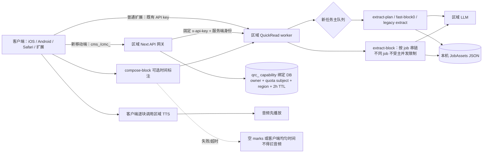

# QuickRead 两区后端架构与连续播放审计（2026-09-05）

## 审计边界与结论

本报告是只读审计。没有发送解读、LLM 或 TTS 合成请求，没有消费额度，没有读取或输出用户正文、令牌、密钥与环境值，也没有更改代码、进程或生产配置。源码基线为：

- QuickRead worker 仓库：`611a6dff032b3097bbaa75e73154456ed5b55b8b`，工作树干净。
- Mobile QuickRead 网关审阅基线：`d0ded1deeea2babe71c07ce517b7040e5df69bdc`，工作树干净。当前 CN 源码为 `62386e902cb7201919e9680e56c82c8627b47110`；与 d0 比较，compute-session route 未变化，`auth.ts` 的差异是普通 cms_ 异常由 401 归类为 503，不改变 compute-session 合同。当前全球生产源码由总审计确认是 `3ce12a7c`，但该对象不在本次可读的本地 Git 历史中，因此本文不把 d0 的端点存在性推成全球今日已部署事实。
- 线上 worker：全球 PID `507570`、中国 PID `1067993`；两者 PID 与 2026-09-04 发布回执一致。全球当时 `queue=0, active=false, jobs_cached=192`，中国 `queue=0, active=0, concurrency=3, jobs_cached=11`。`jobs_cached` 是内存缓存基数，不能解释成成功任务数。

核心结论：

1. **两区 worker 的模型与 TTS 固定路由已经形成代码约束**：CN 固定 DeepSeek、无海外模型 fallback、TTS 固定 `api.castreader.cn`；全球只允许 Gemini/Claude、TTS 固定 `api.castreader.ai`。语言、时区和客户端字段不能改变 worker 上游。
2. **严格意义上的“不跨区”仍有两个需要封口的源码风险**：审阅基线 d0 与当前 CN 623 源码保留显式的跨区 QuickRead compute credential；全球 worker 的实际运行源码会按客户端提供的任意 `http(s)` 图片 URL 跟随重定向抓取。前者需要客户端显式申请不同 `targetRoute`，不是所选区域 cms_ 的自动 fallback；本次没有证明它已部署在全球 3ce、今日被调用或产生真实跨区流量。后者是全球实际运行代码已证的可达出口，但本次也没有读取真实调用记录。
3. **最容易造成“解读/朗读播着停”的不是 marks，而是取消与预算模型不一致**：客户端 fast lane 只等 8 秒、续块只等 20 秒、计划只等 90 秒；worker 收到断线后仅停止 SSE 心跳，不取消已排队或执行中的 LLM。全球 worker 又是单并发，因此超时后的“幽灵任务”仍会占住唯一执行槽，用户随后的正常计划会排在它后面。
4. **所谓恢复只恢复已写入的 job JSON，不恢复正在执行的 LLM**。首块提前发出时会先写一个没有 `_streamState` 的半成品；此时进程重启或完整 plan 失败，客户端已经拿到 job capability，但后续 `extract-block` 会返回 `unknown or expired job_id`。
5. **发布物无法由一个 Git 提交完整重建**：当前两区 `server.mjs` 与发布回执一致，但两区实际 `extract-content.mjs` 都不在发布 manifest 中，其精确内容也不在本次审阅仓库的本地可达 Git 历史中。此结论不覆盖未拉取的远端或隐藏对象。全球实际文件还是较旧版本，核心 LLM curl/exec 没有总超时；中国实际文件有 180 秒 provider 超时。这个来源分叉是当前最重的运维风险。

## 实际链路

图中的“客户端逐块调用区域 TTS 并送入播放队列”由本次审阅的桌面扩展 / iOS Safari 共享客户端源码证明。它描述该客户端实现和当前服务合同，不代表所有已经安装的 iOS、Android、Web 与扩展版本都已逐一做运行态验证。

### 入口与责任边界

| 入口 | 身份 / 额度 | 排队方式 | 是否产生音频 | 失败对播放的含义 |
|---|---|---|---|---|
| `/extract-plan` | 新会话，worker 调内部 entitlement，`consume:true` | 全球主队列 1；CN 主队列 3 | 不直接产生；客户端收到 block 后调区域 TTS | plan 失败则没有后续讲解音频 |
| `/fast-block0` | 不单独扣额度，依赖同时启动的 plan | 与新任务共享主队列 | 客户端拿 narration 后调 TTS | 客户端 8 秒放弃，但 worker 不取消；可反过来堵住 plan |
| `/extract-block` | continuation，不重复扣额度 | 每个 job 串行；不同 job 可并发且绕过主队列上限 | 客户端收到 narration 后调 TTS | 20 秒超时两次后本次播放链会断；服务端可能稍后才完成并缓存 |
| `/compose-block` | continuation，不扣额度 | 不进 LLM 队列 | 无，只回填 marks 时间 | 网关 2 秒后降级为空 marks；已生成音频应继续 |
| `/api/quickread` / `/extract` / `/compose` | 旧 cinematic 流程 | 新任务主队列；compose 不在主队列 | 旧 full 流程可由 worker 生成全段 TTS | 仍含较长 TTS 重试链；不应成为移动端 page 主路径 |
| `GET /:job/...` | Mobile 经 qrc_ capability；普通扩展可见原始 qr_ job | 无 | 读取已生成本机资产 | capability 或磁盘资产过期会 404 |

worker 的额度闸门只在三个新会话入口执行；输入 400 和队列满 503 都发生在扣额度前。技术性 entitlement 非 2xx、坏 JSON 或 5 秒超时会 fail-open；只有一次成功的内部响应明确 `allowed:false` 才返回业务 402。见全球实际运行源码 [us-runtime-server.mjs.txt](/Users/xuxuheng/Documents/CastReader/reports/backend-architecture-review-20260905/quickread/evidence/us-runtime-server.mjs.txt:101) 第 101–160 行及发布说明 [REVIEW.md](/Users/xuxuheng/Documents/MyProject/.worktrees/readout-desktop-quickread-server-continuity-20260904/scripts/video-pipeline/deployments/20260904-retired-gif-preview/REVIEW.md:7) 第 7–8 行。

这解决了“内部额度服务短暂异常被误当业务拒绝”的问题，但**成功扣费发生在生成前**。若随后 LLM、结构校验或首块生成失败，当前链路没有自动退款/冲正。它属于业务闸门导致的可用性损失，不是音频合法性检查。

Mobile 网关与普通扩展的身份强度不同：

- Mobile 网关要求区域 `cms_` 或限定 audience/target 的 `cmc_` principal，并把上游 `qr_` 替换成高熵 `qrc_`；续块必须同时匹配 owner、quota subject 和 service region。[mobile-quickread-proxy.ts](/Users/xuxuheng/Documents/MyProject/.worktrees/readout-web-quickread-continuity-20260904/src/shared/quickread/mobile-quickread-proxy.ts:357) 第 357–445 行。
- 普通扩展为保留既有匿名业务，仍直连 worker 并携带打包 API key 与客户端构造的身份 header。worker 把“没有 device/user/email”视为 legacy/internal 并直接 allow。因此该 API key 是共享服务访问凭据，不是可靠用户身份；拿到 key 的调用者可以省略身份而绕过免费额度。这不会造成停播，却是明确的权益控制缺口。
- Mobile 资产通过 qrc_ bearer 能力访问；worker 原始 `qr_` job 的 GET 路由本身不查 API key。原始 job id 是时间戳加 3 个随机字节，普通扩展会直接持有它。Mobile 的 qrc_ 隔离足够强，旧直连资产面仍应提高 capability 熵并统一 owner/expiry。

输入限制也不统一：Mobile 网关在读完整 `arrayBuffer()` 后才检查 32 MB，worker 各 POST 则无限累加 `body += chunk`，没有 socket/body cap。前者会先分配超限内存，后者可被共享 API key 调用拖垮进程；这属于资源稳定性风险。[mobile-quickread-proxy.ts](/Users/xuxuheng/Documents/MyProject/.worktrees/readout-web-quickread-continuity-20260904/src/shared/quickread/mobile-quickread-proxy.ts:357) 第 357–389 行、[us-runtime-server.mjs.txt](/Users/xuxuheng/Documents/CastReader/reports/backend-architecture-review-20260905/quickread/evidence/us-runtime-server.mjs.txt:792) 第 792–827、862–912 行。

## 队列、超时与断线为什么会表现为停播

### 1. 全球只有一个新任务执行槽，中国有三个

全球实际运行文件仍用 `activeJob` 串行：[us-runtime-server.mjs.txt](/Users/xuxuheng/Documents/CastReader/reports/backend-architecture-review-20260905/quickread/evidence/us-runtime-server.mjs.txt:166) 第 166–206 行。中国实际运行文件用 `MAX_CONCURRENCY`，当前健康值为 3：[cn-runtime-server.mjs.txt](/Users/xuxuheng/Documents/CastReader/reports/backend-architecture-review-20260905/quickread/evidence/cn-runtime-server.mjs.txt:175) 第 175–220 行。

`pendingAdmissions` 修复了“多请求同时等待额度检查后一起越过 MAX_QUEUE”的竞态；它只保护准入容量，不限制 continuation 的模型并发。源码基线实现见 [server.mjs](/Users/xuxuheng/Documents/MyProject/.worktrees/readout-desktop-quickread-server-continuity-20260904/scripts/video-pipeline/server/server.mjs:176) 第 176–223 行。

### 2. 新任务和续块是两套并发域

`extract-plan`、fast lane、旧 extract 走主队列；`extract-block` 使用 `blockChains[job_id]`，只保证同一 job 的调用按到达顺序串行，不校验“必须先 block 1 再 block 2”，也不受全球 1/CN 3 的主并发上限约束：[server.mjs](/Users/xuxuheng/Documents/MyProject/.worktrees/readout-desktop-quickread-server-continuity-20260904/scripts/video-pipeline/server/server.mjs:436) 第 436–445 行、[server.mjs](/Users/xuxuheng/Documents/MyProject/.worktrees/readout-desktop-quickread-server-continuity-20260904/scripts/video-pipeline/server/server.mjs:582) 第 582–611 行。

结果是：

- 全球一个慢 fast/plan 会阻塞所有新任务。
- 多个已经开始的 job 又能同时发续块 LLM，绕过新任务并发上限，可能把 provider 和 CPU/网络打满。
- `blockChains` 只按到达顺序，不按 `nextIdx` 拒绝乱序。若客户端或重试把 block 2 先送到，`running_summary` 会以错误顺序推进，属于内容连续性错误。
- `blockChains` 完成后没有删除；`jobAssets` 与 `urlToJobId` 也没有内存淘汰。当前同 PID 下 `jobs_cached` 已从发布后的 0 增至全球 192、中国 11，这只证明缓存持续累积，尚不能证明已经造成内存事故。

### 3. 客户端放弃不等于 worker 停止

客户端预算为：fast lane 8 秒、extract-block/compose-block 20 秒、extract-plan 90 秒；续块失败会退避 1.5 秒后再请求一次：[quickread-client.ts](/Users/xuxuheng/Documents/MyProject/.worktrees/readout-desktop-quickread-server-continuity-20260904/src/ui/quickread-client.ts:2100) 第 2100–2112 行、[quickread-client.ts](/Users/xuxuheng/Documents/MyProject/.worktrees/readout-desktop-quickread-server-continuity-20260904/src/ui/quickread-client.ts:2158) 第 2158–2164 行、[quickread-client.ts](/Users/xuxuheng/Documents/MyProject/.worktrees/readout-desktop-quickread-server-continuity-20260904/src/ui/quickread-client.ts:2424) 第 2424–2453 行。

worker 的 `req.close` 处理只清除 15 秒 SSE heartbeat，不给排队任务、curl 子进程或 provider fetch 传取消信号：[us-runtime-server.mjs.txt](/Users/xuxuheng/Documents/CastReader/reports/backend-architecture-review-20260905/quickread/evidence/us-runtime-server.mjs.txt:829) 第 829–857、938–958 行。于是会出现两种直接可感知现象：

- fast lane 超过 8 秒：客户端回退并启动 plan；旧 fast 仍占全球唯一槽，plan 只能等它结束。所谓“快道”会把首声进一步推迟。
- extract-block 超过 20 秒：客户端重试一次。第一请求仍执行，第二请求排在同 job chain 后；第二请求也可能在第一完成前超时。服务器稍后可能缓存成功块，但当前播放器已经拿不到下一段，表现为播完即停。

SSE 每 15 秒写 ping 可以防止中间代理把“正在生成”误判为空闲，但它不是进度 watchdog，也不提供取消或断点重连。Next 上游预算对非 compose 是 900 秒：[mobile-quickread-proxy.ts](/Users/xuxuheng/Documents/MyProject/.worktrees/readout-web-quickread-continuity-20260904/src/shared/quickread/mobile-quickread-proxy.ts:468) 第 468–503 行；这与客户端 90/20/8 秒不在同一个预算模型里。

### 4. 全球实际 LLM 没有总超时

全球实际 `geminiStream` 用 `curl -sN`，没有 `--max-time`、kill timer 或父级 AbortSignal；buffered Gemini/Claude/OpenRouter 调用的 `execAsync` 也只设 `maxBuffer`，没有 `timeout`：[us-runtime-extract-content.mjs.txt](/Users/xuxuheng/Documents/CastReader/reports/backend-architecture-review-20260905/quickread/evidence/us-runtime-extract-content.mjs.txt:76) 第 76–121 行、[us-runtime-extract-content.mjs.txt](/Users/xuxuheng/Documents/CastReader/reports/backend-architecture-review-20260905/quickread/evidence/us-runtime-extract-content.mjs.txt:202) 第 202–305 行。

当前仓库版本已经设计了 `LLM_CURL_MAX_TIME=180s` 与 `LLM_EXEC_TIMEOUT=210s`，中国实际文件也含这些限制；但该新版并未成为全球实际 `extract-content.mjs`。即使使用新版，210 秒仍远大于客户端 20 秒续块预算，因此必须在产品层统一预算，而不能只给 server 加一个很长的 timeout。

## 持久化与真实恢复语义

### 已经能恢复的内容

`JobAssets` 在 `set()` / `persist()` 时把当前 job JSON 写入本机目录，采用临时文件后 rename；写盘失败 fail-open，不会拒绝内存中的已生成结果。重启后首次 `get(job_id)` 会从新快照或旧 spec 文件懒加载：[job-assets.mjs](/Users/xuxuheng/Documents/MyProject/.worktrees/readout-desktop-quickread-server-continuity-20260904/scripts/video-pipeline/server/job-assets.mjs:7) 第 7–60 行。

因此，**已经落盘的完整 plan、已生成 section、marks timing、旧 full 流程音频路径**可在同一主机、同一资产目录尚未清理时恢复。它不是任务队列或 LLM 的 durable workflow。

### 不能恢复的内容

- 主队列、`activeJob/running`、`pendingAdmissions` 与 `blockChains` 全在内存。
- 正在 provider 内生成的 prompt/stream offset、retry attempt、客户端 SSE offset 不持久化。
- 早期 block0 callback 在完整 plan 完成前执行 `jobAssets.set`；此时 `_streamState` 尚未写入。完整 plan 后才设置 `_streamState` 并再次保存：[server.mjs](/Users/xuxuheng/Documents/MyProject/.worktrees/readout-desktop-quickread-server-continuity-20260904/scripts/video-pipeline/server/server.mjs:522) 第 522–555 行。
- 重启恢复到这个半成品后，`runExtractBlock` 要求 `_streamState`，否则直接报 `unknown or expired job_id`：[server.mjs](/Users/xuxuheng/Documents/MyProject/.worktrees/readout-desktop-quickread-server-continuity-20260904/scripts/video-pipeline/server/server.mjs:582) 第 582–588 行。

审阅的 Mobile 网关源码在看到上游首个 `qr_...` 后就写入 qrc_ capability 绑定，再把首块暴露给客户端。绑定包含 owner、quota subject、region，默认有效 2 小时；只有尚未过期的已认证 continuation 会 best-effort 延长：[mobile-quickread-job.ts](/Users/xuxuheng/Documents/MyProject/.worktrees/readout-web-quickread-continuity-20260904/src/shared/quickread/mobile-quickread-job.ts:8) 第 8–17、82–172 行及 [mobile-quickread-proxy.ts](/Users/xuxuheng/Documents/MyProject/.worktrees/readout-web-quickread-continuity-20260904/src/shared/quickread/mobile-quickread-proxy.ts:401) 第 401–425、521–541 行。

这会产生三个恢复断层：

1. qrc_ 已经存在，但 worker 只有半成品，没有可续块状态。
2. 用户闲置超过 2 小时，网关绑定失效；worker 本机 job 可能仍在，用户也无法再访问。
3. worker 的 `cleanup.sh` 默认删除 7 天前磁盘文件，但是否在两台生产机实际安装 cron，本次未完成安全核验；即使安装，它也不会清理当前进程的 Map。脚本见 [cleanup.sh](/Users/xuxuheng/Documents/MyProject/.worktrees/readout-desktop-quickread-server-continuity-20260904/scripts/video-pipeline/deploy/cleanup.sh:1) 第 1–23 行。

## TTS 与 metadata

在本次审阅的扩展 / iOS Safari page QuickRead 实现中，worker 只生成讲解文本；每块 narration 返回后，该客户端调用选定区域的 TTS，并在音频成功后通过 `onStreamSection` 交给播放层。`compose-block` 只负责时间标注。网关源码对有效 compose 请求只等 2 秒，网络、404、5xx、坏 JSON 都回一个合法的空 marks section；400/401/403/429 仍保留真实语义：[mobile-quickread-proxy.ts](/Users/xuxuheng/Documents/MyProject/.worktrees/readout-web-quickread-continuity-20260904/src/shared/quickread/mobile-quickread-proxy.ts:447) 第 447–519 行。该客户端还有按音频时长均匀铺 marks 的兜底：[quickread-client.ts](/Users/xuxuheng/Documents/MyProject/.worktrees/readout-desktop-quickread-server-continuity-20260904/src/ui/quickread-client.ts:2400) 第 2400–2421 行。其他已安装四端版本是否完全遵守同一顺序，本报告没有用实机逐一证明。

旧 `/api/quickread` cinematic 路径仍会在 worker 端调用 `generateAllTTS`。它一次并发 5 个 section，但任一 section 最终失败会使整个旧任务失败；单次 TTS 30 秒，同区原请求加 3 次 transient retry，睡眠 2+4+6 秒，理论单个 part 可到约 132 秒；若上游返回 `unprocessed_text`，外层循环没有 whole-section deadline：[generate-tts.mjs](/Users/xuxuheng/Documents/MyProject/.worktrees/readout-desktop-quickread-server-continuity-20260904/scripts/video-pipeline/tools/generate-tts.mjs:52) 第 52–91、98–168、192–251 行。

这里已经做到：有效 MP3 是权威，坏/缺 timestamps 只降级为空，不重新生成或拒绝音频。但旧 full 路径的“任一 section 失败则整体失败”和无整体 deadline 仍是技术阻塞点。移动端 page 主路径不应回退到它。

## 区域边界与跨境检查

### 已证的同区固定项

- worker region 由部署 `QUICKREAD_REGION` 决定，public origin 必须同区；TTS base 只能是该区唯一官方域，环境覆盖指向其他地址会启动/调用时报错：[regional-routing.mjs](/Users/xuxuheng/Documents/MyProject/.worktrees/readout-desktop-quickread-server-continuity-20260904/scripts/video-pipeline/tools/regional-routing.mjs:1) 第 1–23 行。
- CN LLM 固定 `deepseek-v4-pro`、fallback=`none`、`supportsVision=false`；全球只允许 Gemini/Claude 模型前缀：[llm-provider.mjs](/Users/xuxuheng/Documents/MyProject/.worktrees/readout-desktop-quickread-server-continuity-20260904/scripts/video-pipeline/tools/llm-provider.mjs:3) 第 3–38 行。
- CN DeepSeek URL 固定、redirect=`error`，错误不回显 provider body；每次请求有 180 秒 AbortSignal：[llm-provider.mjs](/Users/xuxuheng/Documents/MyProject/.worktrees/readout-desktop-quickread-server-continuity-20260904/scripts/video-pipeline/tools/llm-provider.mjs:92) 第 92–176 行。
- entitlement：CN 固定本机 `127.0.0.1:3000`；全球固定 `castreader.ai`：[regional-routing.mjs](/Users/xuxuheng/Documents/MyProject/.worktrees/readout-desktop-quickread-server-continuity-20260904/scripts/video-pipeline/tools/regional-routing.mjs:35) 第 35–48 行。

### 源码可达的跨区 / 任意外连风险

1. **显式 cross-route compute session（源码可达，今日实流未证）**：审阅基线的 `/api/mobile-auth/compute-session` 只接受 `targetRoute != accountRoute`，用途限定 QuickRead；目标区域网关可据此恢复用户与 quota subject。见 [compute-session route](/Users/xuxuheng/Documents/MyProject/.worktrees/readout-web-quickread-continuity-20260904/src/app/api/mobile-auth/compute-session/route.ts:38) 第 38–85 行与 [auth.ts](/Users/xuxuheng/Documents/MyProject/.worktrees/readout-web-quickread-continuity-20260904/src/shared/voice-clone/auth.ts:401) 第 401–475、1205–1235 行。当前 CN 623 源码保留这份合同；全球 3ce 本地对象不可读，故没有证明该端点今日在全球生产可调用。本次审阅的扩展 / Safari 客户端源码中也没有 compute-session 调用；端点合同要求调用方显式提交不同 `targetRoute`，不能据此推断所选区域 `cms_` 失败时会自动跨区。若产品标准是任何数据都不跨区，应从所有当前发布源码和客户端调用侧共同移除此能力，并要求目标区本地会话。
2. **全球图片水合 SSRF / 跨区出口**：全球实际 worker 接受任意 `http(s)` `srcUrl`，用 `curl -sL` 跟随重定向，只有 12 秒/3MB/content-type 限制，没有公网 IP、私网、host 或 redirect destination 校验：[us-runtime-extract-content.mjs.txt](/Users/xuxuheng/Documents/CastReader/reports/backend-architecture-review-20260905/quickread/evidence/us-runtime-extract-content.mjs.txt:1023) 第 1023–1049、1076–1085 行。它可访问私网/metadata 地址，也可跟随至任意国家或中国域。CN 当前 `supportsVision=false`，实际代码跳过水合，故该活跃风险在全球区。
3. **供应商物理地域未知**：固定域名与模型名称只能证明应用路由，不能证明供应商实际计算、日志、CDN 或控制面所在地。

## GIF 残留

当前响应边界会递归删除 `gif`、`gif_query(s)`、`giphyMap` 等字段，`/gifs` 只返回空结果且不发媒体请求：[retired-gif-assets.mjs](/Users/xuxuheng/Documents/MyProject/.worktrees/readout-desktop-quickread-server-continuity-20260904/scripts/video-pipeline/server/retired-gif-assets.mjs:1) 第 1–17 行、[server.mjs](/Users/xuxuheng/Documents/MyProject/.worktrees/readout-desktop-quickread-server-continuity-20260904/scripts/video-pipeline/server/server.mjs:1203) 第 1203–1208 行。page mode 也把 `gif_queries=[]`。

但旧 cinematic prompt、spec 字段、文件 MIME/asset mapper 与 Giphy/COS 辅助模块仍在仓库和部分实际 runtime 中。当前 server 没有调用 GIF 搜索/下载/COS 上传，所以它们是死代码与历史兼容面，不是当前跨境实流证据。保留它们会继续增加误接回旧链路的风险，应在独立清理中删除 prompt/schema/module/asset route，而不只在响应末端过滤。

## 近 24 小时只读日志证据

脱敏统计窗口约为 `2026-09-04T10:47Z` 至 `2026-09-05T10:47Z`：

| 区域 | entitlement allow | 明确业务 deny | 技术 fail-open | route 级错误 |
|---|---:|---:|---:|---|
| 全球 | 168 | 0 | 0 | `extract-plan` 1；其余本报告固定类别 0 |
| 中国 | 7 | 0 | 0 | 本报告固定类别均 0 |

全球这 1 次发生于 `2026-09-04T23:11:45.300Z`，错误被固定规则归类为 `ordered_paragraphs_missing`，对应硬门槛 `extractPlan needs ordered paragraphs`：[us-runtime-extract-content.mjs.txt](/Users/xuxuheng/Documents/CastReader/reports/backend-architecture-review-20260905/quickread/evidence/us-runtime-extract-content.mjs.txt:1067) 第 1067–1075 行。日志只证明当时命中了“过滤后没有长度至少 20 的 paragraph”这一错误，不包含请求体，因而不能证明当时另有可读全文，也不能单独证明用户已经开始播放后被它中断。代码层可以确认：若请求虽有 `text/fullText`、但 paragraph 数组缺失或过滤后为空，服务端会在调用模型前技术拒绝整次解读；具体当次输入原因未知。

`allow` 只是额度闸门允许次数，不代表 plan、LLM、TTS 或播放成功。全球 PM2 中有大量没有独立时间戳的历史/运行细节行，本报告没有把它们硬归入 24 小时窗口，也没有保存或输出其中正文。安全统计见 [us-log-summary](/Users/xuxuheng/Documents/CastReader/reports/backend-architecture-review-20260905/quickread/evidence/us-log-summary-24h-20260905.json)、[cn-log-summary](/Users/xuxuheng/Documents/CastReader/reports/backend-architecture-review-20260905/quickread/evidence/cn-log-summary-24h-20260905.json) 与 [错误分类](/Users/xuxuheng/Documents/CastReader/reports/backend-architecture-review-20260905/quickread/evidence/us-extract-plan-error-types-24h-20260905.json)。

另有隐私日志风险：全球实际源码会记录标题片段、GIF 查询、图片 caption 片段和部分 provider 错误正文，例如 [us-runtime-extract-content.mjs.txt](/Users/xuxuheng/Documents/CastReader/reports/backend-architecture-review-20260905/quickread/evidence/us-runtime-extract-content.mjs.txt:311) 第 311–374、1023–1046、1158–1160 行。应改成固定事件类型、状态码、长度、耗时和不可逆 hash；不要记录标题、caption、prompt、provider body 或用户标识片段。

## 发布来源与分支污染风险

2026-09-04 activation manifest 声明 runtime source commit 为 `5728d1c...`，并完整记录两区 `server.mjs`、job assets、TTS、regional routing、GIF filter（CN另有 llm-provider）的 hash；当前两区 server hash 与回执一致。见 [activation-manifest.json](/Users/xuxuheng/Documents/MyProject/.worktrees/readout-desktop-quickread-server-continuity-20260904/scripts/video-pipeline/deployments/20260904-retired-gif-preview/activation-manifest.json:1) 第 1–38、188–225、385–389 行。

manifest **没有列 `tools/extract-content.mjs`**。本次读取到：

| 区域 | 实际 SHA-256 | 本次审阅仓库的本地可达 Git 对象匹配 |
|---|---|---:|
| 全球 | `8eba87646a36fc5969b3fd989e9093bc5c3d77d80d03bfb5d3184197cad96a8e` | 0 |
| 中国 | `199489b2b665967ee03b460590f3ca43a4951a2c9126c19faf5aef796fde8533` | 0 |

也就是说，在本次可读的本地历史和 manifest 范围内，发布体现为“对两台机器各自既有区域版本打补丁”，无法从 manifest 指向的一个不可变 Git tree 重建完整产物。全球实际文件 2221 行、中国 3280 行；它们包含不同的 timeout、模型适配、校验与诊断行为。即使 `server.mjs` 一致通过回执，也不能证明 LLM 编排一致或可回滚重建。这里不排除未拉取远端、隐藏 ref 或外部归档中存在同一对象。证据见 [source-provenance](/Users/xuxuheng/Documents/CastReader/reports/backend-architecture-review-20260905/quickread/evidence/source-provenance-20260905.json) 与两份只读源码快照 [全球](/Users/xuxuheng/Documents/CastReader/reports/backend-architecture-review-20260905/quickread/evidence/us-runtime-extract-content.mjs.txt)、[中国](/Users/xuxuheng/Documents/CastReader/reports/backend-architecture-review-20260905/quickread/evidence/cn-runtime-extract-content.mjs.txt)。

当前结构还把生产 QuickRead 服务源码放在桌面扩展仓库的 `scripts/video-pipeline` 下，而 Mobile 网关在另一个 readout-web 仓库。没有一个发布 manifest 同时绑定：网关 commit、worker 完整 tree、区域 proxy 配置、非秘密 env schema 与客户端协议版本。任何一边单独发布都可能产生预算、身份、job schema 或 timeout 漂移。

## 业务限制与技术阻塞分表

| 类型 | 当前行为 | 是否应直接造成停播 |
|---|---|---|
| 业务限制 | API key / cms_ 身份错误返回 401 | 是，合法拒绝；UI 应给可行动的登录状态 |
| 业务限制 | 明确 `allowed:false` 返回 402；每个新 page/batch plan 按既有合同消费一次 | 是，产品政策；不应伪装成模型错误 |
| 技术会话时效机制 | qrc_ capability 2 小时 TTL | 超过窗口后会阻断恢复；当前不是已确认的产品业务政策，应按长期听书连续性重新定义 |
| 技术阻塞 | 主队列满 503 | 不应消耗额度；客户端应等待/退避并保持已有音频播放 |
| 技术阻塞 | plan 要求至少一个长度≥20 的 paragraph，即使全文可用 | 当前会整次失败；应从 text 重建段落或返回可恢复输入错误 |
| 技术阻塞 | 客户端 8/20/90 秒与 server 180/210/无限预算不一致 | 会直接造成“客户端停了、服务器还在跑” |
| 技术阻塞 | 断线只停 heartbeat，不取消上游 | 会制造幽灵任务并堵新任务 |
| 技术阻塞 | early job 半成品已暴露 capability | 重启/plan 失败后续块永久不可用 |
| 辅助降级 | compose-block / timestamps / marks 失败 | 不应阻断；当前 Mobile 网关已按播放优先降级 |
| 技术债 | GIF schema/modules、未淘汰 Map、旧 full TTS | 不一定当场失败，但扩大维护面和资源风险 |

## 简化与巩固建议（按优先级）

1. **统一一个端到端 deadline/cancellation contract**。客户端把明确 deadline/request id 传给网关和 worker；worker 在断线或 deadline 到达时，从队列移除未开始任务，并 abort provider curl/fetch。fast lane 必须在 plan 并行启动且可取消，不能超时后继续占全球唯一槽。续块 deadline 应覆盖可接受首声间隙，server provider timeout 必须小于客户端预算并留回传余量。
2. **把 job 变成显式状态机**：`planning -> ready_for_blocks -> complete/failed/cancelled`。只有 `_streamState` 与 block0 同时原子落盘后才发布可续 capability；或给 early capability 标明不可续并在 plan 完成时提交。持久化 `nextIdx`、状态版本和失败类型；不声称能重放 pending LLM。
3. **统一并发域**。新 plan、fast lane、跨 job continuation 都通过一个带公平性和每用户上限的 scheduler；同 job 严格要求 `block_idx == nextIdx`，缓存命中例外。完成后删除 `blockChains`；JobAssets/url cache 使用 TTL/LRU，并让健康接口报告 active-by-class、oldest age、cancelled count。
4. **播放优先的重试语义**。对 `extract-block` 使用相同 request id 的 single-flight：客户端超时重连应等待原任务或读取其结果，不能再排一个相同工作。已有音频播放完但下一块尚未就绪时保持“等待下一段”，不要宣布整篇完成。metadata 永远异步降级。
5. **生成失败与额度分离**。保留身份、Pro 和真实免费额度；技术失败自动冲正或只有在首个可播放 narration 成功提交后确认消费。并发检查/递增需在数据库中原子化。
6. **封死任意 URL 水合**。最稳妥是客户端上传已裁剪字节；若必须 URL 拉取，解析 DNS 与每次 redirect 后都拒绝 loopback、link-local、RFC1918、云 metadata、非批准 scheme/port，并设置总字节和总 deadline。严格不跨区时使用区域 allowlist。
7. **从当前发布源码与客户端共同删除 cross-route compute handoff，若“不跨境”是绝对要求**。先核对全球 3ce 的实际端点与调用方；账号、quota、job binding、内容与计算全部要求目标区本地会话。所选区域 `cms_` 不得在失败时暗中申请另一地区 compute credential；若业务决定保留显式跨区能力，则必须把它明确列为跨区身份控制面，不能描述成完全无跨区。
8. **生产构建可复现**。把 QuickRead worker 抽成独立包或仓库；一份 canonical source + 明确区域 adapter。每次发布从 clean commit 构建完整只读 artifact，manifest 覆盖所有运行文件、Node lockfile、proxy config hash、env key-name schema和网关协议 commit；禁止在主机既有目录上叠 patch。CI 必须比较线上完整 tree hash。
9. **删除 GIF 与旧 cinematic 生产面**。移除旧 prompt/schema、Giphy/COS helper、asset remapper 与无用路由；若仍需兼容 `/gifs`，保留一个独立空响应 handler，不让旧依赖进入运行包。
10. **日志最小化**。仅记录区域、operation、固定 error code、status、queue wait、provider latency、request hash；禁止正文、标题、caption、URL、邮箱片段、provider body。给所有 route 生成可跨网关/worker关联但不可反推用户的 request id。

## 已证、推断与未知

- **已证**：两区当前 PID/health/server 与 source hash；全球并发 1、中国并发 3；断线不 abort；半成品 job 暴露窗口；所审扩展 / Safari 客户端与 server 预算错配；全球 LLM 无总 timeout；CN provider 固定且无海外 fallback；d0 与 CN 623 源码中的跨区 compute-session 合同；全球任意 URL 跟随重定向；近 24 小时一次 `ordered_paragraphs_missing` 错误类型；运行 `extract-content` 不在 manifest，也不在本次审阅仓库的本地可达 Git 历史。
- **强推断**：慢 fast lane、慢续块会在客户端放弃后继续占资源，并导致随后播放缺段。它由当前控制流直接推出，但本次没有发送探针重现。
- **未知**：全球 3ce 是否实际部署 compute-session 端点及 cross-route credential 今日真实调用量；两区 provider 实际物理处理/日志地域；生产 cleanup cron 是否安装；全局数据库物理地域与复制拓扑；其他已安装 iOS/Android/Web 版本是否与所审客户端实现完全一致；`ordered_paragraphs_missing` 当次请求体；用户某一次具体停播是否正好命中上述哪条路径。要关联单次实机，需要客户端 request id、网关 request id、worker固定错误码三者同链，而当前日志没有可靠 request id。

## 安全证据索引

- [线上 runtime metadata](/Users/xuxuheng/Documents/CastReader/reports/backend-architecture-review-20260905/quickread/evidence/live-runtime-metadata-20260905.json)
- [发布来源比对](/Users/xuxuheng/Documents/CastReader/reports/backend-architecture-review-20260905/quickread/evidence/source-provenance-20260905.json)
- [全球 24h 日志固定类别统计](/Users/xuxuheng/Documents/CastReader/reports/backend-architecture-review-20260905/quickread/evidence/us-log-summary-24h-20260905.json)
- [中国 24h 日志固定类别统计](/Users/xuxuheng/Documents/CastReader/reports/backend-architecture-review-20260905/quickread/evidence/cn-log-summary-24h-20260905.json)
- [全球 extract-plan 错误脱敏分类](/Users/xuxuheng/Documents/CastReader/reports/backend-architecture-review-20260905/quickread/evidence/us-extract-plan-error-types-24h-20260905.json)
- [全球实际 server 快照（文本）](/Users/xuxuheng/Documents/CastReader/reports/backend-architecture-review-20260905/quickread/evidence/us-runtime-server.mjs.txt)
- [全球实际 LLM 编排快照（文本）](/Users/xuxuheng/Documents/CastReader/reports/backend-architecture-review-20260905/quickread/evidence/us-runtime-extract-content.mjs.txt)
- [中国实际 server 快照（文本）](/Users/xuxuheng/Documents/CastReader/reports/backend-architecture-review-20260905/quickread/evidence/cn-runtime-server.mjs.txt)
- [中国实际 LLM 编排快照（文本）](/Users/xuxuheng/Documents/CastReader/reports/backend-architecture-review-20260905/quickread/evidence/cn-runtime-extract-content.mjs.txt)
