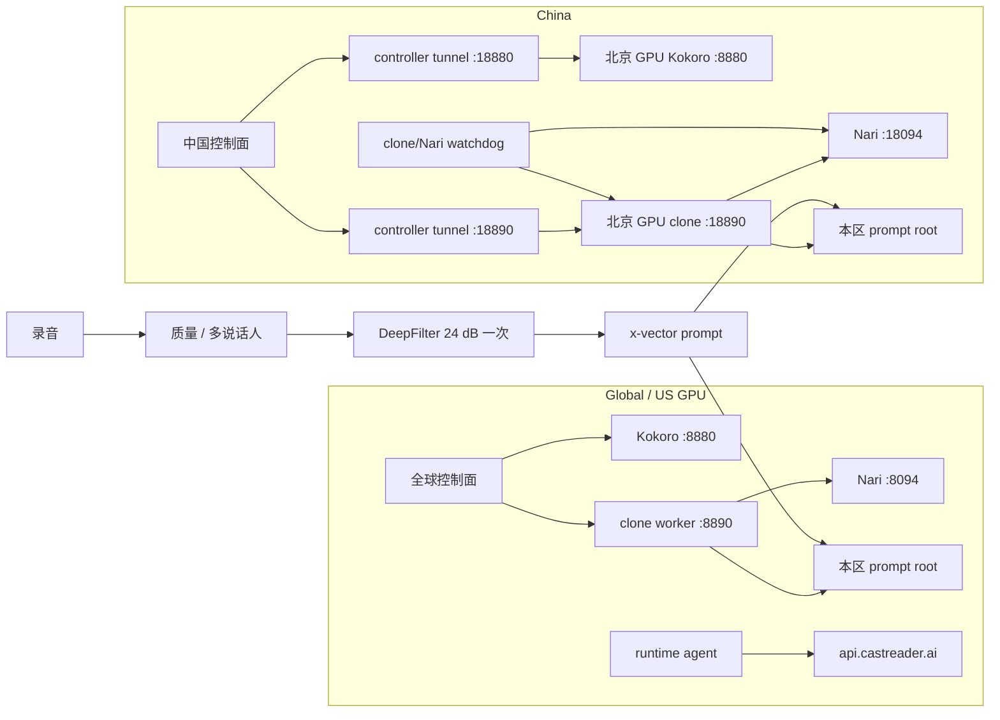
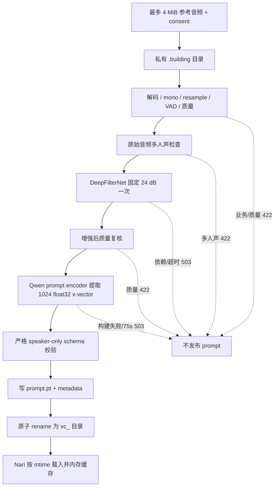

# GPU 语音管线只读复核：Kokoro、克隆建声、Nari 与监管

审计时间：2026-09-05。生产快照集中在 10:32–10:52 UTC（北京时间 18:32–18:52）。

本报告只覆盖两区 GPU 语音供给及其直接上下游边界：Kokoro 普通音色、clone worker、Nari/Qwen3-TTS、录音提交、参考音频检查、DeepFilterNet、x-vector prompt、区域内运行副本、队列、超时、健康检查、监管和恢复。全球与中国 Web/API、QuickRead、数据库和完整对象存储控制面由同批总报告的其他部分复核。

本轮没有发送合成、建声或上传请求，没有读取用户正文、录音、voice ID、账号或密钥，没有重启、部署或修改生产配置。新增内容只有本目录下的脱敏证据和本文。

## 1. 结论

1. **当前两区普通音色和克隆音色使用各自 GPU、端口和 prompt 根目录，运行时没有发现中美互相回退。** 美国 GPU 的运行上报只指向 `api.castreader.ai`；中国 GPU 的相关进程只发现到本机 Nari 的 loopback URL，没有运行上报 agent。两区模型进程均启用离线/本地模型模式。这个结论限于已检查的活动进程、环境和源码；不能代替云厂商对物理地域的法律证明。
2. **当前国际 Kokoro 仍真实发生会中断朗读的技术性 500。** 在精确 24 小时诊断窗口内，worker 有 487 个 HTTP 500 响应事件，归属于 140 个带 500 的 request ID 上下文。487 条都走同一个失败链：英文 source-timestamp 前端先降级，随后真正用于发声的英文 G2P 仍返回“字母数字词没有音素”，相同正文单元重试一次后仍失败，且 `discarded_chunks=0`。因此这批故障不是坏时间戳把已经生成的有效 PCM 丢掉，而是发声前端无法为词生成音素，导致该单元没有可发布声音。
3. **时间戳和裁音当前已经是辅助元数据。** 英文 source-timestamp 准备失败会改走相同模型、音色和正文的 audio-only G2P；非英文对齐、word cue、容器时长和裁音失败会清空或修正 cues，并保留真实 PCM。窗口中另有 131 个 request ID 上下文发生 source 前端降级但没有 HTTP 500，证明“时间戳降级”本身不再必然中断音频。
4. **当前剩余的硬失败位于正文可发声完整性，而不是高亮精度。** `KokoroV1._audio_only_english_chunks` 对字母数字 token 无 phoneme 直接抛错；`TTSService` 将每个完整单元缓存到成功结束才发布，并只重试同一单元一次。它防止重复前缀和静默漏读，但一个无法发音的 token 仍可让整次非流式响应成为 500，已生成的前序单元也没有版本化 continuation 合同可以返回给调用方。
5. **Kokoro 和 clone/Nari 在每区共用一张 4090，却没有跨进程的统一资源调度。** Kokoro 只有进程内 semaphore 和语言锁；clone 有单线程优先级队列；Nari 又有自己的 active-request 上限。三者健康，但压力、OOM、冷启动或 CUDA 同步仍可互相影响。克隆“看起来更流畅”可以由较短分段、单线程排队、请求合并和 Nari 的 GPU graph 常驻共同造成，并不意味着模型本身更轻。
6. **克隆建声的录音质量门只发生在创建音色时，不参与既有音色的每段播放。** 录音长度、有效人声、削波、SNR、多人声和严重混响会阻止不合格 prompt 发布；DeepFilter/diarizer 不可用会令建声临时失败。实时合成只硬拒绝无有效媒体的结果，例如坏容器、非有限样本、低于 0.2 秒或近乎全静音；削波、频谱、段首音高和时长估算已是 advisory，不会丢掉可播放声音。当前代码也让降噪依赖故障不拉下既有音色 TTS。
7. **克隆 prompt 的 worker 本地恢复仍有单点。** 美国 live capability 明确显示 `/workspace` 不是持久 volume，而活动 prompt 根位于其下。控制面的导入/导出接口存在，但本轮没有得到对象版本、自动恢复或恢复演练回执，不能把本地目录当已验证灾备。中国 `/root/autodl-tmp` 是单独 XFS mount，但只凭 mount 也不能证明供应商持久性或恢复 RTO。
8. **中国监管已解除 Kokoro 健康延迟连带重启 clone/Nari。** 当前 watchdog 只拥有 clone/Nari；Nari 异常或整卡空闲显存低于 2.5 GiB 时重启整条 clone 管线，clone 自身健康失败只重启 clone worker。仍有两个缺口：健康探针只看 clone 顶层 `status`，不会发现“已有音色能合成、但新建声依赖坏了”；`nvidia-smi` 一次读取异常也被当作 GPU 安全门失败。
9. **两区 Kokoro registry 不是同一字节。** 中国多一个启用但按当前 resolver 静态不可达的日语 package。它不会改变已证明的请求路由，却会被启动过程预加载，增加冷启动和显存工作。两区应使用同一可达 manifest，区域差异必须独立、显式、可审计。

## 2. 证据口径与边界

本文用三类判断：

| 标记 | 含义 |
|---|---|
| **现场事实** | 当前生产进程、端口、健康、GPU 点值、脱敏环境域名、日志聚合或运行文件 SHA 已只读核实 |
| **源码事实** | 当前生产 SHA 与本地文件一致，或本地/部署脚本明确存在该行为 |
| **风险推断** | 由现场与源码组合得到的可能故障方式；没有写成已经发生 |

日志数字必须按原统计单位解释：

- 美国 `487` 是 HTTP 500 **响应事件数**，不是请求用户数；有 `140` 个不同 request ID 上下文带 500。重试和 request ID 复用使两者都不能换算成用户数。
- 全球控制面报告的 `480` 条 `/api/captioned_speech_partly` 500 是“最新 500 条 5xx 样本”里的截断结果，不是 24 小时总失败数或失败率。原始安全聚合见 [global production 5xx sample](/Users/xuxuheng/Documents/CastReader/reports/backend-architecture-review-20260905/global/production-5xx-sample.json) 与 [recent TTS diagnostics](/Users/xuxuheng/Documents/CastReader/reports/backend-architecture-review-20260905/global/tts-recent-error-diagnostics.json)。
- clone supervisor 的日志统计只读取每个 stream 最多 500 KB tail，不是完整保留窗口；其中测试、管理请求和真实用户流量不能安全拆开。
- GPU、队列和 health 是采集时点，不代表全天容量。

当前生产 Kokoro 关键文件与本地审计工作树 `77daa03648c434d518a53afde7e2df811200b8e4` 的 SHA 一致；clone/Nari 的关键文件在两区也与本地审计源一致。中国唯一不一致的是下文单列的 `model_packages.json`。精确 SHA 见 [US governance](/Users/xuxuheng/Documents/CastReader/reports/backend-architecture-review-20260905/worker/us-runtime-governance.json)、[CN runtime snapshot](/Users/xuxuheng/Documents/CastReader/reports/backend-architecture-review-20260905/worker/cn-runtime-snapshot.json) 与 [source hash comparison](/Users/xuxuheng/Documents/CastReader/reports/backend-architecture-review-20260905/worker/source-hash-comparison.json)。

## 3. 当前实际结构

### 3.1 生产清单

| 项目 | Global / US | China |
|---|---|---|
| GPU | 单张 RTX 4090，24,564 MiB；采集点 used 13,886 / free 10,207 MiB | 单张 RTX 4090，24,564 MiB；采集点 used 14,661 / free 9,420 MiB |
| Kokoro | PID 1,158,018；`:8880`；R131b；启动 2026-09-04 04:07:46 UTC；RSS 5,192,364 KiB | PID 640,207；`:8880`；R131b；启动 2026-09-04 04:25:04 UTC；RSS 4,934,392 KiB |
| clone worker | PID 568,834；loopback `:8890`；1 Uvicorn worker；RSS 2,398,892 KiB | PID 639,681；`:18890`；父进程为 watchdog；RSS 2,512,156 KiB |
| Nari | PID 4,136,837；loopback `:8094`；RSS 2,798,520 KiB | PID 639,323；loopback `:18094`；父进程为 watchdog；RSS 2,752,452 KiB |
| clone queue | 0 / 64；submitted/completed 124/124；failed/expired 0/0 | 0 / 32；submitted/completed 4/4；failed/expired 0/0 |
| clone run p95 | 1,122.73 ms（进程累计窗口） | 1,829.40 ms（进程累计窗口） |
| health | 三服务均 200；Nari ready | 三服务均 200；Nari ready |
| prompt root | `/workspace/castreader-clone/voices` | `/root/autodl-tmp/nari-staging/clone/voices` |
| 本地存储现场能力 | `/workspace` live capability 为 `workspace_is_volume=false` | `/root/autodl-tmp` 为单独 XFS mount；持久 SLA 未证明 |
| 进程管理 | supervisor 中 TTS、clone、clone TLS、Nari、runtime agent RUNNING；candidate STOPPED | clone/Nari 由同一 watchdog 管理；Kokoro 独立 |

RSS 是进程主存，不是每个进程的显存分摊；GPU used 是整卡点值。不能把三项 RSS 相加当作显存，也不能从这一时点推导峰值余量。

中国 controller 的两条 systemd tunnel 均 active、`NRestarts=0`：本地 `18880 → 北京 GPU 127.0.0.1:8880`，本地 `18890 → 北京 GPU 127.0.0.1:18890`。它们是独立隧道进程，但共用同一个北京远端和同一 ingress identity，因此进程级故障隔离存在，共用远端/身份仍是共同故障域。

现场证据：[US snapshot](/Users/xuxuheng/Documents/CastReader/reports/backend-architecture-review-20260905/worker/us-runtime-snapshot.json)、[US governance](/Users/xuxuheng/Documents/CastReader/reports/backend-architecture-review-20260905/worker/us-runtime-governance.json)、[CN snapshot](/Users/xuxuheng/Documents/CastReader/reports/backend-architecture-review-20260905/worker/cn-runtime-snapshot.json)。

## 4. Kokoro 普通音色完整管线

### 4.1 请求、路由与模型选择

1. 区域控制面把一段正文、preset voice、语言、速度、输出格式和是否需要时间戳交给本区 `/dev/captioned_speech`。
2. `TTSService.generate_audio_stream` 先解析音色并决定 `pipeline_lang_code`；语言省略时使用 voice 首字符。英文且请求时间戳时，辅助 splitter 不先改写数字/日期，以便 source-word mapping 看原文。[tts_service.py:400](/Users/xuxuheng/Documents/MyProject/.worktrees/castreader-tts-playback-priority/api/src/services/tts_service.py:400)
3. `smart_split` 是辅助分块。它异常时，Kokoro 会按 pause tag 重建完整计划，把原正文交给模型自己的 G2P/chunker，不静默漏正文。[tts_service.py:377](/Users/xuxuheng/Documents/MyProject/.worktrees/castreader-tts-playback-priority/api/src/services/tts_service.py:377)
4. immutable registry 先 exact voice，再 `routeByLanguage`，最后 default；音色与语言冲突会拒绝，而不会暗换模型或语言。[model_packages.py:108](/Users/xuxuheng/Documents/MyProject/.worktrees/castreader-tts-playback-priority/api/src/inference/model_packages.py:108)
5. 启动时加载 registry 中每个 enabled package；每个 pipeline 用 `model=False` 建立 G2P shell，再显式绑定已加载的指定模型，避免 KPipeline 隐式下载或再建默认模型。[kokoro_v1.py:119](/Users/xuxuheng/Documents/MyProject/.worktrees/castreader-tts-playback-priority/api/src/inference/kokoro_v1.py:119)、[kokoro_v1.py:303](/Users/xuxuheng/Documents/MyProject/.worktrees/castreader-tts-playback-priority/api/src/inference/kokoro_v1.py:303)

当前 global/local registry 有 13 个 enabled package。静态分析发现 5 个 enabled package 没有 exact voice、voice pattern、language route，且不是 default，按当前 resolver 不可达；另有同一基础模型由 5 个 package 重复声明、同一葡语模型由 2 个 package 重复声明。因为启动会加载每个 enabled package，这些条目增加冷启动、CPU/GPU 内存和配置面，即使没有请求会选中它们。明细见 [model registry summary](/Users/xuxuheng/Documents/CastReader/reports/backend-architecture-review-20260905/worker/kokoro-model-registry-summary.json)。

中国 registry SHA 与 global/local 不同。中国以 enabled 的 `kokoro-ja-public-mio-aoi-ren-haruto-kaori-r5` 替换了 global/local 中 disabled 的 r4；r5 没有任何 selector，静态上不会接到请求，但仍会被 eager load。脱敏差异见 [CN/US registry diff](/Users/xuxuheng/Documents/CastReader/reports/backend-architecture-review-20260905/worker/cn-us-model-registry-diff.json)。

### 4.2 分句、G2P、推理和正文完整性

- 服务外层目标分块为约 175–250 tokens、absolute 450；但 `get_sentence_info` 调用 `process_text_chunk(full)` 时漏传 `lang_code`，token estimate 回到默认英文。Kokoro splitter 失败会把完整原文交还模型，因此当前主要影响是分块质量和可预测延迟，不是已证实的正文丢失。[text_processor.py:102](/Users/xuxuheng/Documents/MyProject/.worktrees/castreader-tts-playback-priority/api/src/services/text_processing/text_processor.py:102)
- 英文真实发声路径由 installed G2P 生成 token/phoneme；任何包含字母数字的 token 没有 phoneme 会失败。phoneme 超过 510 时优先按空格切，没有边界也保留所有 suffix，不再做 `ps[:510]` 截断。[kokoro_v1.py:1020](/Users/xuxuheng/Documents/MyProject/.worktrees/castreader-tts-playback-priority/api/src/inference/kokoro_v1.py:1020)
- 非英文先按约 400 字符聚合句子，再按 510 phones 完整分块；拆 phone 后无法可靠映射 source span，因此返回真实声音但不虚构词级时间戳。[kokoro_v1.py:1050](/Users/xuxuheng/Documents/MyProject/.worktrees/castreader-tts-playback-priority/api/src/inference/kokoro_v1.py:1050)
- 每个外层正文单元先把模型产生的 AudioChunk 全部放进 `pending_audio`，只有模型 iterator 完整结束后才发布。若 iterator 后段失败，丢弃这一单元的 pending prefix，再以相同正文、音色、模型和区域重试一次。这避免重复播同一单元开头，但仍然是“单元原子性”，不是“整次请求可恢复 continuation”。[tts_service.py:163](/Users/xuxuheng/Documents/MyProject/.worktrees/castreader-tts-playback-priority/api/src/services/tts_service.py:163)
- 真正空 PCM、非数值/非有限 PCM、可读正文完全无音频仍硬失败；这类检查是媒体真实性，不应改成空音频成功。[audio_timing.py:9](/Users/xuxuheng/Documents/MyProject/.worktrees/castreader-tts-playback-priority/api/src/core/audio_timing.py:9)

### 4.3 时间戳、裁音和音频交付

当前优先级是：有效 PCM 决定声音能否交付；时间戳只决定高亮是否可用。

| 阶段 | 当前行为 | 是否能撤销有效 PCM |
|---|---|---|
| 英文 source mapping | `prepare_english_chunks` 异常后记录脱敏事件，改走相同正文/音色/模型的 audio-only G2P | 否；但 audio-only G2P 自身仍可能因无 phoneme 失败 |
| 非英文 word alignment | 异常后 `tokens=[]` | 否 |
| result → word cues | 异常后直接从 result.audio 建 AudioChunk，cues 为空 | 否 |
| cue sanitize | 非有限、空词、倒序、越界 cue 被删除或夹到真实音频时长 | 否 |
| 静音 trim | trim、cue 或时长检查失败后恢复原 normalized PCM 和原 cues | 否 |
| PCM validate | 空、一维性错误、非数值或非有限 PCM | 是；没有可播放媒体 |

代码证据：[kokoro_v1.py:929](/Users/xuxuheng/Documents/MyProject/.worktrees/castreader-tts-playback-priority/api/src/inference/kokoro_v1.py:929)、[kokoro_v1.py:978](/Users/xuxuheng/Documents/MyProject/.worktrees/castreader-tts-playback-priority/api/src/inference/kokoro_v1.py:978)、[audio_timing.py:15](/Users/xuxuheng/Documents/MyProject/.worktrees/castreader-tts-playback-priority/api/src/core/audio_timing.py:15)、[audio.py:225](/Users/xuxuheng/Documents/MyProject/.worktrees/castreader-tts-playback-priority/api/src/services/audio.py:225)。

非流式 endpoint 仍将所有 chunk 合并完成才回 JSON。因此即使内部叫 `generate_audio_stream`，对上游 partly 请求的单段而言，首包时间仍包含整个该段模型生成、编码和合并时间；单段过长会直接表现为停顿。[tts_service.py:561](/Users/xuxuheng/Documents/MyProject/.worktrees/castreader-tts-playback-priority/api/src/services/tts_service.py:561)

### 4.4 当前真实 P0：英文 G2P 技术失败

美国当前 24 小时诊断窗口（2026-09-04 10:41–2026-09-05 10:41 UTC）包含：

- 5,599 条结构化事件，解析错误 0；
- `request_failed` 491 条：500 为 487 条、404 为 3 条、400 为 1 条；
- 487 条 500 全部命中同一 model-unit fatal fingerprint；每条的第二次尝试失败，`discarded_chunks=0`；
- 140 个不同 request ID 上下文至少出现一个 500；
- 500 elapsed p50 984 ms、p95 27,441 ms、最大 31,045 ms；它是日志中的响应耗时，不是全链端到端播放间隔；
- 487 条 fatal 的 text length 覆盖 3 到 933 字符，不能简写为“只在长文”或“只在一个字符”；
- 另有 131 个 distinct request ID 上下文发生 source frontend 降级却没有 HTTP 500。

失败栈是：

1. `compatible_english_timestamps.py:102` 的 source-timestamp 准备发现 G2P 丢了 lexical token；
2. `kokoro_v1.py:943–960` 正确降级到 audio-only；
3. `kokoro_v1.py:1025–1031` 的真实 audio G2P 仍发现字母数字 token 没有 phoneme；
4. `tts_service.py:167–203` 原单元重试一次，第二次仍失败且没有可发布 PCM；
5. `tts_service.py:485–531` 包装为 `Failed to generate complete audio`，router 返回 500。

全球控制面的最近 30 个 `en / am_adam` 错误样本均带 upstream request ID。用 request ID 的 SHA-256 前 12 位做脱敏关联，30/30 在 worker 找到对应 fatal，30/30 的 control-plane `inputLength` 与 worker `text_chars` 一致；样本正文形状只有 letters、spaces、punctuation，没有数字和 symbols。该关联证明控制面的“preset upstream rejected request”就是这一 worker 失败链，但不能由 30 条样本推断全部 487 条都属于同一 voice 或同一自然语言内容。证据见 [cross-layer correlation](/Users/xuxuheng/Documents/CastReader/reports/backend-architecture-review-20260905/worker/us-gateway-worker-correlation.json)、[fatal shape](/Users/xuxuheng/Documents/CastReader/reports/backend-architecture-review-20260905/worker/us-playback-fatal-shape.json)、[worker aggregate](/Users/xuxuheng/Documents/CastReader/reports/backend-architecture-review-20260905/worker/us-playback-log-aggregate.json)。

中国当前诊断文件的 24 小时窗口有 9 个 500 response events：相同 unit 都重试一次，`model_generation_failed` 18 条，另有 `trim_preserved_complete_pcm` 42 条。中国 fingerprint 与美国上述 fatal fingerprint 不同，本轮没有读取用户正文，也没有进一步生产探针，所以只确认“相同 wrapper 下有 9 次技术失败”，不把它归因于美国的同一种 lexical G2P。最后一条发生于 2026-09-05 06:35:23 UTC，快照时三服务均已健康。

### 4.5 Kokoro 并发与性能风险

| 机制 | 当前事实 | 风险 |
|---|---|---|
| chunk semaphore | 全进程最多 4 个 `_process_chunk` | 没有显式队列上限、等待时限、优先级或 overload 指标；请求会在进程内等待 |
| pipeline lock | key 是调用方提交的 `lang_code`，缺省则 voice 首字符 | `en` 与缺省后得到的 `a` 可能解析到同一实际 package/pipeline，却进入不同锁；同一 KPipeline iterator 仍可能并发 |
| model adapter lock | package/adapter 切换另有锁 | 只保护 adapter 激活，不构成整卡资源调度 |
| input length | `CaptionedSpeechRequest.input` 无 max_length | 依赖上游分段；直连或旧调用可形成超长等待和大内存响应 |
| memory cleanup | `memory_allocated()/1e9 > memory_threshold(0.8)` | 配置描述像比例，代码却拿 GB 与 0.8 比；模型常驻后很可能每次都 `empty_cache+synchronize`，静态上是单位不一致，实际延迟贡献尚未单独测量 |
| health | `/health` 固定返回 `healthy` | 不证明 registry/model 已加载、GPU 可推理、队列是否卡住或输出编码可用 |
| logging | splitter 和 model debug/info 日志包含前 50/100 字符 | 可能把正文写入普通日志；安全 diagnostics 已脱敏，但旧日志面仍需收口 |

对应源码：[tts_service.py:58](/Users/xuxuheng/Documents/MyProject/.worktrees/castreader-tts-playback-priority/api/src/services/tts_service.py:58)、[schemas.py:126](/Users/xuxuheng/Documents/MyProject/.worktrees/castreader-tts-playback-priority/api/src/structures/schemas.py:126)、[kokoro_v1.py:1102](/Users/xuxuheng/Documents/MyProject/.worktrees/castreader-tts-playback-priority/api/src/inference/kokoro_v1.py:1102)、[model_config.py:20](/Users/xuxuheng/Documents/MyProject/.worktrees/castreader-tts-playback-priority/api/src/core/model_config.py:20)、[main.py:140](/Users/xuxuheng/Documents/MyProject/.worktrees/castreader-tts-playback-priority/api/src/main.py:140)、[text_processor.py:64](/Users/xuxuheng/Documents/MyProject/.worktrees/castreader-tts-playback-priority/api/src/services/text_processing/text_processor.py:64)。

Kokoro 还默认启用 wildcard CORS、dev/debug router 和 web player，并绑定 `0.0.0.0`。是否能从公网直达取决于防火墙/隧道/入口，本轮没有把源码默认等同为公网暴露；但生产进程不需要这些表面，应该从制品中关闭。[main.py:122](/Users/xuxuheng/Documents/MyProject/.worktrees/castreader-tts-playback-priority/api/src/main.py:122)、[config.py:5](/Users/xuxuheng/Documents/MyProject/.worktrees/castreader-tts-playback-priority/api/src/core/config.py:5)。

## 5. 录音、上传、降噪与建声

### 5.1 客户端交接边界

iOS 当前源码录制 24 kHz、mono、PCM16 WAV；本地限制 3–30 秒、4 MiB。[VoiceCloneRecorder.swift:17](/Users/xuxuheng/Documents/CastReader/CastReader/Services/VoiceCloneRecorder.swift:17)、[VoiceCloneRecorder.swift:63](/Users/xuxuheng/Documents/CastReader/CastReader/Services/VoiceCloneRecorder.swift:63)

本地只做便宜的预检：有效人声低于 2.5 秒、active RMS 低于 -42 dBFS 或 clipping ratio 高于 0.004 时阻止提交；解码失败则跳过本地质量判断，服务端仍是权威检查。[VoiceCloneRecorder.swift:246](/Users/xuxuheng/Documents/CastReader/CastReader/Services/VoiceCloneRecorder.swift:246)

Global 使用 multipart 提交整份 WAV；China 先取得本区 STS，把 WAV PUT 到 STS 指定 COS host，再向控制面只提交 `referenceObjectKey`。创建请求预算 150 秒，401 刷新 session 后重试一次；COS 签名有效 600 秒。这个客户端路径没有为一般网络异常、429/503 实现统一 backoff，也没有显式设置 COS upload timeout 或端到端 `X-Request-ID`。[VoiceCloneService.swift:80](/Users/xuxuheng/Documents/CastReader/CastReader/Services/VoiceCloneService.swift:80)、[VoiceCloneService.swift:113](/Users/xuxuheng/Documents/CastReader/CastReader/Services/VoiceCloneService.swift:113)、[VoiceCloneService.swift:169](/Users/xuxuheng/Documents/CastReader/CastReader/Services/VoiceCloneService.swift:169)、[VoiceCloneService.swift:410](/Users/xuxuheng/Documents/CastReader/CastReader/Services/VoiceCloneService.swift:410)

创建失败时 UI 保留同一 WAV 和所选语言，允许用户以相同材料重试，而不是强迫重录。[VoiceCloneCreatedView.swift:1335](/Users/xuxuheng/Documents/CastReader/CastReader/Views/Settings/VoiceCloneCreatedView.swift:1335)

### 5.2 worker 建声状态机

建声 API 要求 consent；upload 上限 4 MiB，prompt 上限 2 MiB，合成文本上限 600 字符，默认 build 总预算 75 秒。[clone_worker.py:74](/Users/xuxuheng/Documents/CastReader/reports/nari-dynamic-voice-clone-poc/worker/clone_worker.py:74)、[clone_worker.py:205](/Users/xuxuheng/Documents/CastReader/reports/nari-dynamic-voice-clone-poc/worker/clone_worker.py:205)、[clone_worker.py:705](/Users/xuxuheng/Documents/CastReader/reports/nari-dynamic-voice-clone-poc/worker/clone_worker.py:705)

质量门及其范围：

| 检查 | 当前阈值/行为 | 类型 | 对已建音色播放的影响 |
|---|---|---|---|
| 容器/采样率 | 8–192 kHz 可解码，raw duration 3–30 秒 | 建声硬门 | 无 |
| 有效讲话 | speech 至少 3 秒，speech ratio 至少 35% | 建声硬门 | 无 |
| 响度 | active RMS 至少 -42 dBFS | 建声硬门 | 无 |
| 削波 | ratio 不高于 0.004，最长连续削波不高于 8 ms | 建声硬门 | 无 |
| 噪声 | 可可靠估计时 SNR 至少 9 dB；不可可靠估计时 broadband flatness 低于 0.70 | 建声硬门 | 无 |
| 严重混响 | 至少两个独立 tail，tail/direct 高于 -4 dB 才拒绝；较轻只 warning | 建声硬门/提示 | 无 |
| 多说话人 | 第二说话人 ≥0.8s，或 ≥0.35s 且 overlap ≥0.2s 拒绝 | 建声硬门 | 无 |
| diarizer 不可用 | retryable 503，不把未检查参考发布为 prompt | 技术建声失败 | 无 |
| DeepFilter | binary/hash 必须可信；固定 24 dB、一次；无 raw fallback | 建声硬门 | 无 |
| speaker consistency | 增强前后 embedding 相对下降 0.05 只 warning | advisory | 无 |
| transcript-duration | 当前 speaker-only 模式仅 advisory | advisory | 无 |

源码：[audio_quality.py:44](/Users/xuxuheng/Documents/CastReader/reports/nari-dynamic-voice-clone-poc/worker/audio_quality.py:44)、[audio_quality.py:551](/Users/xuxuheng/Documents/CastReader/reports/nari-dynamic-voice-clone-poc/worker/audio_quality.py:551)、[adaptive_denoise.py:83](/Users/xuxuheng/Documents/CastReader/reports/nari-dynamic-voice-clone-poc/worker/adaptive_denoise.py:83)、[adaptive_denoise.py:377](/Users/xuxuheng/Documents/CastReader/reports/nari-dynamic-voice-clone-poc/worker/adaptive_denoise.py:377)、[clone_worker.py:814](/Users/xuxuheng/Documents/CastReader/reports/nari-dynamic-voice-clone-poc/worker/clone_worker.py:814)、[clone_worker.py:1107](/Users/xuxuheng/Documents/CastReader/reports/nari-dynamic-voice-clone-poc/worker/clone_worker.py:1107)。

DeepFilter timeout/cancel 会先 TERM 整个 process group，1 秒后仍未退出才 KILL；失败绝不回退到 raw reference。[adaptive_denoise.py:417](/Users/xuxuheng/Documents/CastReader/reports/nari-dynamic-voice-clone-poc/worker/adaptive_denoise.py:417)

### 5.3 prompt 内容、发布和清理

生产新 prompt 只允许 `1024 x float32` speaker embedding，加少量版本/时长字段；schema 明确禁止 `ref_text`、reference audio、codec、bootstrap 或其他 ICL context。worker 写入前检查，Nari 读取时再检查。[build_prompt.py:19](/Users/xuxuheng/Documents/CastReader/reports/nari-dynamic-voice-clone-poc/worker/build_prompt.py:19)、[build_prompt.py:53](/Users/xuxuheng/Documents/CastReader/reports/nari-dynamic-voice-clone-poc/worker/build_prompt.py:53)、[text.py:127](/Users/xuxuheng/Documents/CastReader/reports/nari-dynamic-voice-clone-poc/nari-qwen3-tts/src/nari_qwen3_tts/model/text.py:127)

每次创建在 `.building` 私有目录中完成；增强 WAV、原始 reference 和 denoise 工作文件随后删除；只有验证后的 `prompt.pt + metadata.json` 通过原子 rename 发布。进程启动也清除遗留 `.building`。因此半成品不会被当作可用音色。[clone_worker.py:631](/Users/xuxuheng/Documents/CastReader/reports/nari-dynamic-voice-clone-poc/worker/clone_worker.py:631)、[clone_worker.py:744](/Users/xuxuheng/Documents/CastReader/reports/nari-dynamic-voice-clone-poc/worker/clone_worker.py:744)

Nari 按 prompt 文件 mtime 缓存，最多 128 个；进程重启后可从本地目录重新加载。[text.py:137](/Users/xuxuheng/Documents/CastReader/reports/nari-dynamic-voice-clone-poc/nari-qwen3-tts/src/nari_qwen3_tts/model/text.py:137)

worker 提供受共享 token 保护的 prompt import/export，但没有内建自动对象存储备份、版本化或跨节点复制。用户/owner 映射在区域控制面，而 worker 只认识 opaque `vc_` ID。R131 的 Kokoro runtime backup 不包含用户 prompt；不能拿模型备份当音色恢复。

### 5.4 已建音色的实时合成

正常每段克隆 TTS 不再读取录音、不再跑录音质量门、不再降噪或建声。路径是：

`区域控制面 → clone /v1/captioned-speech → 读取/缓存本地 prompt → clone scheduler → loopback Nari → PCM → 输出质量检查 → MP3 + 可选时间戳`。

当前实时路径始终使用 speaker embedding 的 x-vector 模式。总预算内依次尝试原 seed、第二个 sampled seed、最后一次 greedy；这些都是同一 prompt、正文、音色、Nari 和区域。重试只由媒体无效/空静音或 transport failure 触发，不会因频谱、削波、段首音高或“估计时长过长”而丢音频。[clone_worker.py:1689](/Users/xuxuheng/Documents/CastReader/reports/nari-dynamic-voice-clone-poc/worker/clone_worker.py:1689)

实时输出门当前分为：

| 检查 | 当前处理 | 性质 |
|---|---|---|
| WAV 无法解码、采样率错误、空/非有限样本 | 拒绝并在预算内换 attempt | 媒体真实性硬门 |
| 时长 <0.2s、RMS <0.001、silent ratio >99.5% | 拒绝并在预算内换 attempt | 无有效可听内容硬门 |
| 削波 >3%、DC offset、噪声/电子频谱、段首 pitch 异常 | 记录 `blocking=false` warning，仍返回原音频 | advisory |
| 生成时长高于文字估算 | `generated_audio_duration_warning`，仍返回原音频 | advisory |
| word timing 计算失败 | MP3 已编码，返回空 timestamps | advisory |

对应源码：[clone_worker.py:2182](/Users/xuxuheng/Documents/CastReader/reports/nari-dynamic-voice-clone-poc/worker/clone_worker.py:2182)、[clone_worker.py:2502](/Users/xuxuheng/Documents/CastReader/reports/nari-dynamic-voice-clone-poc/worker/clone_worker.py:2502)、[clone_worker.py:2645](/Users/xuxuheng/Documents/CastReader/reports/nari-dynamic-voice-clone-poc/worker/clone_worker.py:2645)。这些硬门判断的是“是否存在真实可播放媒体”，不是高亮或主观音质；三次都无有效媒体后仍返回 503，不能用空音频伪装成功。

`/v1/captioned-speech` 另有 request ID 和内容短期合并：request-ID cache 64/90s、content cache 32/120s，且只缓存成功结果；`/v1/speech` 和 voice build 没有同等 coalescing。[request_coalescer.py:46](/Users/xuxuheng/Documents/CastReader/reports/nari-dynamic-voice-clone-poc/worker/request_coalescer.py:46)、[clone_worker.py:152](/Users/xuxuheng/Documents/CastReader/reports/nari-dynamic-voice-clone-poc/worker/clone_worker.py:152)

## 6. clone/Nari 调度、超时与取消

### 6.1 clone scheduler

clone worker 是 1 个 Uvicorn process，内部只有 1 条 GPU scheduler execution thread。它区分 interactive、prefetch、background；优先 interactive，并让每等待 8 秒的低优先级任务提升一级，防止永久饥饿。美国 queue cap 64，中国 32。[inference_scheduler.py:67](/Users/xuxuheng/Documents/CastReader/reports/nari-dynamic-voice-clone-poc/worker/inference_scheduler.py:67)

queue full 返回 429 + `Retry-After: 2`；deadline 返回 503 + `Retry-After: 2`。排队期间超时可取消；一旦 Python `execute()` 已开始，scheduler 只会令等待调用方超时，不能抢占任意 Python job。Nari HTTP streaming 支持主动取消；prompt encoder 构建没有贯穿 GPU kernel 的 cancel，因而 API 已超时后仍可能短暂占 GPU。[inference_scheduler.py:108](/Users/xuxuheng/Documents/CastReader/reports/nari-dynamic-voice-clone-poc/worker/inference_scheduler.py:108)、[inference_scheduler.py:201](/Users/xuxuheng/Documents/CastReader/reports/nari-dynamic-voice-clone-poc/worker/inference_scheduler.py:201)

每个 voice mutation 通过 256 个 hash-striped `RLock` 之一串行。它有固定内存上限，但哈希碰撞会让两个无关 voice 偶然相互等待。[clone_worker.py:560](/Users/xuxuheng/Documents/CastReader/reports/nari-dynamic-voice-clone-poc/worker/clone_worker.py:560)

### 6.2 运行时预算

| 预算 | US | CN | 备注 |
|---|---:|---:|---|
| voice build | 75s | 75s | 含 decode、质量、多说话人、降噪、prompt |
| clone synthesis | 源码默认 45s；live 未见 override | 60s | 整个 clone handler |
| Nari HTTP | 源码默认 30s；live 未见 override | 45s | loopback 请求 |
| Nari max active | CLI 未传，源码默认 128 | CLI 明确 1 | clone scheduler 已将普通 adapter 流量串行；US direct/internal client 仍有过量 admission 风险 |
| Nari PCM buffer | 每请求 8 MiB | 每请求 8 MiB | overflow 清空并取消，不返回截断 PCM |

Nari 的 readiness 不是固定字符串：完整 CUDA graph capture、无 eager fallback、各 stage health、有效 PCM 和 retire 状态共同决定 ready。engine 运行后不可恢复故障会进入 FAILED，`/ready` 返回 503。[health.py:85](/Users/xuxuheng/Documents/CastReader/reports/nari-dynamic-voice-clone-poc/nari-qwen3-tts/src/nari_qwen3_tts/contract/health.py:85)、[engine.py:766](/Users/xuxuheng/Documents/CastReader/reports/nari-dynamic-voice-clone-poc/nari-qwen3-tts/src/nari_qwen3_tts/engine/engine.py:766)、[app.py:57](/Users/xuxuheng/Documents/CastReader/reports/nari-dynamic-voice-clone-poc/nari-qwen3-tts/src/nari_qwen3_tts/api/app.py:57)。

US 的 128 active 默认并不等于当前已有 128 并发；现场 queue 为 0，clone scheduler 将正常流量串行。这是绕过 adapter 或未来新增直接调用时的配置风险。

## 7. 健康检查、监管和恢复

### 7.1 当前健康语义

| 组件 | health 实际证明 | 没有证明 |
|---|---|---|
| Kokoro | HTTP server 能返回固定 JSON | registry/model 已加载、GPU 可生成、encoder 可用、queue 延迟、输出编码 |
| clone 顶层 `status` | 2 秒内 Nari `/ready` 成功 | prompt root 可写、token 可读、prompt encoder 可执行、DeepFilter/diarizer 能建声 |
| clone `voice_creation_enabled` | writer marker + denoise/diarizer dependencies ready | 一份新用户参考一定能通过质量门 |
| Nari `/ready` | engine 与 CUDA capture/stages 满足 readiness contract | 上游 clone、区域隧道或对象存储可用 |

clone 有意把既有音色 TTS 与新建声能力分开：DeepFilter 或 diarizer 冷启动失败不会让 worker 退出，existing voice synthesis 仍可工作；`voice_creation_enabled=false` 暴露建声故障。[clone_worker.py:631](/Users/xuxuheng/Documents/CastReader/reports/nari-dynamic-voice-clone-poc/worker/clone_worker.py:631)、[clone_worker.py:668](/Users/xuxuheng/Documents/CastReader/reports/nari-dynamic-voice-clone-poc/worker/clone_worker.py:668)

clone token 文件会在每个受保护请求上读取：不可读返回 503，token 不匹配返回 401；`/health` 不验证 token 文件。因此会存在“health 200、业务请求才发现 credential/file 故障”的窗口。[clone_worker.py:545](/Users/xuxuheng/Documents/CastReader/reports/nari-dynamic-voice-clone-poc/worker/clone_worker.py:545)

这一区分是正确的，但中国 watchdog 目前 grep 顶层 `"status":"healthy"`，不会因 `voice_creation_enabled=false` 自动告警。正确动作应是独立 capability 告警，不应为了修建声而重启仍在服务的 existing-voice playback。

### 7.2 中国 watchdog

当前运行脚本 SHA 与本地 r131 一致。其行为是：

- 只拥有 clone/Nari，不检查、不停止 Kokoro；
- Nari 冷启动前要求整卡 free ≥14,000 MiB，最多等待 30 分钟 readiness；ready 后要求 free ≥2,500 MiB；
- 运行期每 2 秒看 GPU free；值不可解析或低于 2,500 MiB，结束并重启 clone/Nari；
- Nari `/ready` 2 秒 timeout 连续两次失败，重启 clone/Nari；
- clone `/health` 在 20 秒 startup grace 后连续三次不 healthy，只 TERM 并重启 clone；
- TERM 父监管时依次 TERM 两个 child，并等待退出；没有常驻 STOP 或 KILL 快捷路径。

代码：[watchdog r131:4](/Users/xuxuheng/Documents/MyProject/.worktrees/castreader-tts-playback-priority/deployment/cn-watchdog/watchdog-china-staging.sh.r131:4)、[watchdog r131:46](/Users/xuxuheng/Documents/MyProject/.worktrees/castreader-tts-playback-priority/deployment/cn-watchdog/watchdog-china-staging.sh.r131:46)、[watchdog r131:79](/Users/xuxuheng/Documents/MyProject/.worktrees/castreader-tts-playback-priority/deployment/cn-watchdog/watchdog-china-staging.sh.r131:79)。

当前 clone/Nari PID 自 2026-09-04 04:23–04:24 UTC 起保持，Kokoro 随后切换没有让它们重启，说明旧“Kokoro 健康慢 → 杀 clone/Nari”的级联已解除。

剩余风险推断：

- `nvidia-smi` 单次读取失败与真实低显存同样触发整条 clone pipeline 重启；应区分 telemetry unavailable 与硬显存不足，并要求短窗口多点确认。
- Nari readiness 连续约 4 秒失败即可重启；需记录 active request、CUDA event、GPU pressure 后再决定是否重启，避免健康 handler 暂时饿死被当作 engine failed。
- 冷启动前 14 GiB free gate 是必要的保护，但没有显示“因 Kokoro/其他服务占用而等待多久”的 metric；控制面只能看到 clone 不可用。

### 7.3 美国 supervisor 与日志

本轮确认各 program 的 RUNNING/STOPPED 状态，没有取得同等级的 restart policy、退避和依赖图，不能推断美国发生故障时一定优雅排空。clone shutdown 会 `SCHEDULER.close(wait=True)`，停止接收、清掉待执行队列并最多等待 worker thread 5 秒，然后关闭 Nari client；运行中 job 的完整退出仍取决于进程管理器给的 TERM grace。[clone_worker.py:661](/Users/xuxuheng/Documents/CastReader/reports/nari-dynamic-voice-clone-poc/worker/clone_worker.py:661)、[inference_scheduler.py:185](/Users/xuxuheng/Documents/CastReader/reports/nari-dynamic-voice-clone-poc/worker/inference_scheduler.py:185)

supervisor tail 只做脱敏聚合：clone stdout tail 中看到 342 个 HTTP 200、39 个 503、9 个 404、4 个 422，以及 xvector accepted/rejected 和质量 warning；没有保留 body、request/voice ID 或正文。由于窗口不完整且混有测试/管理请求，不能计算真实失败率。[supervisor tail aggregate](/Users/xuxuheng/Documents/CastReader/reports/backend-architecture-review-20260905/worker/us-supervisor-log-tail-aggregate.json)

## 8. 区域与跨境边界

| 数据/计算 | Global / US | China | 当前结论 |
|---|---|---|---|
| 普通 TTS compute | US Kokoro 8880 | 现场核实：北京 Kokoro 8880，经 controller 18880 tunnel | 活动进程分离；无跨区 worker fallback |
| clone compute | US clone 8890 + Nari 8094 | 现场核实：北京 clone 18890 + Nari 18094，经 controller 18890 tunnel | 每区 loopback 到本区 Nari |
| 模型依赖 | Kokoro `HF_HUB_OFFLINE=1`、`TRANSFORMERS_OFFLINE=1`；Nari `--local-files-only` | 两者 offline/local | 正常推理不运行时下载模型；registry 的 HuggingFace source 是物料标识，不是当前网络请求 |
| prompt live copy | `/workspace/.../voices` | `/root/autodl-tmp/.../voices` | 区域目录分开；持久性见风险 |
| runtime telemetry | agent → `api.castreader.ai` | 未发现 agent；相关 URL 只有 loopback Nari | 现场活动配置符合区域；不是完整 egress packet proof |
| 原录音/对象存储 | 控制面审计范围 | STS/COS 控制面审计范围 | worker 自身只处理传入 bytes 并删除 build reference；bucket 地域/lifecycle 由总报告证明 |

US runtime agent domain 的脱敏证据见 [runtime agent domain](/Users/xuxuheng/Documents/CastReader/reports/backend-architecture-review-20260905/worker/us-runtime-agent-domain.json)。CN GPU active process/env 扫描没有发现 `api.castreader.ai`；CN controller 也没有 TTS/ops timer、cron 或 exporter 指向它。这个方法看不到运行库临时拼出的 URL、云供应商内部链路或 DNS/CDN 实际落点，因此“未发现”不能扩写成法律意义的零跨境证明。

当前没有自动中美故障转移。区域隔离上这是正确的；可用性上意味着每区必须有本区 standby、对象恢复和入口冗余，不能用跨区 fallback 补高可用。

## 9. 故障影响矩阵

| 故障 | 当前影响范围 | 会不会丢掉已有音频 | 当前恢复 | 缺口 |
|---|---|---|---|---|
| 英文 token 无 phoneme | 当前 Kokoro 请求 500；客户端停止/重试 | 该 unit 没有 PCM；前序 unit 在非流式响应中也无法交付 | 相同 unit 一次重试，确定性错误通常重复失败 | 无 token 级安全发音 fallback、无 partial continuation |
| 时间戳/对齐异常 | 高亮为空或减少 | 不会 | 自动降级 | 需监控比率和语言分布，不能再升级为播放失败 |
| trim/时长探测异常 | 保留完整 normalized PCM | 不会 | 自动降级 | 需确保控制面不二次硬验 cues |
| Kokoro OOM | 当前 unit 重试后失败，可能 500 | pending unit 不发布 | clear cache + unit retry | 无进程级 GPU broker、无 bounded queue/priority、health 太浅 |
| clone queue full | 429 | 尚未生成 | `Retry-After:2` | 客户端/网关重试预算需统一，避免重试风暴 |
| Nari deadline / failed | clone 503 | buffer overflow 时不会交付截断媒体 | watchdog/supervisor 重启 | 每区单实例；恢复中无本区第二供给 |
| DeepFilter/diarizer 坏 | 新建声 503，既有音色仍可合成 | 不涉及已有播放 | 修依赖后重试建声 | capability 告警未接入 watchdog/dashboard |
| prompt local root 丢失 | 该节点所有克隆音色不可读 | 之后合成失败 | 控制面可理论 import | US 本地不是 volume；自动恢复/RTO 未验证 |
| CN tunnel/identity 坏 | CN 普通或 clone 对应 tunnel 断 | 新请求失败 | systemd tunnel restart | 两 tunnel 共用远端/identity；无第二北京节点 |
| CN GPU free telemetry 异常 | watchdog 重启 clone/Nari | 活跃请求中断 | 自动冷启 | 单次 telemetry 错误与真实危险未区分 |
| registry 漂移 | 冷启动/显存/路由不可预测 | 视条目而定 | 人工部署/回滚 | 两区 manifest 不同且无静态 reachable gate |

## 10. 建议的稳固化方案

以下是方案，不是本轮已实施状态。

### P0：先消除当前真实断供

1. **把 G2P 故障隔离到最小 token，并保证正文守恒。**
   - 在 selected package/voice/region 内先做 Unicode NFKC、已知缩写/专名、零宽字符和不可见控制符清理；不能改变可见正文的顺序或漏字。
   - G2P 失败时二分到最小 lexical token，使用同一语言、同一 voice、同一模型的 deterministic spelling/character pronunciation；禁止换声、跨区或把正文 token 变成静音。
   - 如果同模型仍不能发音，新版协议可以返回已提交的可播放 prefix、精确 `unprocessed_text`、稳定 error code 和 `complete=false`；不要把整段变成 500，也不要谎报 complete。调用方只对 exact suffix 做同区有限恢复。
   - **不能直接让现有 whole-text endpoint 返回 partial。** 当前旧网关/客户端按“整段成功”消费响应，并不具备可靠的剩余正文协商；有的入口会拒绝余文或把 partial 当失败。必须用版本化字段、capability negotiation 或新 endpoint，同时改 gateway 和各端 continuation consumer；兼容层对旧调用仍保持原合同，直到“可播放 prefix 入队、exact suffix 继续、最终完整且不重复”通过端到端验收。
   - 对当前 fingerprint 建匿名回归 corpus：普通英文、缩写、Unicode 组合字符、URL、专名、emoji/符号邻接；验证每个 source unit 不是“有字无音素”。

2. **为音频单元建立可恢复提交点。**
   - 生成状态固定为 `prepared → PCM validated → media encoded → published → metadata attached`。
   - `published` 后任何 timestamp、trim、缓存、持久化或诊断异常都不能撤销媒体。
   - 每次响应带 `request_id + unit_index + consumed_source_offset + exact_remaining + complete`；重试必须从最后 committed offset 开始。
   - 同一 request/unit 使用幂等键和成功缓存；相同 deterministic frontend 错误不做盲目二次模型推理。

3. **统一错误分类和总重试预算。**
   - frontend deterministic、invalid request、业务 auth/quota 不重试；
   - queue/full、网络 reset、进程恢复、一次 OOM 可以同区有限退避；遵守 `Retry-After`；
   - 单次朗读 session 有总预算，避免 iOS/Web/网关/worker 各自叠加重试；
   - 重试只用原正文 suffix、原 voice、原 region，不切模型或跨境。

4. **把 prompt 恢复变成每区真实能力。**
   - prompt 发布后异步写本区私有、加密、版本化对象存储；写入失败不能撤销本机刚建好的 voice，但必须告警并补偿重试。
   - 新节点启动按 manifest 恢复 prompt，校验 SHA/schema/owner mapping，再开放 clone traffic。
   - US 不能依赖非-volume `/workspace`；CN 也不能仅凭 XFS mount 认定可靠。
   - 每区定期做“空白节点 → 本区 object store → 恢复既有诊断 voice”的演练；不把一份跨区备份作为生产依赖。

### P1：让播放拥有明确资源优先级

5. **建立每区统一 GPU admission。**
   - 当前三个进程各自调度同一张卡。应加入 GPU resource broker，或把工作合并到一个有统一资源视图的 scheduler。
   - 优先级只服务供给：正在播放的 continuation 最高，下一段 prefetch 次之，新建声和离线诊断只在保留的 spare capacity 内运行。
   - admission 应排队和背压，而不是用新的内容/时间戳硬门停止播放；超载时公开 queue position、deadline、Retry-After 和可恢复 offset。
   - 若短期不能统一进程，至少显式保留 Kokoro/Nari 显存预算、限制 US Nari `max-active-requests`、禁止未经 adapter 的直接调用。

6. **用 resolved route 加锁。**
   - 把 Kokoro lock key 从调用方 `lang_code/voice-prefix` 改为 resolver 最终的 `(package_id, resolved_lang, adapter)`。
   - 对不可并发 iterator 严格单飞；不同真正独立模型才允许并发。
   - 增加 lock wait、queue depth、generation/encode 分段耗时，验证 semaphore=4 是否有实际吞吐收益。

7. **修正显存治理。**
   - `memory_threshold` 明确为比例或 MiB，代码与配置同单位；不要在每次正常请求前无条件 `empty_cache+synchronize`。
   - OOM 先拒绝后台 voice build/prefetch，保留 active playback；一次 controlled recycle 后继续 exact suffix。
   - watchdog 对真实低显存使用短窗口多点确认；`nvidia-smi` 不可读单独告警，不立即等同显存耗尽。

8. **拆分 liveness、readiness 和 capability。**
   - Kokoro liveness 只证明进程活；readiness 必须证明 registry/model loaded、GPU 可接受请求、encoder 可用、队列未冻结，但不能在线 health 每次做真实合成。
   - clone 分开 `synthesis_ready` 与 `voice_creation_ready`；前者决定既有声音流量，后者只告警/控制建声入口。
   - watchdog 只重启自己拥有且确实坏的进程；不得因 Kokoro、时间戳、对象存储或建声附属组件拖下另一条可用音频管线。

### P2：减少长期复杂度和单点

9. **编译一份可达模型 manifest。**
   - CI 拒绝 enabled 但不可达 package、重复 exact voice、未使用的 `timestampMode`、重复加载同一 model tensor。
   - US/CN 使用同一 signed manifest；任何区域差异放在独立 override，写明原因、owner、过期时间和验证。
   - 同一 model source 只加载一次权重，多个 voicepack/pipeline 复用；对高频活跃模型预热，避免简单“全部 lazy”把冷启动推给用户。

10. **缩小生产表面。**
    - production 关闭 dev/debug/test/web player 和 wildcard CORS；worker bind loopback 或私有 interface，只由区域 gateway/tunnel 访问。
    - 删除死的 denoise selector、未消费 registry 字段和历史路径；保留一个建声状态机和一个实时合成状态机。
    - 普通日志不写 `text[:50]` / `text[:100]`；只保留 request ID、package、language、preset code、input length/shape、unit index、queue、timing、safe error code。

11. **每区独立可观测和高可用。**
    - request ID 从客户端到 gateway、Kokoro/clone/Nari 全链透传；安全错误 code 直接表达 frontend、model、PCM、encode、queue、deadline，不靠异常字符串 hash 才能定位。
    - 每区 dashboard 统计 success、TTFA、audio duration/compute time、queue wait、retry、continuation、gap、G2P fallback、timestamp degrade、prompt restore；CN 数据留 CN，Global 留 Global。
    - 每区准备第二 GPU 或 warm standby、第二 tunnel/ingress 和本区 prompt restore；禁止以另一地区作为自动 failover。

## 11. 建议验收定义

目前没有同一版本、同一负载和同一网络条件下的完整基线，不能先写任意 TTFA、gap、恢复成功率或 RTO 数字。第一轮应按下表统一测量，再以真实 iPhone/Android/Web/扩展缓冲预算、两区峰值负载和恢复演练结果设目标。内容完整与区域隔离可以直接作为硬门，不依赖统计基线。

| 指标 | 测量与验收方式 |
|---|---|
| 正文守恒 | 所有 success/partial 的 `committed source range + exact remaining` 精确重建输入；硬门为零静默截断、零重复 prefix、零伪报 complete |
| 旧协议兼容 | whole-text 老入口继续得到其原有完整响应合同；partial/unit 新合同只有在 gateway 和客户端声明 capability 后启用，并验收 prefix 已入队、suffix 继续和最终完整 |
| PCM 真实性 | 每个声明可播放的正文单元都有可解码、非空、有限 PCM；不以空音频伪装成功 |
| 元数据隔离 | 分别注入 timestamp、trim、cache、diagnostics 故障；硬门为这些辅助失败不能把已验证 PCM 变成音频失败，并单独统计 metadata degraded |
| warm partly TTFA | 按区域、语言、voice package、正文长度桶、并发和 cache 状态记录 p50/p95/p99；以各端真实预取 buffer 能否覆盖为产品指标，再依据峰值实测定预算 |
| 连续播放 gap | 在客户端记录前一段最后可听帧到下一段第一可听帧；分别测稳定网络、弱网、queue wait、单次 retry 和 worker 恢复，再以主观可感知测试设目标 |
| transient resume | 按 network reset、queue full、worker restart、OOM 分类，统计从最后 committed unit 恢复的成功率、耗时和重复/漏字；先做故障注入基线，再设每类目标 |
| deterministic frontend | 相同 deterministic 错误不重复消耗模型推理；当前 G2P fatal corpus 必须全部得到同模型可发音表示，或通过新版合同返回可验证的 exact partial，绝不静默跳过 |
| queue | 分别记录 active playback、prefetch、voice build 的 admission、wait、deadline 和 cancel；验证后台工作不逐出正在播放的 continuation，再按两区峰值设容量门 |
| 区域 | 所有正文、参考、prompt、音频和 telemetry destination 通过本区 allowlist；硬门为所有跨区 fallback 测试均被拒绝 |
| prompt DR | 每区执行空白节点从本区对象存储恢复既有诊断 prompt，记录实际 RPO、RTO、校验和和开放流量时点；基于首轮演练再定恢复目标 |
| watchdog | 只重启故障所有者；telemetry 单点读失败不触发 pipeline restart；每次 restart 必须记录原因、active-work 影响和恢复时点 |

## 12. 尚未证明的事项

- 没有云供应商控制面材料证明 GPU、对象存储、Supabase/R2 或 LLM 内部处理的法律物理地域。
- 没有验证 US 宿主上任何目录同步方案的目标、加密、版本和恢复；不能把存在同步能力当成 prompt 灾备已经可用。
- 没有验证 CN XFS volume 在实例销毁后的契约、快照和 RTO。
- 没有获取美国 supervisor 完整 restart policy，也没有完整 clone/Nari 日志保留窗口。
- 没有读取 CN 9 次 500 的原文或新增请求，当前 safe fingerprint 不足以归因具体语言/token。
- 没有在本轮做任何合成、上传、建声、长稳或故障注入；当前 health 只说明采集时可响应。
- 没有证明旧客户端版本全部使用当前入口。运行端没有跨区 fallback，不等于所有旧安装包已经升级。

## 13. 证据文件

- [US runtime snapshot](/Users/xuxuheng/Documents/CastReader/reports/backend-architecture-review-20260905/worker/us-runtime-snapshot.json)
- [US runtime governance and source hashes](/Users/xuxuheng/Documents/CastReader/reports/backend-architecture-review-20260905/worker/us-runtime-governance.json)
- [US runtime agent domain](/Users/xuxuheng/Documents/CastReader/reports/backend-architecture-review-20260905/worker/us-runtime-agent-domain.json)
- [US Kokoro 24h safe aggregate](/Users/xuxuheng/Documents/CastReader/reports/backend-architecture-review-20260905/worker/us-playback-log-aggregate.json)
- [US Kokoro fatal shape](/Users/xuxuheng/Documents/CastReader/reports/backend-architecture-review-20260905/worker/us-playback-fatal-shape.json)
- [Gateway-to-worker request correlation](/Users/xuxuheng/Documents/CastReader/reports/backend-architecture-review-20260905/worker/us-gateway-worker-correlation.json)
- [US supervisor tail aggregate](/Users/xuxuheng/Documents/CastReader/reports/backend-architecture-review-20260905/worker/us-supervisor-log-tail-aggregate.json)
- [CN runtime snapshot](/Users/xuxuheng/Documents/CastReader/reports/backend-architecture-review-20260905/worker/cn-runtime-snapshot.json)
- [Kokoro registry summary](/Users/xuxuheng/Documents/CastReader/reports/backend-architecture-review-20260905/worker/kokoro-model-registry-summary.json)
- [CN/US registry diff](/Users/xuxuheng/Documents/CastReader/reports/backend-architecture-review-20260905/worker/cn-us-model-registry-diff.json)
- [Production/local source hash comparison](/Users/xuxuheng/Documents/CastReader/reports/backend-architecture-review-20260905/worker/source-hash-comparison.json)
- [Evidence index](/Users/xuxuheng/Documents/CastReader/reports/backend-architecture-review-20260905/worker/evidence-index.json)
