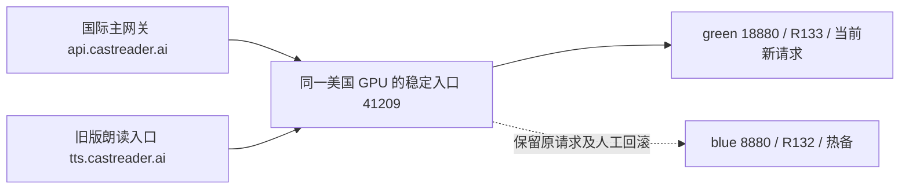

# 核心音频后端生产上线与 24 小时观察

本次执行顺序是**先完成后端上线，再观察真实生产数据**。本目录接续[上一轮迭代](../backend-audio-iteration-20260906/README.md)，保留旧证据，不把候选验证算成生产观察。

## 生产状态

**本轮后端修复已全部上线。** 国际主网关、旧版直连网关与 US Kokoro R133 均已完成生产核验，持久化路由与环境/冷启动目标已收敛到同一 US 稳定入口。最后一次完整维护发布 `34012365932` 已成功。

| 组件 | 本轮修复与生产身份 | 证据 |
|---|---|---|
| 国际主网关 `api.castreader.ai` | 修复默认 NDJSON 被单 JSON 解析器拒绝的问题；环境配置与冷启动路径固定为同一 US 稳定入口。最终源码 `e8a755d4ea9602397cad138e6b3bbd3d91f7fa54`，部署 `dpl_9fnjABFoGBgj2ni2KAgf59Pa2jRc`；DB revision 1 | [最终线上身份](global-release/final-production-capabilities.json)、[DB 与审计读回](global-release/tts-db-final-readback.json)、[最终公网音频](public-final-after-route-audio-probe.json) |
| 旧版朗读入口 `tts.castreader.ai` | 源码 `b9e7e9129e49f882398289511bbb90dbda8c6c08`；运行文件 SHA `53a4ca273a7b3d60b1ce24f3cb089985f57bb6006b2838b683549c69e93d26d5`。读取完整音频，旧端口配置映射到固定 US 稳定入口 | [生产与排空回执](direct-gateway/status-receipt.json) |
| US 稳定入口 | `us-tts-origin-proxy-20260906-v1`，源码 `954730c1c67e0a103f8ce80992e97a2df400e4a8`，当前 revision 2 / green | [入口发布回执](us-kokoro/proxy-release-receipt.json)、[当前模型回执](us-kokoro/r133-production-receipt.json) |
| US Kokoro | R133，源码 `ca857ee91c3367999fb905de1f0924a6e28edd81`，green/18880。修复重复数字 `00` 的空音素供给失败，保留两个数字及完整原文 | [生产回执](us-kokoro/r133-production-receipt.json)、[九语公网验证](us-kokoro/r133-public-41209-validation.json) |
| 中国区、克隆与解读服务 | 本次未替换这些服务的模型或改变地区。已有两区供给监控持续采集，Global 发布流程包含克隆与相关业务接口回归 | [监控说明](monitoring/README.md) |

## 当前供给结构

稳定入口只允许同一主机的两个固定 loopback 目标。每个请求在读取正文前固定模型槽位，切换只影响新请求；先预热、验证，再原子切换，旧请求继续完成。入口不解析或拒绝时间戳，不把预热、发布验证放到用户每次播放的路径中。业务身份、非会员与额度限制保留。

Global 与 Direct 的实际目标都是 `http://71.175.237.103:41209/dev/captioned_speech`。配置拒绝未知或中国区目标，转发拒绝重定向；没有新增跨区兜底。代理管理端仅使用 root-only Unix socket。中国区保持原有中国区入口与模型供给。

R132 原进程保留，`/workspace/castreader-runtime/current` 仍保持蓝槽的 R132 启动语义。**这个旧链接不能代表稳定入口当前使用的模型。** 当前 green/R133 有独立 Supervisor 持久配置；监控核对实际槽位、监听 PID、Supervisor PID、工作目录及 G2P 源文件 SHA。

## 已执行的验证

- Global 通过原有 production 维护发布流程验证不可变源码、配置、候选与生产接口。首次候选探针遇到 TLS 连接重置，独立复核完整音频通过；再次发布应用成功后，收尾脚本暴露 ESM/CJS 导入错误。PR #26 将入口 `.mts` 改为 `.ts`，业务代码字节不变，并加入真实命令行子进程启动测试。最终完整发布成功；04:57:09 UTC 经受保护 admin API 写入 revision 1，04:57:13 UTC 连续公网读回为 database，独立数据库查询确认状态与追加审计内容完全一致。见[路由收敛回执](global-release/ci-run-34012365932-attempt1/routing-artifact/evidence.json)。
- Direct 覆盖省略 `stream`、`true`、`false` 三种旧客户端契约，实际 MP3 全量解码及余文闭合验证通过。切换已排空旧请求和临时候选，常驻 Caddy、QuickRead 进程保持不变。
- R133 在同一 US 主机上验证九种语言、重复 `00`、原文尾部、完整 MP3 解码和余文为零。双模型并存时，4 个并发完整音频请求最长 8.621 秒，峰值仍有 4,811 MiB 显存空闲；克隆与降噪进程未重启。
- US 控制机对两个国际公网朗读入口执行固定非用户 `00` 回归：均 HTTP 200、70,317 字节音频、4.392 秒完整解码、余文为零。只保留摘要，不保存音频或用户正文。
- 监控新增代理/模型身份适配 10 项测试，原验收 28 项测试通过；已在生产五分钟窗口验证完整采集。这个[短窗口预检](monitoring/preflight-five-minute.json)不属于正式 24 小时验收。

## 版本固定、备份与边界

发布使用既有 GitHub production 环境与互斥入口。同账号 Vercel CLI 会话通过官方 OAuth 刷新后，将短期 access token 注入既有 CI secret；refresh token 留在本地，未导出到 CI 或报告。[凭据路径审计](global-release/release-credential-path-audit.md)记录实际边界。长期无人值守凭据轮换仍需独立管理。

US 恢复集包含原版完整基线、R132 增量和本轮 R133/代理生产增量。生产代码、模型清单、代理状态、Supervisor 配置与恢复步骤已进入 Global 私有存储，逐对象完整读回核对；见[恢复索引](us-kokoro/r133-production-recovery-index.json)。Direct 的[原版备份](direct-gateway/offhost-readback.json)与[生产备份](direct-gateway/offhost-production-readback.json)也已完整读回。

这些证据证明对象及校验链完整，尚未执行灾难恢复演练。同一 GPU 双槽能避免停掉旧模型再启动新模型的发布空窗，**不等于独立主机或机房级容灾**，也没有据此宣称所有客户端零中断。

本次范围是后端上线。上一轮 Android `0663a5b`、iOS `09dcb64` / `814030a` 客户端增强已经提交，本任务未发布移动端二进制；不能将其当作旧客户端已经具备的行为。

## 正式观察

唯一状态文件为 [acceptance-state.json](../backend-audio-iteration-20260906/monitoring/acceptance-state.json)，结果为 [latest-acceptance.json](../backend-audio-iteration-20260906/monitoring/latest-acceptance.json)。正式窗口已固定为 **2026-09-06T05:01:25Z 至 2026-09-07T05:01:25Z**，共 86400 秒。北京时间为 **2026-09-06 13:01:25 至 2026-09-07 13:01:25**。生产完成与观察基线见[完整回执](production-completion-receipt.json)。观察刚开始，尚无 24 小时验收结论。

每小时只读汇总既有两区五分钟供给探针、Global 客户端事件、Vercel 核心 5xx、Direct 请求日志及版本身份。状态不变且没有可处理异常时保持安静；新增故障或到期结论才通知。到期后按原窗口完成汇总并暂停自动化，不因样本不足自动延长。

供给、客户端首音频及技术停止、数据覆盖分开判断。探针 HTTP 200 不能替代四端持续播放完成率；Web/扩展端到端、克隆/解读样本不足会明确保留为证据缺口。这里的 US TTS 同区证据也不能单独证明全系统每个存储、鉴权或 LLM 请求均无跨境。
