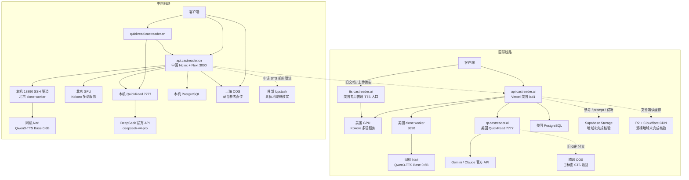
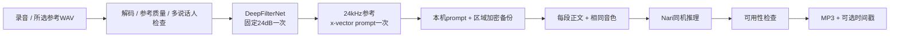

# CastReader 核心后端全链路只读审计

> 本文保留修复前审计时点的版本和证据。用户随后授权的修改、实际部署和当前验收边界见[核心服务迭代记录](/Users/xuxuheng/Documents/CastReader/reports/backend-core-iteration-20260904.md)，不要把本文旧状态当作最新生产状态。

审计日期：2026-09-04（北京时间）。范围：国际区/中国区的朗读、解读、Kokoro、克隆模型、录音、音频文件导入、上传、存储、降噪、建声、试听、恢复和持续播放。

首轮审计只读检查生产部署、配置、服务源码、健康状态及数据库聚合；没有修改业务代码、配置、数据库或部署，也没有发起新的音频合成或上传。

后续按用户“先证明和定位”的要求，已追加无身份路由探针、当前生产500日志和一条非用户诊断语音的本地时间戳注入验证。**实际跨境已闭环，时间戳硬门槛已隔离复现；当前500的逐条内部原因尚未全部取证。** 证据及界限见[实证核查报告](/Users/xuxuheng/Documents/CastReader/reports/backend-core-evidence-20260904/README.md)。后续核查同样没有修改业务代码或生产部署。

## 1. 结论与判定口径

**目前不能认定“整个后端已杜绝跨境”，也不能认定“所有技术检查都不会打断播放”。** 已修复的网关时间戳降级、克隆频谱误拒和文件缓存写入阻塞确实在生产；但更深层的 Kokoro 校验、旧接口、存储依赖和客户端差异仍然存在。

最重要的发现：

1. **Kokoro worker 内部仍有时间戳硬校验。** 网关拿到音频后清空坏时间戳，无法挽救 worker 在返回音频前已经抛出的异常。
2. **中国区旧文档/上传接口仍明确代理国际入口。** `/documents`、`/sts`、`/async-md-upload-by-url`、`/upload` 是生产 Nginx 的有效配置。
3. **中国区文件朗读并未接通所有入口。** `/api/markdown-tts/*`、大部分 `/api/tts/*` 被 Nginx 直接 404；新版上传通知缺少 reader 上游配置会 503。不能把“已合并修复”当成中国公开文件朗读已可用。
4. **国际网关当前去美国，但区域加固分支尚未进入现网。** 普通 TTS 切流、克隆 worker 配置、存量音频 URL、重定向等仍有区域边界缺口。
5. **录音上传和旧解读仍有外部依赖。** 中国 STS 前置 Upstash 限流；国际旧解读 GIF 合成启用 COS 上传。二者必须分别核查，不能由主模型所在地代替全链路证明。
6. **连续播放仍受队列、每段鉴权、额度、超时和解读 job 生命周期影响。** 试听还存在“音频已经生成，存储/数据库失败却不能返回”的路径。

本报告按三种证据区分：

| 标记 | 含义 |
|---|---|
| 现场确认 | 当前运行进程、线上配置、部署身份或只读数据查询已核实 |
| 代码确认 | 源码存在该行为；是否被特定已发布客户端调用另行说明 |
| 待核实 | 缺少供应商地域、安装版本或实际流量证据，不能写成“已安全”或“已发生” |

“区域隔离”首先指：选定 CN 后正文、录音、参考音频、prompt 和生成结果不被后台切到国际线；选定 Global 后不转入中国线，包括重试、恢复、缓存和旧接口。国际用户到美国本身可能跨国；Gemini/Claude 的全球 API、Cloudflare CDN 的边缘节点也不能证明供应商内部处理固定在美国。若要求“任何用户都不跨国”，现有两区部署本身不满足这个更强目标。

## 2. 本次实际核对的版本

| 组件 | 当前核对结果 | 证据性质 |
|---|---|---|
| 国际 Web/API | `2be1e9e9e9a9be69d772a556295a85e6e4117983`；Vercel `dpl_3zYvnPzXRo2hX2tp5AhmQV17z5Wy`；READY；`iad1` | 现场 |
| 中国 Web/API | `97443cef6d9aeec236f0196ad26e06bee260d628`；`release-20260904011344` | 现场 |
| 两区克隆 worker | `clone_worker.py` SHA-256 `97cb920eadf2c467faa284d910d9ea2e1a35540d0e189de4a4cbbb9ff8e21ab6`；来源 `56e014e` | 现场 |
| 美国 QuickRead | `/root/castreader/routing-releases/20260903-global-routing/candidate`；`QUICKREAD_REGION=global` | 现场 |
| 中国 QuickRead | `/opt/castreader-quickread-cn/current`；`QUICKREAD_REGION=cn` | 现场 |
| 两区Kokoro | 美国R130 `/workspace/castreader-runtime/releases/20260903-kokoro-compatible-1236-r130`；中国R130 `/root/autodl-tmp/castreader-runtime/releases/20260904-kokoro-compatible-cn-r130` | 现场；关键源码SHA一致 |
| 国际区域加固 | `codex/global-regional-routing` 不是现网 `2be1e9e9`；不能把分支代码当生产行为 | 代码/部署对照 |
| iOS 客户端 | 主工作区 `b71cb2c`；另核对发布准备工作树 `e3bbe90`（1.2.33 / Build 53，包含音频文件导入） | 源码；未据此认定用户已安装 |
| Android 客户端 | `3511c3c` 工作区 | 源码；未核对 Play/用户已安装包 |
| 扩展客户端 | 主工作区 `2f06097`；兼容发布工作树 `f4dac51` 仍保留旧 QuickRead 配置路径 | 源码；未核对商店实际安装版本 |

旧报告和注释中“新加坡 QuickRead”“共享海外 CN 数据库”“自适应 24/100 降噪”“禁止失去词高亮”等内容不能直接当作当前事实。当前进程和代码优先于历史叙述。

## 3. 四条核心服务的结构

图中的虚线不是“已经发生事故”，而是额外依赖或已部署的例外路径。所有“同机”仅指服务间连接为 loopback；中国QuickRead当前直接调用DeepSeek官方API，并非大模型在CN Web主机上本地推理。

### 3.1 国际 TTS

普通 TTS 有两种入口：

- 统一网关：`api.castreader.ai/api/captioned_speech_partly`（另有 `/api/captioned_speech`）→ `tts-gateway.ts` → 路由配置/环境地址 → 美国 GPU `71.175.237.103:41228/dev/captioned_speech`。
- 专用入口：`tts.castreader.ai` → 美国 QuickRead 主机上的 `7778` 网关 → 同一美国 GPU。Android 普通音色当前源码优先走此入口，失败可单次回同区 `api.castreader.ai`。这不是中美互相回退，但属于独立入口，不能默认继承 Next 网关全部逻辑。

克隆 TTS：`/api/voice-clone/captioned-speech`，或兼容接口识别 `vc_` → session/Pro/音色授权/额度 → 美国 worker `/v1/captioned-speech` → 同机 Nari → MP3与时间戳返回。兼容`/api/captioned_speech_partly`负责切段并添加`processed_text/unprocessed_text`；直接克隆接口只接受不超过600个JavaScript UTF-16单元的文本，不自行返回剩余正文，调用方须分段。正常每段不上传参考、不降噪、不重新建声。

另有`/api/voice-clone/speech` → worker `/v1/speech`返回WAV，仍校验Pro、语言和600字符限制；没有captioned链路的10次瞬态重试，仅遇404时恢复音色后再调用。试听也使用这类WAV合成，不能套用captioned重试策略。

Web 文件朗读：`/api/markdown-tts/generate` → 可选数据库缓存 → 命中返回 CDN `audioUrl`；未命中走共用 TTS 网关，先返回 `audioBase64`，再后台写 R2 和数据库。缓存读取和时间戳读取分别有 500ms 预算；两次顺序等待不能理解为总共只有 500ms。

仍有独立旧入口 `/api/tts/generate` 与 `/api/tts/tts_and_transcribe`，使用自己的上游变量/默认值，未完全汇入共用路由。前者仍被工具页调用；后者实际流量与旧上游可用性未核实。两者fetch均未设置显式超时，也未声明route maxDuration；异常catch返回500。旧transcribe下载返回音频URL失败时，还可能返回200但空audio。平台最终函数时限未逐函数核实，不能把配置中的通配值直接当现网有效上限。

### 3.2 国际解读

当前逐块主路径：

`extract-plan → 首块/后续 extract-block → 客户端调用所选音色的 TTS → compose-block 计算标注时间 → 客户端入队播放`。

全球鉴权入口将请求转到精确允许的 `qr.castreader.ai`，不跟随 3xx；公开 job 映射绑定用户、额度主体、serviceRoute 与过期时间。解读不是另一套独立语音模型，讲解文本仍复用普通或克隆 TTS。

美国 QuickRead 的自有 VPS 已核实在美国新泽西，三个域名 `qr.castreader.ai`、`quickread.castreader.ai`、`tts.castreader.ai` 当前均指向 `140.82.14.49`。旧 `quickread.castreader.ai:8444` 由 Caddy 转本机 7777。

默认讲解模型是 Gemini，回退 Claude；现行 global 区域校验不允许 Kimi/Moonshot 或任意代理覆盖。供应商内部推理所在地没有取得固定美国的证明。

旧整篇路径还包含服务端整篇 TTS 和 GIF 处理。美国 `generate-tts.mjs` 已固定 global、取消中美回退；但旧非 page 的 `compose` 分支仍启用 `uploadGifsToCos`，向 STS 返回的 COS 目标上传。当前未见足够证据证明近期用户实际触发该上传，亦不能将它写成已隔离。

### 3.3 中国 TTS

`api.castreader.cn` Nginx → 本机 Next 3000 → 普通音色进入北京 SeetaCloud GPU；克隆进入本机 18890 隧道，再到北京 clone worker/Nari。两区的 clone worker 文件哈希相同。

目录及示例音频通过 CN 本机静态镜像提供，`/api/tts/catalog`、`/api/tts/assets/voice-library/*` 不依赖国际目录回源。

**公开入口的限制必须明确：** Nginx 当前把其余 `/api/tts/*` 和 `/api/markdown-tts/*` 直接 404。因此后端代码中有文件朗读修复，不代表中国域名可以访问该修复路径；iOS 本地 EPUB/Kindle 提取后调用普通 TTS 与服务器文件朗读是不同链路。

### 3.4 中国解读

`quickread.castreader.cn/api/quickread/*` 按入口凭据分支：

- 不带 `x-api-key`：本机 Next 3000 校验 `cms_`/`cmc_`，再转本机 7777；iOS/移动会话通常走这里。
- 带 `x-api-key`：直接本机 7777，由 worker 校验 key；兼容浏览器扩展。
- `api.castreader.cn/api/quickread/*` 走本机 Next，不直接放行客户端自报身份。

LLM：QuickRead直接请求`https://api.deepseek.com/chat/completions`，固定`deepseek-v4-pro`、fallback为none。现场未见8787代理监听；历史“回环DeepSeek”注释不符合当前实现。当前CN配置不回退Gemini/Claude，但该供应商fetch尚未显式禁止重定向。

中国 QuickRead 的旧 `generate-tts.mjs` 仍保留 COS 配置、按 `tz` 选 CN/US、互相 fallback。但目前只有旧精确 `POST /api/quickread` 根路由调用。后续2026-09-04实请求更正：无key安全GET/HEAD根路径返回301到尾斜杠路径，尾斜杠路径返回308到根路径；尾斜杠携带非凭据dummy `x-api-key`返回worker404。公开路径因此无法正常抵达旧精确根handler，不能简写为“根路由直接404”。这是**已部署但当前公网路径不能正常到达的历史跨区分支**，不是当前逐块解读已发生跨区的证据。

当前中国公网主机为 `106.54.47.163`；QuickRead实际release目录为 `20260814T165413Z-deepseek-v4-pro-cn-optimized-r5`，其中有后续改动，不能按目录日期推断源码年代。现场队列上限10、并发3；美国旧版本主队列则上限30、串行处理，两区并非同一套执行能力。两区worker的job状态都在内存，进程重启会丢失旧job的继续处理能力，即使网关数据库中的公开job仍没过期。

## 4. 录音和音频文件导入

### 4.1 四端并不是完全相同的前处理

| 入口 | 上传前处理 | 影响与边界 |
|---|---|---|
| iOS 直接录音 | AVAudioRecorder，24kHz、单声道、PCM16 WAV；3–30s、≤4MB；检查有效人声、低音量、削波 | 检查作用于建声材料，不是每段朗读；本地波形的 noiseGate 是显示能量门限，不等于音频降噪 |
| iOS 文件导入（Build 53 源码） | 本地复制/解码/声道选择，最多200MiB、10分钟；16kHz分析，最多3个候选，目标10s；输出24kHz单声道WAV | 原文件不上传，只提交所选参考片段；试听在这版源码中是可选；未从源码推断用户已安装 |
| Android 直接录音 | AudioRecord，优先 VOICE_RECOGNITION 再 MIC；PCM16 mono；本地重采样24kHz，VAD选约6–10s，稳定轻噪声门控、音量归一化 | 还在客户端硬拒绝噪声/回声/多人声的信号估计。比iOS/扩展更复杂；同录音可能各端结果不同 |
| Web 当前生产页 | 浏览器 `getUserMedia` 开启 echoCancellation/noiseSuppression；MediaRecorder，再解码为mono PCM16 WAV | 保留 AudioContext 的采样率，服务器再标准化；浏览器先降噪、服务器再降噪，两层处理 |
| 扩展直接录音 | `getUserMedia` 显式关闭 echoCancellation/noiseSuppression/autoGainControl；本地导出24kHz mono WAV，少量有效人声/削波检查 | 与Web策略不同。扩展当前主工作区和1.2.36兼容工作树仍是录音路径 |
| Web/扩展文件导入分支 | 有本地200MiB/10分钟分析、10s候选、只上传选中WAV的实现 | 存在于独立 upload-audio 工作树；不能当成当前国际生产网页/商店扩展已经发布 |

客户端本地算法没有调用云端降噪服务。iOS 文件导入可读取系统文件提供者交付的本地文件；文件提供者自身下载不属于 CastReader 后端 TTS 路由。

### 4.2 两种上传协议

**国际建声：** 客户端 multipart WAV/FLAC → 当前国际账号入口 `/api/voice-clone/voices` → 加密参考写 Supabase → worker 建声 → compiled prompt 导出、加密持久化 →数据库标 active。

**中国建声：** 当前 CN session → `/api/mobile/upload/sts` → 临时凭据 → 客户端 PUT 上海 COS 账号隔离前缀 → `/api/voice-clone/voices` 提交 `referenceObjectKey` →服务端验证当前账号前缀并读取参考 → 北京 worker →加密参考/prompt/试听持久化至 CN COS。

重要边界：

- 中国 object key 必须符合 `user/cn/<account-hash>/...`；国际服务拒绝中国 object-reference 协议。
- CN 生产 COS 为 `ap-shanghai`，数据库为本机 PostgreSQL；不是旧文档描述的共享海外数据库。
- **CN STS 仍先 await Upstash 限流（5次/分钟/IP）。** 运行环境配置外部 `*.upstash.io`，没有CN本地限流分支。锁定版本`@upstash/ratelimit@2.0.8`默认5秒超时后放行，但5秒前先返回的异常缺少业务层catch，仍可能阻止上传；挂起则可能先增加约5秒等待。其具体数据库地域未核实，所以STS全境内不能验收。传递的是限流主体/元数据，并非该步骤上传录音本体。
- CN Nginx 默认请求体上限2MB，建声 handler允许4MB；直接 multipart 的2–4MB请求可能在到达 handler前413。CN客户端的STS→COS→小JSON路径绕过该矛盾。
- CN当前worker地址为北京隧道、COS为上海，但clone worker URL仍缺精确地域allowlist，COS region/endpoint也只做格式校验；未来误配置的保护弱于已钉死北京节点的普通TTS。
- 试听与创建分开：保存参考、编译/保存prompt、激活音色是创建必需步骤；固定试听在后续请求生成，不是每次创建必同步生成。
- 前端参考材料前处理、服务端建声资格检查，与已存在音色的正常朗读是不同阶段。不能笼统地把所有录音检查称为“播放门槛”。

## 5. Kokoro与克隆模型内部管线

### 5.1 Kokoro：模型、分句、锁与时间戳

`区域入口 → 本区GPU /dev/captioned_speech → 文本切分/语言与音色匹配 → 本机KPipeline/KModel → PCM → 归一化/裁静音 → MP3与时间戳 → 返回`。

| 模型/物料 | 实际用途 | 区域事实 |
|---|---|---|
| Kokoro v1.0 | 美英、英英、西班牙语、法语、印地语、意大利语、日语、葡萄牙语基础包 | 两区本机模型 |
| Kokoro v1.1-zh | 中文，来源标识`hexgrad/Kokoro-82M-v1.1-zh` | 两区本机缓存；不是运行时访问Hugging Face |
| Kikiri German/Kokoro社区德语包 | 德语音色 | 本机模型包 |
| shared model / voicepack / adapter | 按具体西/法/意/葡/日音色命中 | 本机包；CN比US另启用`kokoro-ja-public-mio-aoi-ren-haruto-kaori-r5` |

未见普通音色实时转F5、Melo或外部Qwen服务。两区运行环境均为 `HF_HUB_OFFLINE=1`、`TRANSFORMERS_OFFLINE=1`，`HF_ENDPOINT`未设；模型registry指向当前本机release。首次部署下载模型与正常朗读时的计算网络是不同阶段。

调度与供给：TTSService最多4个chunk并发，但同语言使用`asyncio.Lock`串行，同模型adapter切换还有锁；没有区分当前播放与预取优先级。内部分块目标250 tokens、绝对450 tokens；英文source chunk另有510 phonemes上限。模型iterator完成后才释放该chunk音频，途中某些异常会丢弃同chunk已生成PCM；空音频最多尝试两次，即一次重试。

**已确认两区仍有以下硬耦合：**

1. 非流式`/dev/captioned_speech`按请求的`return_timestamps`调用`generate_audio`。
2. 英文分支`source_timed_audio`要求存在预测时长、每个phoneme都有时长、PCM采样数等于时长总和乘600；不符直接异常。
3. `_validate_source_word_timestamps`要求source模式、字段、词、区间及顺序正确；PCM处理前后都可能调用，失败直接`RuntimeError`。
4. 异常发生在HTTP返回音频之前，会形成500；上游网关虽然已支持空时间戳，但此时没有成功响应可以降级。

这些检查不能全部当成无意义规则：G2P正文覆盖检查也用于防止实际漏读。但“已经有PCM，仅因时间戳字段/顺序/时钟对不上就丢整段”的路径仍与播放优先要求冲突。应分别审视音频内容完整性与高亮元数据，不能再用一个失败状态统管两者。

### 5.2 克隆：参考处理与每段合成

实际模型为 **Qwen3-TTS Base 0.6B**；Nari 是同机推理执行服务，不是另一个外部供应商。

当前生产 `DENOISE_PIPELINE_VERSION=fixed-deepfilter-atten24-v1`。不是从分支名推测的“24/100自适应选择”：每次建声固定一次 atten24 增强、一次 x-vector prompt 构建，没有100dB候选、合成探针或未经增强的 raw fallback。`adaptive_denoise.py` 的旧selector辅助代码仍保留，不代表生产调用它。

建声时仍可硬失败：无可用音频/人声、参考质量或多人声不通过、降噪组件不可用/失败、prompt结构或持久化失败。相对说话人一致性下降现为告警。参考文本为可选描述，当前 x-vector 主路径不要求按参考文案逐字复述；保留的旧ICL/ASR校验代码不等于每段线上运行ASR。

具体顺序不是“所有材料先降噪再判定”：原始参考先通过质量基线，再做独立多说话人检查，然后才DeepFilter。原始材料要求3–30秒、有效讲话至少3秒且占比至少35%、活跃音量不低于−42dBFS、削波比例不超过0.4%且连续削波不超过8ms；可靠SNR不足9dB、明显混响/多人声也会拒绝。Silero VAD不可用可退能量VAD，但独立diarization不可用会503。客户端2.5秒有效人声与服务器3秒并非同一个阈值，边缘录音可能本地通过、服务器不通过。

DeepFilter在本机将临时音频转换为48kHz PCM16，使用已验哈希的v0.5.6二进制执行`-a 24 -D`；输出再走参考处理。参考处理本身还可能包含保守轻噪声DSP、首尾裁剪、RMS归一化和淡入淡出，因此“DeepFilter一次”不等于“只有一层信号处理”。最终模型参考24kHz，目标RMS−20dBFS、增益限±9dB、峰值−1dBFS，首尾10ms淡入淡出。临时参考清理后发布prompt与metadata。

逐段合成：读取已有音色prompt → 单机队列 → x-vector Nari生成 → 验证基础音频可用性 → 编码MP3 → 轻量时间戳 →返回。中/日/韩以片段级高亮为产品合同；字母语言的克隆词时间来自音频能量/文本分配，不是在线ASR或另一轮神经模型对齐。

克隆支持`zh/en/fr/de/it/ja/ko/pt/ru/es`十种输出语言，与Kokoro的语言集合不同。600字符请求限制在continuation正常时不应导致长文截断。另有独立生成规模限制：`maximum_generation_frames(text)`仍按文本估算64–4096帧并传给Nari的`max_new_tokens`；时长评分变告警不等于取消生成上限。本轮未验证自然流量是否触顶，达到上限时的正文完整性仍待验证。

逐段当前仍硬拒绝：不能解码、非法/非有限样本、无效采样率、时长不足0.2秒、RMS低于0.001、静音样本比例超过99.5%等。频谱、电音评分、音高、削波、DC偏移和文本推算时长现只告警；时间戳异常返回空数组保留音频。硬静音判定也是数值阈值，不能描述成绝无误判，但与之前频谱误拒已经分开。

Worker丢失本机音色时，网关先加载本区已保存prompt并import；只有prompt不存在时才加载参考重建。冷恢复因此可能重新进入建声/降噪和存储依赖，不应将它等同于正常热合成耗时。

### 5.3 实际执行预算

| 项目 | 美国 | 中国 |
|---|---:|---:|
| clone待处理队列上限 | 64 | 32 |
| clone GPU排队与生成阶段预算 | 45秒 | 60秒 |
| Nari/x-vector候选共享总预算 | 30秒 | 45秒 |
| worker建声预算 | 75秒 | 75秒 |
| 网关一次建声worker请求 | 90秒 | 50秒 |
| 网关一次克隆合成请求 | 120秒 | 120秒 |

中国worker实际允许建声75秒，而CN网关代码注册请求50秒，存在外层先超时的预算不一致，不能依据代码中旧“worker40秒”注释认定足够。

45/60秒不包含调度结束后的MP3编码和时间戳，也不包含网关冷恢复、存储及多轮HTTP重试；它不是用户整次请求的墙钟上限。

clone使用一个执行线程，优先级interactive > prefetch > background，等待每8秒可晋级；建声prompt编译属于background，但已开始执行的任务不能抢占。两种语音服务同机运行也不等于拥有跨Kokoro与clone统一的GPU调度。clone队列和request-id合并均为进程内状态，不是可在重启后自动恢复的持久任务队列。

## 6. 持续播放仍受哪些限制

| 阶段 | 当前机制 | 可能表现 | 分类 |
|---|---|---|---|
| Kokoro worker | 内部source timestamps硬校验 | 返回音频前抛错，当前段无音频；网关降级无效 | 技术阻断，优先排查 |
| 普通TTS统一网关 | 单次120s，未自动同节点重试；上游非2xx透传；空响应/坏JSON→502 | 网络/worker一次异常可传到客户端 | 技术阻断 |
| 国际专用TTS入口 | 独立网关，单请求120s、单段上限900字符 | 不应假定与Next入口完全等价 | 协议/入口差异 |
| 克隆队列 | US最多64、CN最多32个待处理；有限排队/执行预算 | 忙时429/503/超时，缓冲耗尽后停顿 | 容量/调度 |
| 克隆captioned网关重试 | 最多10次，配置退避总47.5s，单次worker可等120s，缺整体墙钟deadline | 外层请求可能先超时，内层仍重试；长等待或重复工作 | 超时不协调 |
| 克隆授权 | 每段session/Pro/音色授权/数据库校验 | 过期、撤销、DB故障时下一段不能供给 | 授权边界及其可用性依赖 |
| 克隆月额度 | 当前合同120分钟/月，预估当前段超过余额可429，无当前会话续听宽限 | 可在段落边界停止；不是Kokoro总时长限制 | 商业规则 |
| 克隆结果协议 | 音频格式、voice_code等不符仍503 | 有响应但不满足播放合同 | 协议验证 |
| 文件/旧WebTTS限流 | 120次/分钟/IP；预取、短句、同IP用户共享 | 播放或预取触发429 | 容量/限频规则 |
| QuickRead worker限流 | 当前30次/分钟、600次/小时 | plan/fast及多次预取可共享频控；CN续块extract/compose-block没有再次限流 | 服务限频 |
| QuickRead compute票 | `cmc_`15分钟有效，每次验证；过期401 | 旧跨账号区/计算区客户端续块失败 | 凭据生命周期 |
| QuickRead公开job | 固定2小时有效，未见续块延寿 | 长解读/暂停恢复后续块404 | 任务生命周期 |
| QuickRead数据库 | 首次SSE输出job前写绑定；续块/资源读绑定 | DB故障可截断SSE或阻止续块 | 前置持久化依赖 |
| compose-block | 服务端标注模型/JSON失败可400；客户端先await再降级 | iOS/Android不一定报错停播，但已生成音频仍须等待，可出现缓冲断供 | 非核心标注仍占关键时间 |
| 克隆试听 | 合成WAV后仍同步写存储、标ready才返回；缓存异常仅404重建 | 声音已生成，存储/DB失败仍试听失败 | 可选缓存阻断 |
| 克隆建声 | 参考/prompt存储失败会创建失败；建声预算需容纳存储+worker+DB | 上传结束后仍长等/报错 | 建声可靠性，不是常规逐段门槛 |
| CN文件朗读/上传 | Nginx404；新notify缺reader上游503 | 内容入口直接不可用 | 未完成服务接入 |
| 美国旧整篇解读TTS | 某section失败被catch，最后filter(Boolean)；坏缓存JSON直接抛错 | 可能漏掉讲解小节，或旧整篇生成失败 | 旧流程连续性缺陷 |

已改善的部分不能漏掉：网关时间戳格式/覆盖不足降级空数组；克隆实时频谱/音高/文本时长只告警；实时额度结算不再挡返回；全球文件朗读缓存写入移到响应之后。**这些改善只覆盖对应层，没有自动消除整个系统的所有硬检查。**

没有发现一个对普通 Kokoro 整段听书会话统一执行“听满某分钟就停止”的后台开关。主要风险是每段重新经历网络、路由、队列、协议和可选处理，任一段失败就会使连续供给中断。

### 为什么模型快仍然可能卡

用户实际等待时间是：`上传/往返 + 鉴权/数据库 + 排队 + 模型生成 + 音频处理/对齐 + 下载 + 客户端入队`。模型运行时间只是其中一项。

要不断播，下一段总供给时间必须被现有缓冲覆盖；加速播放还会缩短可用缓冲。短句逐次请求、多层串行await、预取挤占队列、失败后的固定重试，都可能让快的Kokoro比已预先生成或更长分段的克隆音色听起来更卡。本次没有做新压测，不能用这一原理冒充本轮对用户某次卡顿的定量复现。

## 7. 跨境与隔离缺口清单

| 编号 | 发现 | 当前状态与证据强度 |
|---|---|---|
| R1 | CN旧文档/STS/上传Nginx直接代理`api.castreader.ai` | **现场有效跨区路由**；未等同于本次用户一定调用 |
| R2 | 国际TTS路由覆盖只验公网IP/端口/路径，不验区域；普通fetch跟随重定向 | **生产源码缺口**；当前DB无覆盖，实际配置是美国 |
| R3 | 两区clone worker URL缺精确区域绑定/redirect拒绝；全球Supabase项目未钉死，CN COS地域只验格式 | **生产源码缺口**；当前worker美国/北京、CN COS上海已核实，全球voice storage地域仍未知 |
| R4 | 文件音频/时间戳缓存URL缺区域检查，R2/S3配置无区域合同 | **生产源码缺口**；174,543条音频及同量时间戳URL都为同一Cloudflare CDN，未发现当前COS缓存 |
| R5 | 国际旧解读非page GIF合成启用COS上传，目标由STS决定 | **现场启用分支**；近期是否实际触发、目标桶地域未完成核验 |
| R6 | CN旧整篇TTS helper仍按时区及远程COS配置做CN/US互相回退 | **已部署遗留代码**；后续实请求确认公网根路径301/308循环或尾斜杠worker404，逐块主路径不调用 |
| R7 | CN录音STS前置外部Upstash | **现场外部依赖**；具体地域未核验，不能验收全境内；音频本体仍走上海COS |
| R8 | 扩展旧QuickRead先读取COS远程配置，国际base可被覆盖 | **当前/兼容发布工作树代码确认**；商店安装版本未核实；CN分支也在判区前读该配置 |
| R9 | Android账号区与计算区分离；克隆按账号区，普通TTS/解读按位置区 | **源码确认**；人在中国的Global账号可能普通TTS走CN、克隆走Global，不能承诺四端统一冻结一条区线 |
| R10 | iOS中国发行区域自动选线受Build灰度和配置失败影响 | **现场配置+源码确认**：runtime config只允许Build52进CN；Build53源码不在窗口时默认Global。显式测试选CN另行处理 |
| R11 | Gemini/Claude内部推理、R2源桶、voice Supabase项目、Upstash地域 | **待核实**；不得根据域名或CDN边缘点标成全美国/全境内 |

其中R10发生在启动确定业务线路之前，不是已经冻结CN后失败自动切Global。它仍意味着“中国发行区域”不自动等于“中国服务线路”。本轮两个runtime-config公开入口均回 `iosChinaServiceRoute=cn, minimumBuild=52, maximumBuild=52, cacheSeconds=300`。

## 8. 四端与后台的合同差异

1. iOS当前源码已让ComputeRouting跟随ServiceRouting；QuickRead生产初始化同区，旧独立Compute resolver/ticket辅助代码不是正常入口。新iOS自有API有精确host重定向边界。
2. Android当前源码仍按网络国家/SIM/时区确定生成区域，账号区域按发行渠道；Global QuickRead仍可从Supabase远程配置读取旧base，`cmc_`是两区身份分离时期的兼容票。
3. 扩展普通生成选线仍有GeoIP/时区与配置缓存；旧QuickRead远程配置可覆盖国际入口；iOS Safari则有独立的原生账号入口合同。
4. Web普通文件朗读、工具页TTS、克隆试听、实时克隆不是一条handler。仅修其中一条无法自然覆盖全部Web入口。
5. iOS/Android的解读prepare阶段目前会收集音频，再等待compose结果后返回可播放块。compose失败有fallback，但等待本身仍在音频入队之前。
6. Android原生QuickReadViewModel还存在单块最多24次TTS循环、某次异常`getOrNull() ?: break`后保留已有部分继续的实现，可能截断讲解；这是客户端补充发现，不宜归因服务器已经修好就消失。

未核实用户实际安装的所有旧包，因此本报告不宣称四端生产行为已完全一致。

## 9. 审计后的目标约束（本次未实施）

- 普通/克隆朗读的成功条件以可播放音频和正文继续推进为核心；词时间戳、标注、试听/公共缓存写入不能决定已生成音频是否返回。
- 冻结区域必须贯穿入口、鉴权、模型、参考存储、prompt恢复、缓存URL、重试和旧兼容路径；故障恢复只在本区完成。
- 录音建声质量检查和逐段合成检查分开管理。参考材料不合格不应影响用户已经在使用的其他有效音色。
- 对一段音频建立统一时间预算，协调客户端、网关、worker排队、模型执行与重试；不能每层独立给满超时再叠加。
- 长会话续块/暂停恢复应有明确的job、凭据与配额续接合同。鉴权仍须有效，但服务内部续期不能要求用户处理技术凭据。
- CN文件输入链路必须完整落地境内；不能一边关闭新路径，一边让旧上传继续跨区。
- 以连续章节/翻页/长时播放、混合负载和弱网恢复验收；单次接口200或健康检查不能证明不会停播。

建议处理先后：先消除Kokoro中仅由时间戳失败导致的音频丢弃、梳理超时和恢复预算；同时收敛CN旧文档跨区与文件入口缺失；再覆盖录音STS依赖、试听持久化、全域URL/重定向/存储约束、四端区域合同和长job续接。本次未执行这些修改。

另有一个明确的文档矛盾：扩展仓库AGENTS.md仍写“宁可不支持，也不做能读但同步断裂”，与本次用户明确的“播放第一，高亮第二”相反。本报告遵循用户当前要求；本次未修改旧文档。后续应统一产品合同，避免再次把辅助质量信号升级成停播规则。

## 10. 可追溯代码依据

以下链接指向本次审计的对应工作树，而非任意最新分支。

| 主题 | 依据 |
|---|---|
| 全球TTS供给与时间戳降级 | [tts-gateway.ts](/Users/xuxuheng/Documents/MyProject/.worktrees/readout-web-tts-playback-priority-global/src/shared/lib/tts-gateway.ts:331) |
| 全球路由覆盖校验 | [tts-upstream-routing.ts](/Users/xuxuheng/Documents/MyProject/.worktrees/readout-web-tts-playback-priority-global/src/shared/ops/tts-upstream-routing.ts:101) |
| 文件朗读缓存返回/异步写入 | [generate/route.ts](/Users/xuxuheng/Documents/MyProject/.worktrees/readout-web-tts-playback-priority-global/src/app/api/markdown-tts/generate/route.ts:63)、[tts-playback-cache.ts](/Users/xuxuheng/Documents/MyProject/.worktrees/readout-web-tts-playback-priority-global/src/shared/lib/tts-playback-cache.ts:31) |
| 克隆每段供给与资格 | [captioned.ts](/Users/xuxuheng/Documents/MyProject/.worktrees/readout-web-tts-playback-priority-global/src/shared/voice-clone/captioned.ts:72) |
| 克隆重试与worker请求 | [transient-retry.ts](/Users/xuxuheng/Documents/MyProject/.worktrees/readout-web-tts-playback-priority-global/src/shared/voice-clone/transient-retry.ts:1)、[worker.ts](/Users/xuxuheng/Documents/MyProject/.worktrees/readout-web-tts-playback-priority-global/src/shared/voice-clone/worker.ts:26) |
| 建声保存/冷恢复 | [voices/route.ts](/Users/xuxuheng/Documents/MyProject/.worktrees/readout-web-tts-playback-priority-global/src/app/api/voice-clone/voices/route.ts:635)、[worker-restore.ts](/Users/xuxuheng/Documents/MyProject/.worktrees/readout-web-tts-playback-priority-global/src/shared/voice-clone/worker-restore.ts:31) |
| 试听仍等待缓存 | [preview.ts](/Users/xuxuheng/Documents/MyProject/.worktrees/readout-web-tts-playback-priority-global/src/shared/voice-clone/preview.ts:100) |
| 解读网关、job、重定向 | [mobile-quickread-proxy.ts](/Users/xuxuheng/Documents/MyProject/.worktrees/readout-web-tts-playback-priority-global/src/shared/quickread/mobile-quickread-proxy.ts:57) |
| 中国现场Nginx对应文件 | [nginx-api-castreader-cn.conf](/Users/xuxuheng/Documents/MyProject/.worktrees/readout-web-tts-playback-priority/scripts/nginx-api-castreader-cn.conf:73)（现场与此文件SHA一致；旧跨区接口从145行起，404从133行起） |
| CN录音STS/Upstash | [sts-handlers.ts](/Users/xuxuheng/Documents/MyProject/.worktrees/readout-web-tts-playback-priority/src/shared/upload-gateway/sts-handlers.ts:120)、[rate-limit.ts](/Users/xuxuheng/Documents/MyProject/.worktrees/readout-web-tts-playback-priority/src/shared/lib/rate-limit.ts:218) |
| CN COS参考隔离 | [storage.ts](/Users/xuxuheng/Documents/MyProject/.worktrees/readout-web-tts-playback-priority/src/shared/voice-clone/storage.ts:138) |
| 克隆固定24降噪与x-vector | [clone_worker.py](/Users/xuxuheng/Documents/CastReader/reports/nari-dynamic-voice-clone-poc/worker/clone_worker.py:1107) |
| 参考质量、VAD与DSP | [audio_quality.py](/Users/xuxuheng/Documents/CastReader/reports/nari-dynamic-voice-clone-poc/worker/audio_quality.py:551)、[adaptive_denoise.py](/Users/xuxuheng/Documents/CastReader/reports/nari-dynamic-voice-clone-poc/worker/adaptive_denoise.py:417) |
| prompt本地编译与队列 | [build_prompt.py](/Users/xuxuheng/Documents/CastReader/reports/nari-dynamic-voice-clone-poc/worker/build_prompt.py:110)、[inference_scheduler.py](/Users/xuxuheng/Documents/CastReader/reports/nari-dynamic-voice-clone-poc/worker/inference_scheduler.py:67) |
| 克隆实时音频可用性门槛 | [clone_worker.py](/Users/xuxuheng/Documents/CastReader/reports/nari-dynamic-voice-clone-poc/worker/clone_worker.py:2196) |
| iOS冻结区域/Build窗口 | [ServiceRouting.swift](/Users/xuxuheng/Documents/.worktrees/CastReader-ios-voice-gift-release-1.2.32/CastReader/Services/ServiceRouting.swift:399) |
| iOS原生录音 | [VoiceCloneRecorder.swift](/Users/xuxuheng/Documents/CastReader/CastReader/Services/VoiceCloneRecorder.swift:57) |
| iOS文件导入标准 | [VoiceCloneReferenceModels.swift](/Users/xuxuheng/Documents/.worktrees/CastReader-ios-voice-gift-release-1.2.32/CastReader/Models/VoiceCloneReferenceModels.swift:6)、[VoiceCloneAudioUploadViewModel.swift](/Users/xuxuheng/Documents/.worktrees/CastReader-ios-voice-gift-release-1.2.32/CastReader/ViewModels/VoiceCloneAudioUploadViewModel.swift:6) |
| iOS先compose再交付音频块 | [ExplainViewModel.swift](/Users/xuxuheng/Documents/CastReader/CastReader/ViewModels/ExplainViewModel.swift:1865) |
| Android生成区域与直连 | [GenerationRouting.kt](/Users/xuxuheng/Documents/CastReader-Android/app/src/main/java/com/same/castreader/network/routing/GenerationRouting.kt:7)、[TtsEndpointRouter.kt](/Users/xuxuheng/Documents/CastReader-Android/app/src/main/java/com/same/castreader/data/remote/TtsEndpointRouter.kt:25) |
| Android解读旧配置 | [QuickReadApi.kt](/Users/xuxuheng/Documents/CastReader-Android/app/src/main/java/com/same/castreader/data/remote/QuickReadApi.kt:82) |
| Android本地降噪/拒绝 | [VoiceCloneAudioProcessor.kt](/Users/xuxuheng/Documents/CastReader-Android/app/src/main/java/com/same/castreader/data/model/VoiceCloneAudioProcessor.kt:82) |
| Android解读截断风险 | [QuickReadViewModel.kt](/Users/xuxuheng/Documents/CastReader-Android/app/src/main/java/com/same/castreader/ui/screens/quickread/QuickReadViewModel.kt:345) |
| 扩展旧解读COS配置 | [quickread-client.ts](/Users/xuxuheng/Documents/MyProject/.worktrees/readout-desktop-1.2.36-compatible/src/ui/quickread-client.ts:1104) |
| 扩展录音关闭浏览器前处理 | [voice-clone/main.ts](/Users/xuxuheng/Documents/MyProject/readout-desktop/src/entrypoints/voice-clone/main.ts:1220) |
| Web录音开启浏览器前处理 | [voice-cloning-client.tsx](/Users/xuxuheng/Documents/MyProject/.worktrees/readout-web-tts-playback-priority-global/src/app/[locale]/(landing)/voice-cloning/voice-cloning-client.tsx:200) |
| 旧产品文档矛盾 | [扩展AGENTS.md](/Users/xuxuheng/Documents/MyProject/readout-desktop/AGENTS.md:20) |

### 10.1 生产Kokoro源码交叉核验

以下四份文件在两区运行目录中的SHA一致；本机对应源码副本在`/Users/xuxuheng/Documents/MyProject/castreader-tts-compatible-fix/api/src/`。生产SHA不依赖本机分支名称。

| 文件 | 两区现场SHA-256 | 关键位置 |
|---|---|---|
| services/tts_service.py | `7e42a26e742f17c0cf63a4ad546cb58d631fe3b89f4a23ee94a575dac1aee680` | [43行起校验](/Users/xuxuheng/Documents/MyProject/castreader-tts-compatible-fix/api/src/services/tts_service.py:43)，调用点227/262/513/537 |
| inference/kokoro_v1.py | `cfe7b692483f83098edc3c579c1067b7f4cc8dc7c866c312320d2ae0cb42bc31` | [930行英文source分支](/Users/xuxuheng/Documents/MyProject/castreader-tts-compatible-fix/api/src/inference/kokoro_v1.py:930) |
| inference/compatible_english_timestamps.py | `ce9b091505f85b9fcb6760507538cc8c6e68000a26541512df36b7cd9c86e381` | [139行预测时长/PCM时钟硬门](/Users/xuxuheng/Documents/MyProject/castreader-tts-compatible-fix/api/src/inference/compatible_english_timestamps.py:139) |
| routers/development.py | `126505be591e5921fd05adb0a5fe0336200736139d4131494862f7fd94412649` | [325行非流式调用](/Users/xuxuheng/Documents/MyProject/castreader-tts-compatible-fix/api/src/routers/development.py:325) |

### 10.2 生产QuickRead只读依据

| 主机 | 运行文件与位置 | 结论 |
|---|---|---|
| 美国QuickRead | 当前candidate目录 `tools/generate-tts.mjs:82–89,110–124,198–247` | 旧整篇跳过失败section、坏缓存无降级；TTS已固定global且30s/同区重试 |
| 美国QuickRead | `server/server.mjs:725–749`；`tools/cos-upload.mjs:15–29,56–85,103–105` | 非page compose默认启用COS；未配置`QUICKREAD_COS=0`；目标未按区域验证 |
| 中国QuickRead | `/opt/castreader-quickread-cn/current/tools/generate-tts.mjs:42–77,246–290`；`server/server.mjs:337,929,980` | 旧整篇仍有CN/US回退，但目前公网不暴露根handler |
| 中国QuickRead | `tools/llm-provider.mjs:16–26,96–104` | DeepSeek v4 pro、fallback none；fetch仍缺显式redirect拒绝 |
| 中国QuickRead | `server/server.mjs:683,1040–1047,1098–1102,1134–1176`；`tools/extract-content.mjs:1905–1912` | 队列/限频与compose错误；续块不再次限频 |
| 中国Nginx | `/etc/nginx/sites-enabled/castreader` | 与报告所链脚本SHA `d28afe87e0a422d7bf194eade617a5202b17fa2c4379a04f67930a07fa6a0261`一致 |

生产进程健康时刻，两区clone队列为空；美国QuickRead队列为空、jobs_cached=113，中国QuickRead队列为空、并发配置3、jobs_cached=277。这些只证明读取瞬间服务存活，不能证明长期连续播放无故障。Nginx中“1Mbps”带宽描述目前只是历史注释，本轮未取得当前带宽配置，因此不作为已确定的瓶颈。

供应商源桶位置、安装包实际版本、跨区分支最近调用量、长时连续播放负载结果，均不在本次只读证据中冒充已验证。
