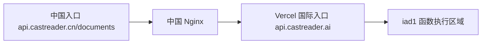

# 跨境与播放中断：实证核查

日期：2026-09-04。北京时间为UTC+8。范围：只读检查当前生产配置、日志、对应源码及最小诊断请求；没有修改业务代码、配置或部署。

## 1. 已证明：中国文档入口实际进入国际服务

2026-09-04 **10:45:29.221–10:45:29.839**，发送一个无身份、无正文的诊断请求：

```text
GET https://api.castreader.cn/documents?castreader_audit=cn-legacy-documents-20260904-proof-a1
```

请求返回HTTP200。以下三份证据指向同一次请求：

| 位置 | 实际记录 |
|---|---|
| 中国Nginx access.log | `04/Sep/2026:10:45:29 +0800`，相同唯一query，GET /documents，200 |
| 中国入口响应 | `X-Vercel-Id: sin1::iad1::9m8x9-1788489929563-8f1048664c96`，`X-Matched-Path: /documents`，MISS |
| 国际Vercel生产日志 | 相同ID `9m8x9-1788489929563-8f1048664c96`，UTC02:45:29.563，域名`api.castreader.ai`，GET /documents，200，生产部署`dpl_3zYvnPzXRo2hX2tp5AhmQV17z5Wy` |

因此这条链路已由实际请求证明：



Vercel官方将`iad1`标为美国Washington, D.C.、`sin1`标为Singapore；这里有响应区域标识和国际生产日志双重依据，不是根据`.ai`后缀推测地理位置。[Vercel区域说明](https://vercel.com/docs/regions)

本轮另从Vercel部署API重新读取当前部署，确认Git SHA为`2be1e9e9e9a9be69d772a556295a85e6e4117983`，`/documents`和`/api/captioned_speech_partly`实际Lambda均部署到`iad1`，timeout300秒。[当前部署快照](castreader-current-global-deployment-dpl3z-proof-20260904.json)

**具体原因**：生产Nginx的`location /documents`直接配置`proxy_pass https://api.castreader.ai`，并把Host和TLS名称设置为国际域名。对应本机配置的SHA256与线上一致：`d28afe87e0a422d7bf194eade617a5202b17fa2c4379a04f67930a07fa6a0261`。详见[路由源码快照](nginx-route-source.json)，原文件[145行](/Users/xuxuheng/Documents/MyProject/.worktrees/readout-web-tts-playback-priority/scripts/nginx-api-castreader-cn.conf:145)。

同一配置还有`/sts`、`/async-md-upload-by-url`、`/upload`代理国际域名，但本轮没有对它们执行凭据签发或上传，因此只能说这些路由生效，不能声称四条都已经有本轮真实上传执行证据。

过去24小时已读取的Nginx日志中，`/documents`只有本轮探针；另有两条`GET /upload →307`，没有发现`/sts`和`/async-md-upload-by-url`。这些计数不能用于推断用户跨境规模。探针没有携带真实用户ID，也没有读取用户文档。

原始脱敏证据：[中国请求与响应](castreader-cn-documents-routing-proof-20260904.json)、[中国Nginx记录](castreader-cn-legacy-nginx-proof-20260904.json)、[国际相同请求ID记录](castreader-cn-to-global-documents-vercel-proof-20260904.json)。

## 2. 已证明：当前国际普通TTS仍向调用方返回500

固定查询北京时间**08:00–10:45**的生产5xx日志，取得26条`POST /api/captioned_speech_partly` HTTP500记录，均属于当前部署`dpl_3zYvnPzXRo2hX2tp5AhmQV17z5Wy`。这些请求发生于本轮诊断探针之前；不是拿上一轮已修故障充当当前问题。

| 北京时间 | 音色 | 输入字符数 | 实际结果 | Vercel request ID |
|---|---|---:|---|---|
| 10:39:15.815 | am_liam | 425 | 上游500，网关500 | `kfbpm-1788489555815-f0eb3eb712cb` |
| 10:37:18.565 | am_liam | 261 | 上游500，网关500 | `svh4q-1788489438565-3471009d0fea` |
| 10:27:26.576 | af_sarah | 55 | 上游500，网关500 | `5jpr5-1788488846576-2f8ad8d08549` |
| 09:35:16.122 | bm_lewis | 115 | 上游500，网关500 | `ld5hd-1788485716122-adec0f3f5c0a` |
| 09:09:22.646 | zm_013 | 70 | 上游500，网关500，另一错误指纹 | `r2vgp-1788484162646-3b353559f957` |
| 08:27:10.390 | bf_emma | 471 | 上游500，网关500 | `55xfk-1788481630390-cb1a7d95d08e` |

25条错误的`messageHash=eeebd1874eb4d4a3`，等于错误文本`Failed to generate complete audio`的SHA256前16位，对应生产同版`tts_service.py:559`。另一条中文请求指纹`51d3d9f64a62a84f`，不能混为同一原因。没有总请求量，因此不计算失败率；没有对应客户端会话ID，因此不能把26个请求直接换算成26位用户或26次实际停播。

错误向播放链路传播的机制也已定位：

1. 普通TTS网关等待一次上游请求；上游非2xx时直接返回其状态和错误正文，没有同节点重试。位置：[tts-gateway.ts:331](/Users/xuxuheng/Documents/MyProject/.worktrees/readout-web-tts-playback-priority-global/src/shared/lib/tts-gateway.ts:331)。
2. 时间戳降级在上游成功返回之后才运行，因此救不了已经返回500的请求。位置：[tts-gateway.ts:390](/Users/xuxuheng/Documents/MyProject/.worktrees/readout-web-tts-playback-priority-global/src/shared/lib/tts-gateway.ts:390)。
3. 当前iOS源码对普通TTS非2xx直接throw，TTSService将异常向上传递；ReadAloudViewModel将`moreSegmentsExpected=false`、状态设为`.error`并结束失败会话。已经处于等待下一段的播放器收到此标志后只结束等待，不会自动推进。位置：[APIService.swift:223](/Users/xuxuheng/Documents/CastReader/CastReader/Services/APIService.swift:223)、[TTSService.swift:274](/Users/xuxuheng/Documents/CastReader/CastReader/Services/TTSService.swift:274)、[ReadAloudViewModel.swift:2922](/Users/xuxuheng/Documents/CastReader/CastReader/ViewModels/ReadAloudViewModel.swift:2922)、[AudioPlayerService.swift:453](/Users/xuxuheng/Documents/CastReader/CastReader/Services/AudioPlayerService.swift:453)。这是源码传播证明，不冒充这批线上请求已与某个安装包的播放日志关联；若队列仍有音频，其后行为也不能一概说成立刻停播。

原始脱敏记录：[26条生产500](castreader-global-tts-production-errors-20260904.json)、[错误传播源码及hash快照](error-propagation-source.json)。

### 2.1 已重放证明：时间戳错误仍会拒绝有效音频

这是一项明确的**本地隔离故障注入**，不是声称自然线上请求已经触发相同原因。它用于检验：仅改变高亮时间戳，是否足以让当前校验拒绝同一份可播放音频。

北京时间**10:51:46.626**，美国当前生产`/dev/captioned_speech`使用`af_heart`、诊断文本`This is a playback continuity diagnostic.`、`return_timestamps=true`、WAV格式、非流式请求，得到HTTP200，耗时1.678秒。音频经解码验证为24kHz单声道PCM16，实际68013帧、**2.833875秒**，RMS0.04808，有6个词时间戳。

随后在本机独立进程执行生产同版`tts_service.py`中**未经改写的原校验函数AST**，使用真实NumPy；用字段容器装载上述真实PCM和时间戳。两区生产源码与本机文件SHA256一致：`7e42a26e742f17c0cf63a4ad546cb58d631fe3b89f4a23ee94a575dac1aee680`。

| 输入变化 | 音频字节 | 原函数结果 |
|---|---|---|
| 原始6词时间戳 | 原样 | 通过 |
| 仅将首词end改为与start相同 | 完全不变 | `RuntimeError: Source timestamp interval is invalid or reordered` |
| 仅将末词end改为音频结尾后10ms | 完全不变 | `RuntimeError: Audio processing removed a source word interval` |

三种情形的PCM SHA256均为`273f6b555a91809735a1442ad8ff2a5042a02bfecf17eb8791061cd4495eb426`。本轮根代理独立重放了保存脚本，得到相同结果。

**准确定位**：[tts_service.py:43](/Users/xuxuheng/Documents/MyProject/castreader-tts-compatible-fix/api/src/services/tts_service.py:43)定义校验，80/82行抛错；227行在已收集模型音频、尚未交付之前调用。正常生产处理还在262/513/537行再次调用。超出音频结尾的检查在默认`allow_edge_clipping=false`下拒绝；部分中间裁剪阶段明确允许边缘超出，不能误写为每一阶段都拒绝10ms越界。零长度/倒序检查不受该开关影响。

异常会被生成循环包装为`Failed to generate complete audio`（559行），并由[development.py:409](/Users/xuxuheng/Documents/MyProject/castreader-tts-compatible-fix/api/src/routers/development.py:409)转为HTTP500。网关的空时间戳降级要等上游成功后才能生效，因而无法挽救在worker内部就被抛弃的音频。

这已经证明“辅助时间戳仍能成为音频交付的硬门槛”。它没有证明音频中的每个词都完整正确，也没有证明上面26条生产500全部触发了这个门槛；两件事必须分开。

可复核材料：[实验结果](local-timing-gate-proof.json)、[可重放脚本](replay-local-timing-gate.py)、[正常生产响应，仅含诊断正文与音频](production-normal-response.json)、[诊断音频](production-normal.wav)。脚本仅在本地读取证据及原源码，没有网络调用、模型调用或生产进程变更。

### 2.2 尚未证明的部分：26条500的逐条内部原因

美国worker输出进入Supervisor管道，本轮未恢复常规落盘TTS日志；Vast返回的日志下载链接未取得内容，本机读取返回HTTP403。中国watchdog最近16MB样本未匹配目标异常，但时间覆盖尚未确认。因此没有内部堆栈，不能仅凭外层相同hash就断言25条都是时间戳错误。

同生产版本前端另检查了20条自造缩写、数字、URL、脚注等文本，全部通过；未找到可用普通输入直接重现的自然时间戳失败。这也不能证明不存在。详见[日志访问边界](log-access-boundary.json)、[20条前端检查](us-synthetic-frontend-cases.json)。

当前可以严格成立的结论是：**实际跨境请求已证明；当前生产音频请求500已证明；当前时间戳门槛可拒绝有效PCM已通过隔离实验复现。具体线上500与这个门槛的逐条关联尚未证明。**

## 3. 已验证的入口阻断，以及证据边界

中国入口`/api/markdown-tts/generate`和`/api/tts/generate`安全HEAD请求均得到Nginx404。配置本身是整条路径`return 404`，因此不只HEAD方法被挡；当前Web文件阅读器/文本工具的普通音色代码使用这些相对路径。它证明相关CN同源Web路径不可用，尚不能证明用户刚才的iPhone Kindle走过它们。[实请求记录](castreader-cn-route-head-proof-20260904.json)

更正上一版审计：中国旧QuickRead根路径不是“直接404”。安全GET/HEAD实测无key根路径301→尾斜杠，尾斜杠308→根；尾斜杠带dummy非凭据`x-api-key`返回worker404。旧精确根handler无法经此正常抵达，不能据其遗留代码声称当前逐块解读已经跨境。[实请求记录](castreader-cn-quickread-root-proof-20260904.json)

目前未取得国际旧QuickRead COS真实上传、具体桶地区、全球存储跨境或中国外部Upstash具体地域的执行证据；它们继续保留为待验证项。当前模型500也不能自动归因于跨境。上述两类问题分别有独立证据，不能把它们强行串成同一次故障。
