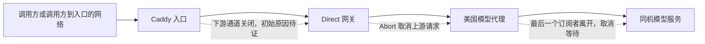

# 国际区 TTS 74 次响应前断开的归因记录

本次已查清服务端中断的直接触发链：**Direct 网关先观察到下游请求通道关闭，然后取消发往模型代理的请求。没有发现这 74 次是模型先报错或服务端到达超时期限所导致。** 但“是谁、因为什么最先关闭调用通道”仍缺少历史证据，事件保持未关闭。

范围固定为北京时间 **2026-09-07 02:37:52.522573 至 2026-09-08 02:37:52.522573**，即原 24 小时观察窗。最后增量是北京时间 9 月 8 日 01:26:52.003 至 02:37:52.522573，新增 14 次。没有延长原窗口，也没有启动新的监控任务。本次仅读取现有生产配置、日志和代码，执行本地验证；没有修改或部署生产服务，也没有生成生产音频。

**1. 这 74 次究竟是什么**

74 次全部为 `/api/captioned_speech_partly` 请求，Direct 记录一致：

| 字段 | 74 次记录中的值 | 含义 |
| --- | --- | --- |
| `status` | `null` | Direct 尚未发送 HTTP 响应头，不能虚构为 200、502 或 504 |
| `abortSource` | `downstream_closed` | Direct 的响应关闭 / 请求中止事件触发了取消 |
| `abortStage` | `upstream_headers` | 还在等待模型代理的响应头 |
| `downstreamDisconnected` | `true` | Direct 观察到下游通道关闭 |
| `elapsedMs` | 27–3,609 ms | 全部早于已配置的请求总期限 |

这里的“断开”是请求层面的观测，不能等同于 74 条独立 TCP 连接断开，更不能等同于 74 位用户或 74 次实际停播。HTTP/2 请求流取消、入口代理终止转发、网络断开，都可能在 Direct 这一跳表现为相同事件。

Direct 直接连接的是本机 Caddy，因而它能证明的边界是“Caddy → Direct 这一跳关闭”，不能单凭 `downstream_closed` 断言用户主动取消。

**2. 按请求关联后的因果链**

从美国模型主机现有日志中重新过滤出 **529 条脱敏事件**，覆盖全部 74 个匿名请求键。扫描覆盖原窗口，日志文件读取前后 inode 一致，没有截断，解析异常为 0；生产代理源码 SHA 与固定版本一致。

| 关联结果 | 数量 | 证据解释 |
| --- | ---: | --- |
| 只有一次 `cancelled` 的请求键 | 72 | 已建立模型服务连接，等待响应期间取消，收到音频字节为 0 |
| 同一请求键先取消、后来成功 | 1 | 键 `77601dd021ec365fe333` 对应两次代理请求：一次取消、一次完成；不能把成功覆盖到前一次断开上 |
| 模型代理已完成，Direct 响应前断开 | 1 | 键 `5227410452a5955e31d8`，代理记录完成，Direct 随后记录响应前关闭；客户端是否收到音频未知 |
| 匹配到的代理请求总数 | 75 | 因上述重复键，多于 74 个请求键；结果是 73 次取消、2 次完成 |
| 匹配请求中的上游 / 代理失败事件 | 0 | 无 `upstream_failed` 或 `request_failed` |

73 次取消对应的代理请求都已连接上模型服务，连接建立耗时 **0.171–0.608 ms**。这些数据排除了“这一步一直连不上 GPU 服务”的解释，但不能证明 GPU 当时已经开始计算，也不能排除排队或响应等待影响体验。

这 73 笔代理取消完成日志时间比对应 Direct 断开日志晚约 1.47–10.54 ms，中位数约 3.99 ms。两个主机的时钟精度没有独立校验，因此这一时间关系只作旁证；取消方向还由实际源码和本地 HTTP 实验支持。

直接取消模型调用的代码在 Direct 的 `abortIfDownstreamClosed`，监听 `response.close` 和 `request.aborted`；响应已正常结束时不触发取消。代理在最后一个订阅者离开后取消尚未完成的上游任务。**这些取消发生后，原 HTTP 通道已经不可用于交付音频；简单禁止后端取消，不能让已经关闭的通道恢复播放。**

**3. 为什么值得优先追 Android 1.0.46**

以下分母为固定窗口中已记录的 Direct 请求，不是整个国际区所有入口的请求量，也不是用户数。

| 调用方标记 | 已记录请求 | 响应前断开 | 比例 |
| --- | ---: | ---: | ---: |
| Android 1.0.46 | 4,018 | 70 | 1.742% |
| Android 1.0.45 | 7,945 | 1 | 0.0126% |
| Android 1.0.47 | 104 | 1 | 0.962% |
| 扩展 1.2.37 | 8,980 | 2 | 0.0223% |

1.0.46 占这批断开记录的 **94.6%**，最后 14 次全部标记为该版本。差异不是仅由 1.0.46 请求量更大解释的，但还不能认定是版本回归：请求内容、网络、来源、实际用户量与测试流量构成都未被这些日志记录；平台和版本来自调用方请求头，也不是已核验的安装包身份。

核对了干净的 1.0.46 / build 53 源码工作树，提交 `3fe41d62b9f0c1d699ba20e84aecb63fd970b33b`。存在一条**会取消仍然有用的预取请求的具体路径**：

1. 普通阅读当前段播完，进入自然推进下一段的分支。
2. 非 Kindle、非 YouTube 的分支调用 `loadParagraph(nextIndex)`。
3. `loadParagraph` 先增加播放代次，调用 `cancelPrefetchJobs()`，取消全部预取协程，然后才检查下一段缓存。
4. 如果下一段尚未完整生成，已发出的预取 HTTP 请求被协程取消；接下来从可复用的音频前缀继续生成，或重新请求该段。
5. 原本已经等待了一部分时间的有效生成请求因此被废弃，可能增加重复供给和段间等待；它不需要用户手动点击停止也会发生。

这条取消可以传播到真实网络：该版本使用 Retrofit 2.11.0 的 `suspend` API，库在协程取消时调用 HTTP `Call.cancel()`。[对应版本源码](https://raw.githubusercontent.com/square/retrofit/2.11.0/retrofit/src/main/java/retrofit2/KotlinExtensions.kt)。TTS 拦截器在调用已取消时也不会再发备用请求。

**不能将上述机制直接当作 74 次的最终原因。** Kindle 与 YouTube 已有专门的预取交接分支，会等待并复用正在进行的下一段生产任务。普通切段的取消逻辑在 1.0.45 源码中也已存在：`cancelPrefetchJobs()` 加到普通加载路径的历史提交为 `dfe6069d`，并非本次 1.0.46 新增。修改音色、替换内容等路径也会取消请求；历史日志没有请求用途和取消原因，无法逐笔区分。此次进行了源码核对，没有运行 Android 播放器的端到端复现，也未修改 Android。

**4. 检查过的后端解释与证据边界**

| 待查解释 | 这次证据支持什么 |
| --- | --- |
| 模型先报错导致这 74 次断开 | 没有对应失败事件；73 笔是在等响应时被取消，另有一笔模型代理已完成。不能据此保证所有模型请求都正常 |
| 后端请求总超时 | 74 笔取消源都不是本地期限触发。普通请求 120 s，扩展策略总期限 28 s / 单次 20 s，均大于本批 3.609 s 最大耗时 |
| 时间戳校验拒绝音频 | 取消发生在等响应头阶段，尚未进入 Direct 音频与时间戳处理，不能由该阶段的校验触发 |
| Caddy 配置了很短的等待期限 | 实际配置为上游拨号 5 s、读写 125 s，没有发现 1–3 s 的请求期限；Node 请求期限 125 s。5 s keep-alive 是空闲连接设置，不应当被解释为合成任务预算 |
| Caddy / Direct 重启打断请求 | 当前 Caddy 实例自 8 月 15 日运行，Direct 固定版本自 9 月 7 日 03:21:28 UTC 运行，当前实例 `NRestarts=0`。74 笔横跨更早和当前 Direct 版本，不能用当前计数替代完整历史重启证明 |
| Caddy / 网络最先中断 | 仍不能排除。Caddy 没有配置访问日志；固定窗口现有 journal 中没有目标请求记录，无法回溯 HTTP 流取消和入口网络错误 |
| 这批是跨境模型回退 | 已关联的服务端链为美国 Direct → 美国固定模型代理 → 同机模型服务。未发现这些请求走中国备用；这不证明调用方所在国家或所有其他产品链路 |

另一个真实的观测缺口：Direct 的并发上限 `503` 分支在详细请求日志初始化之前返回。因而原汇总中的“已记录 0 条 5xx”不能推广成“入口所有请求都没有 5xx”。这不改变已关联 74 笔的取消方向，但应纳入后续后端诊断修补。

**5. 本地验证**

针对生产 Direct 同一份源码运行现有取消与期限测试，**6/6 通过**：真实 HTTP 下游关闭会中止上游连接，记录 `null + downstream_closed`，不伪造 504；真正到达本地期限记录 504；只有上游 AbortError 而没有下游关闭时记录 502。分别覆盖等响应头、读响应体，以及上传未完整结束的情况。

本地 Node 为 `v24.11.1`，生产固定记录为 `v22.23.2`。这是相同源码的本地行为验证，不宣称与生产运行时完全等价，也不等于重放了真实用户操作。

**6. 下一步应针对什么处理**

优先修复的候选是“自然连续播放时废弃仍然有效的音频生产任务”。后续验证应固定短段内容、让下一段生成跨过当前段播放终点，比较普通阅读与 Kindle 的行为：自然切段不取消所需生产任务，下一段只生成一次，音频持续交接；用户明确换内容或换音色时，旧任务才按其生命周期退出。它是可独立复现和修复的具体机制，不能在验收前冒充这 74 次的已证根因。

后端应补入口与网关的最小脱敏请求生命周期记录，并覆盖并发上限等提前返回：关联键、请求阶段、是否已发响应、断开事件类别、耗时和计数，不记录正文、音频、账号、认证头或原始 IP。观测失败不得改变音频行为。入口日志能继续区分通道和传输问题，但**仅靠后端无法知道客户端为何取消协程**；逐笔闭环还需要调用方传递稳定请求关联键及固定枚举的用途 / 取消原因，并以播放是否继续为验收依据。

因此，本次结论是：**服务端直接触发原因已定位；Android 普通自然切段存在具体取消风险；74 次各自的最初触发原因与实际停播影响尚未证实。** 这些记录继续保留为待归因事件，不应直接视作正常取消，也不应计为 74 次模型崩溃。

完整可复核数据见本目录 `root-cause-review.json`（74 笔逐项关联、版本分母、源码 SHA、验证记录和原档案 SHA）、`proxy-targeted-readback.json`（529 条阶段事件）及 `ingress-readback.json`（实际 Caddy / Direct 配置与日志覆盖）。所有数据均为脱敏状态、阶段、计数及匿名请求关联键。
